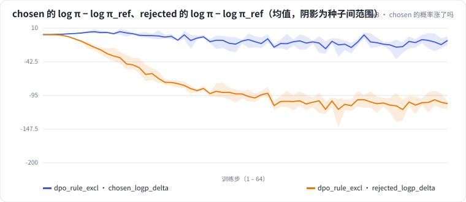

<!-- 本页由 python -m labkit docs 从 ../lesson.yaml 和 results/ 生成，不要手改 -->

[← 在线采样 + 排除型 prompt](08-onpolicy-excl.md) · [课程首页](../README.md) · [β 从 0.1 降到 0.01 →](10-beta.md)

# 第 9 步 / 共 17 步：chosen 的概率涨了吗

> 阶段 4 / 7：**DPO：参考模型与 β** · 场景：`dpo_rule_excl`

DPO 的目标是"chosen 相对参考模型涨得比 rejected 多"。训练中每步记录了 chosen 和 rejected 的 log π − log π_ref（序列对数概率，回答所有 token 求和）。

## 这一步跑了什么

| 场景 | 作用 | 说明 | 相对基线改了什么 | 种子（H20） |
| - | - | - | - | - |
| `dpo_rule_excl` | 本步 | DPO，规则偏好对，prompt 里一半是排除型条件（SFT 没见过的句式） | `pref_method=dpo`, `pref_pairs=rule`, `pref_exclusion_ratio=0.5` | 3 |

## 先预测

**训练结束时，chosen 的 log π − log π_ref 大约是？**

- **A.** 明显上升（> +1）
- **B.** 基本不变（−1 到 +1）
- **C.** 下降（< −1）

> 先选定一个（记下来），再展开下面的实测。dev 差异小于 6.7 个点（两条样本）、排除型合成集差异小于 5 个点（三条样本）或小于种子间波动，都按“差不多”算。

## 实测

展开实测：H20 · Qwen2.5-7B · SFT + 偏好阶段 · 每个场景 3 种子（已有 3 / 3 个运行）

| 场景 | 类型 | chosen 的 Δlogπ（末步） | rejected 的 Δlogπ（末步） | 偏好准确率（末步） | 排除型 条件保留率 | chosen 的 Δlogπ（末步）：各种子 | 断言 |
| - | - | - | - | - | - | - | - |
| `dpo_rule_excl` | 候选改动 | -9.06 ± +6.94 | -107.72 ± +7.50 | 1.00 ± 0.00 | 32.8% ± 56.8 | s0 -8.16 / s1 -2.62 / s2 -16.41 |  |

运行目录（每个目录里有 `summary.json` 指标、`evidence.json` 证据摘要、`predictions.jsonl` 逐条预测、`log.txt` 日志）：

- `dpo_rule_excl` [s0](../../../results/h20x8/L07/dpo_rule_excl/s0-e37ea1/) · [s1](../../../results/h20x8/L07/dpo_rule_excl/s1-ba5bcc/) · [s2](../../../results/h20x8/L07/dpo_rule_excl/s2-019344/)

## 看完实测再想一步

两条曲线谁动得多？偏好准确率到 1 之后，两条曲线还在往哪走？

---

[← 在线采样 + 排除型 prompt](08-onpolicy-excl.md) · [课程首页](../README.md) · [β 从 0.1 降到 0.01 →](10-beta.md)
