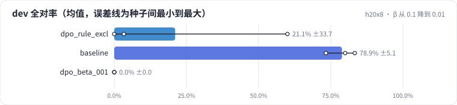
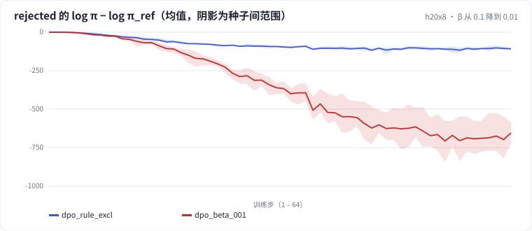

<!-- 本页由 python -m labkit docs 从 ../lesson.yaml 和 results/ 生成，不要手改 -->

[← chosen 的概率涨了吗](09-logp.md) · [课程首页](../README.md) · [GRPO，同分布 prompt →](11-grpo.md)

# 第 10 步 / 共 17 步：β 从 0.1 降到 0.01

> 阶段 4 / 7：**DPO：参考模型与 β** · 场景：`dpo_beta_001`（对照 `dpo_rule_excl`）

同样的偏好对（规则对、一半排除型 prompt），只把 β 从 0.1 降到 0.01。β 越小，loss 对"偏离参考模型多远"越不敏感，模型可以走得更远。

## 这一步跑了什么

| 场景 | 作用 | 说明 | 相对基线改了什么 | 种子（H20） |
| - | - | - | - | - |
| `dpo_rule_excl` | 对照 | DPO，规则偏好对，prompt 里一半是排除型条件（SFT 没见过的句式） | `pref_method=dpo`, `pref_pairs=rule`, `pref_exclusion_ratio=0.5` | 3 |
| `baseline` | 参照 | 只做 SFT（与 L05 基线同配置），偏好阶段的起点和对照 | `pref_method=none` | 3 |
| `dpo_beta_001` | 本步 | 同 dpo_rule_excl，β 从 0.1 降到 0.01（几乎不约束偏离参考模型） | `pref_method=dpo`, `pref_pairs=rule`, `pref_exclusion_ratio=0.5`, `dpo_beta=0.01` | 3 |

## 先预测

**和 β = 0.1 比，dev 全对率（3 种子均值）会怎样？**

- **A.** 差不多（±6.7 个点以内）
- **B.** 明显更好（> +6.7 个点）
- **C.** 明显更差（< −6.7 个点）

> 先选定一个（记下来），再展开下面的实测。dev 差异小于 6.7 个点（两条样本）、排除型合成集差异小于 5 个点（三条样本）或小于种子间波动，都按“差不多”算。

## 实测

展开实测：H20 · Qwen2.5-7B · SFT + 偏好阶段 · 每个场景 3 种子（已有 9 / 9 个运行）

| 场景 | 类型 | dev 全对率 | 排除型 条件保留率 | 合成验证全对率 | rejected 的 Δlogπ（末步） | chosen 的 Δlogπ（末步） | dev 全对率：与 `dpo_rule_excl` 差 | dev 全对率：各种子 | 断言 |
| - | - | - | - | - | - | - | - | - | - |
| `dpo_rule_excl` | 候选改动 | 21.1% ± 33.7 | 32.8% ± 56.8 | 17.2% ± 21.8 | -107.7 ± +7.5 | -9.1 ± +6.9 | — | s0 60.0% / s1 3.3% / s2 0.0% |  |
| `baseline` | 基线 | 78.9% ± 5.1 | 60.6% ± 26.2 | 100.0% ± 0.0 | — | — | +57.8 个点 | s0 83.3% / s1 73.3% / s2 80.0% | 通过 |
| `dpo_beta_001` | 候选改动 | 0.0% ± 0.0 | 0.0% ± 0.0 | 0.0% ± 0.0 | -654.4 ± +66.3 | -154.8 ± +46.9 | -21.1 个点 | s0 0.0% / s1 0.0% / s2 0.0% |  |

运行目录（每个目录里有 `summary.json` 指标、`evidence.json` 证据摘要、`predictions.jsonl` 逐条预测、`log.txt` 日志）：

- `dpo_rule_excl` [s0](../../../results/h20x8/L07/dpo_rule_excl/s0-e37ea1/) · [s1](../../../results/h20x8/L07/dpo_rule_excl/s1-ba5bcc/) · [s2](../../../results/h20x8/L07/dpo_rule_excl/s2-019344/)
- `baseline` [s0](../../../results/h20x8/L07/baseline/s0-606cc1/) · [s1](../../../results/h20x8/L07/baseline/s1-4e1f34/) · [s2](../../../results/h20x8/L07/baseline/s2-c2b0c4/)
- `dpo_beta_001` [s0](../../../results/h20x8/L07/dpo_beta_001/s0-e24144/) · [s1](../../../results/h20x8/L07/dpo_beta_001/s1-d2404f/) · [s2](../../../results/h20x8/L07/dpo_beta_001/s2-833e43/)

## 看完实测再想一步

β 小 10 倍，rejected 被压低了多少倍？目标集合和 dev 是各往哪边走的？

---

[← chosen 的概率涨了吗](09-logp.md) · [课程首页](../README.md) · [GRPO，同分布 prompt →](11-grpo.md)
