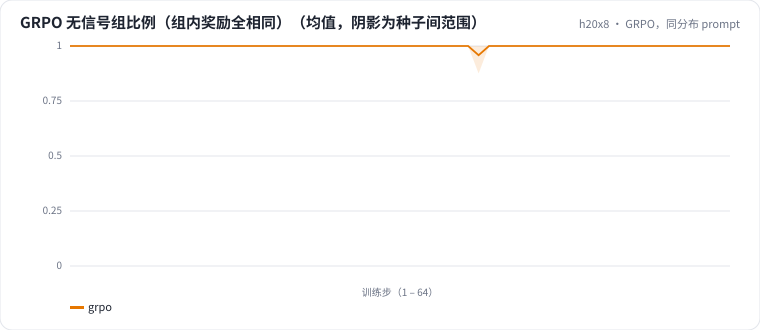

<!-- 本页由 python -m labkit docs 从 ../lesson.yaml 和 results/ 生成，不要手改 -->

[← β 从 0.1 降到 0.01](10-beta.md) · [课程首页](../README.md) · [GRPO，一半排除型 prompt →](12-grpo-excl.md)

# 第 11 步 / 共 17 步：GRPO，同分布 prompt

> 阶段 5 / 7：**GRPO：可验证奖励** · 场景：`grpo`（对照 `baseline`）

GRPO：每步 8 个 prompt，每个采样 G = 4 条，用字段奖励打分；优势 = (奖励 − 组均值) / 组标准差。prompt 是 512 个同分布合成样本（64 步）。

## 这一步跑了什么

| 场景 | 作用 | 说明 | 相对基线改了什么 | 种子（H20） |
| - | - | - | - | - |
| `baseline` | 对照 | 只做 SFT（与 L05 基线同配置），偏好阶段的起点和对照 | `pref_method=none` | 3 |
| `grpo` | 本步 | GRPO，字段奖励，prompt 同分布（每个 prompt 采样 4 条，组内归一化优势） | `pref_method=grpo`, `reward=field` | 3 |

## 先预测

**每组 4 条回答奖励完全相同（优势全为 0，没有学习信号）的组，平均占多少？**

- **A.** 不到 30%
- **B.** 30% - 70%
- **C.** 70% 以上

> 先选定一个（记下来），再展开下面的实测。dev 差异小于 6.7 个点（两条样本）、排除型合成集差异小于 5 个点（三条样本）或小于种子间波动，都按“差不多”算。

## 实测

展开实测：H20 · Qwen2.5-7B · SFT + 偏好阶段 · 每个场景 3 种子（已有 6 / 6 个运行）

| 场景 | 类型 | 无信号组比例 | 采样奖励（末步） | dev 全对率 | 排除型 条件保留率 | dev 全对率：与 `baseline` 差 | dev 全对率：各种子 | 断言 |
| - | - | - | - | - | - | - | - | - |
| `baseline` | 基线 | — | — | 78.9% ± 5.1 | 60.6% ± 26.2 | — | s0 83.3% / s1 73.3% / s2 80.0% | 通过 |
| `grpo` | 候选改动 | 99.9% ± 0.1 | 1.000 ± 0.000 | 77.8% ± 6.9 | 71.1% ± 27.5 | -1.1 个点 | s0 83.3% / s1 80.0% / s2 70.0% |  |

运行目录（每个目录里有 `summary.json` 指标、`evidence.json` 证据摘要、`predictions.jsonl` 逐条预测、`log.txt` 日志）：

- `baseline` [s0](../../../results/h20x8/L07/baseline/s0-606cc1/) · [s1](../../../results/h20x8/L07/baseline/s1-4e1f34/) · [s2](../../../results/h20x8/L07/baseline/s2-c2b0c4/)
- `grpo` [s0](../../../results/h20x8/L07/grpo/s0-946274/) · [s1](../../../results/h20x8/L07/grpo/s1-5e6351/) · [s2](../../../results/h20x8/L07/grpo/s2-26721e/)

## 看完实测再想一步

无信号组比例随训练怎么变？奖励曲线还有多少上升空间？

---

[← β 从 0.1 降到 0.01](10-beta.md) · [课程首页](../README.md) · [GRPO，一半排除型 prompt →](12-grpo-excl.md)
