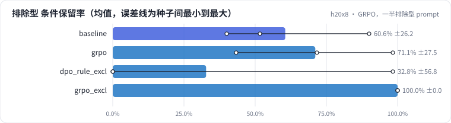
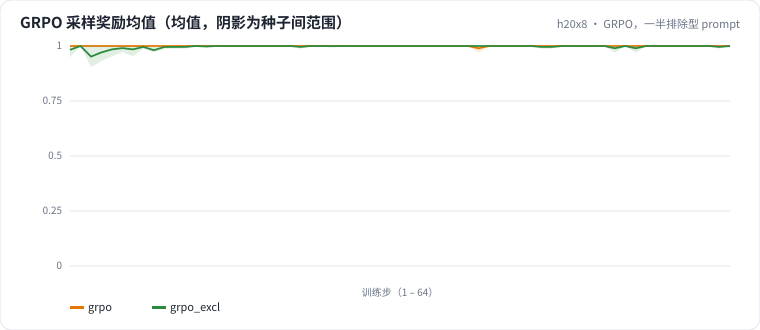

<!-- 本页由 python -m labkit docs 从 ../lesson.yaml 和 results/ 生成，不要手改 -->

[← GRPO，同分布 prompt](11-grpo.md) · [课程首页](../README.md) · [奖励只看召回 →](13-reward.md)

# 第 12 步 / 共 17 步：GRPO，一半排除型 prompt

> 阶段 5 / 7：**GRPO：可验证奖励** · 场景：`grpo_excl`（对照 `baseline`）

同样的 GRPO，prompt 里一半换成排除型条件。字段奖励里条件保留占 0.3：SFT 模型丢掉排除条件时，这条回答的奖励比保留条件的低。

## 这一步跑了什么

| 场景 | 作用 | 说明 | 相对基线改了什么 | 种子（H20） |
| - | - | - | - | - |
| `baseline` | 对照 | 只做 SFT（与 L05 基线同配置），偏好阶段的起点和对照 | `pref_method=none` | 3 |
| `grpo` | 参照 | GRPO，字段奖励，prompt 同分布（每个 prompt 采样 4 条，组内归一化优势） | `pref_method=grpo`, `reward=field` | 3 |
| `dpo_rule_excl` | 参照 | DPO，规则偏好对，prompt 里一半是排除型条件（SFT 没见过的句式） | `pref_method=dpo`, `pref_pairs=rule`, `pref_exclusion_ratio=0.5` | 3 |
| `grpo_excl` | 本步 | GRPO，字段奖励，prompt 里一半是排除型条件 | `pref_method=grpo`, `reward=field`, `pref_exclusion_ratio=0.5` | 3 |

## 先预测

**排除型合成集的条件保留率，和只做 SFT 比会怎样？**

- **A.** 基本不变（±5 个点以内）
- **B.** 提升 5 - 20 个点
- **C.** 提升 20 个点以上
- **D.** 下降超过 5 个点

> 先选定一个（记下来），再展开下面的实测。dev 差异小于 6.7 个点（两条样本）、排除型合成集差异小于 5 个点（三条样本）或小于种子间波动，都按“差不多”算。

## 实测

展开实测：H20 · Qwen2.5-7B · SFT + 偏好阶段 · 每个场景 3 种子（已有 12 / 12 个运行）

| 场景 | 类型 | 排除型 条件保留率 | 无信号组比例 | dev 全对率 | 合成验证全对率 | 排除型 条件保留率：与 `baseline` 差 | 排除型 条件保留率：各种子 | 断言 |
| - | - | - | - | - | - | - | - | - |
| `baseline` | 基线 | 60.6% ± 26.2 | — | 78.9% ± 5.1 | 100.0% ± 0.0 | — | s0 90.0% / s1 51.7% / s2 40.0% | 通过 |
| `grpo` | 候选改动 | 71.1% ± 27.5 | 99.9% ± 0.1 | 77.8% ± 6.9 | 100.0% ± 0.0 | +10.6 个点 | s0 98.3% / s1 71.7% / s2 43.3% |  |
| `dpo_rule_excl` | 候选改动 | 32.8% ± 56.8 | — | 21.1% ± 33.7 | 17.2% ± 21.8 | -27.8 个点 | s0 98.3% / s1 0.0% / s2 0.0% |  |
| `grpo_excl` | 候选改动 | 100.0% ± 0.0 | 98.3% ± 0.8 | 81.1% ± 5.1 | 99.4% ± 1.0 | +39.4 个点 | s0 100.0% / s1 100.0% / s2 100.0% |  |

运行目录（每个目录里有 `summary.json` 指标、`evidence.json` 证据摘要、`predictions.jsonl` 逐条预测、`log.txt` 日志）：

- `baseline` [s0](../../../results/h20x8/L07/baseline/s0-606cc1/) · [s1](../../../results/h20x8/L07/baseline/s1-4e1f34/) · [s2](../../../results/h20x8/L07/baseline/s2-c2b0c4/)
- `grpo` [s0](../../../results/h20x8/L07/grpo/s0-946274/) · [s1](../../../results/h20x8/L07/grpo/s1-5e6351/) · [s2](../../../results/h20x8/L07/grpo/s2-26721e/)
- `dpo_rule_excl` [s0](../../../results/h20x8/L07/dpo_rule_excl/s0-e37ea1/) · [s1](../../../results/h20x8/L07/dpo_rule_excl/s1-ba5bcc/) · [s2](../../../results/h20x8/L07/dpo_rule_excl/s2-019344/)
- `grpo_excl` [s0](../../../results/h20x8/L07/grpo_excl/s0-69954e/) · [s1](../../../results/h20x8/L07/grpo_excl/s1-726303/) · [s2](../../../results/h20x8/L07/grpo_excl/s2-215ff4/)

## 看完实测再想一步

无信号组比例和同分布 prompt 比少了多少？奖励曲线是在往上走吗？

---

[← GRPO，同分布 prompt](11-grpo.md) · [课程首页](../README.md) · [奖励只看召回 →](13-reward.md)
