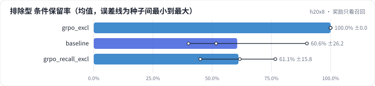

<!-- 本页由 python -m labkit docs 从 ../lesson.yaml 和 results/ 生成，不要手改 -->

[← GRPO，一半排除型 prompt](12-grpo-excl.md) · [课程首页](../README.md) · [时间花在哪 →](14-cost.md)

# 第 13 步 / 共 17 步：奖励只看召回

> 阶段 5 / 7：**GRPO：可验证奖励** · 场景：`grpo_recall_excl`（对照 `grpo_excl`）

同样的 GRPO 和 prompt，只把奖励换成"只看召回"：卖点和优惠找全了就给分，**不看条件**，也不罚多写、不罚无依据。

## 这一步跑了什么

| 场景 | 作用 | 说明 | 相对基线改了什么 | 种子（H20） |
| - | - | - | - | - |
| `grpo_excl` | 对照 | GRPO，字段奖励，prompt 里一半是排除型条件 | `pref_method=grpo`, `reward=field`, `pref_exclusion_ratio=0.5` | 3 |
| `baseline` | 参照 | 只做 SFT（与 L05 基线同配置），偏好阶段的起点和对照 | `pref_method=none` | 3 |
| `grpo_recall_excl` | 本步 | GRPO，奖励只看召回（不看条件、不罚多写），prompt 里一半是排除型条件 | `pref_method=grpo`, `reward=recall_only`, `pref_exclusion_ratio=0.5` | 3 |

## 先预测

**和字段奖励比，排除型合成集的条件保留率会怎样？**

- **A.** 差不多（±5 个点以内）
- **B.** 明显更低（< −5 个点）
- **C.** 明显更高（> +5 个点）

> 先选定一个（记下来），再展开下面的实测。dev 差异小于 6.7 个点（两条样本）、排除型合成集差异小于 5 个点（三条样本）或小于种子间波动，都按“差不多”算。

## 实测

展开实测：H20 · Qwen2.5-7B · SFT + 偏好阶段 · 每个场景 3 种子（已有 9 / 9 个运行）

| 场景 | 类型 | 排除型 条件保留率 | dev 无依据率 | 无信号组比例 | dev 全对率 | 排除型 条件保留率：与 `grpo_excl` 差 | 排除型 条件保留率：各种子 | 断言 |
| - | - | - | - | - | - | - | - | - |
| `grpo_excl` | 候选改动 | 100.0% ± 0.0 | 0.5% ± 0.4 | 98.3% ± 0.8 | 81.1% ± 5.1 | — | s0 100.0% / s1 100.0% / s2 100.0% |  |
| `baseline` | 基线 | 60.6% ± 26.2 | 1.0% ± 0.4 | — | 78.9% ± 5.1 | -39.4 个点 | s0 90.0% / s1 51.7% / s2 40.0% | 通过 |
| `grpo_recall_excl` | 候选改动 | 61.1% ± 15.8 | 0.7% ± 0.7 | 99.3% ± 0.6 | 76.7% ± 0.0 | -38.9 个点 | s0 45.0% / s1 61.7% / s2 76.7% |  |

运行目录（每个目录里有 `summary.json` 指标、`evidence.json` 证据摘要、`predictions.jsonl` 逐条预测、`log.txt` 日志）：

- `grpo_excl` [s0](../../../results/h20x8/L07/grpo_excl/s0-69954e/) · [s1](../../../results/h20x8/L07/grpo_excl/s1-726303/) · [s2](../../../results/h20x8/L07/grpo_excl/s2-215ff4/)
- `baseline` [s0](../../../results/h20x8/L07/baseline/s0-606cc1/) · [s1](../../../results/h20x8/L07/baseline/s1-4e1f34/) · [s2](../../../results/h20x8/L07/baseline/s2-c2b0c4/)
- `grpo_recall_excl` [s0](../../../results/h20x8/L07/grpo_recall_excl/s0-c7f777/) · [s1](../../../results/h20x8/L07/grpo_recall_excl/s1-5ab1f1/) · [s2](../../../results/h20x8/L07/grpo_recall_excl/s2-b85ca1/)

## 看完实测再想一步

条件保留率停在哪？和 SFT 比呢？无依据率有没有往上漂？

---

[← GRPO，一半排除型 prompt](12-grpo-excl.md) · [课程首页](../README.md) · [时间花在哪 →](14-cost.md)
