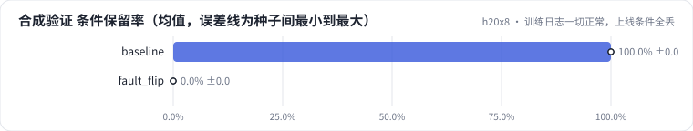
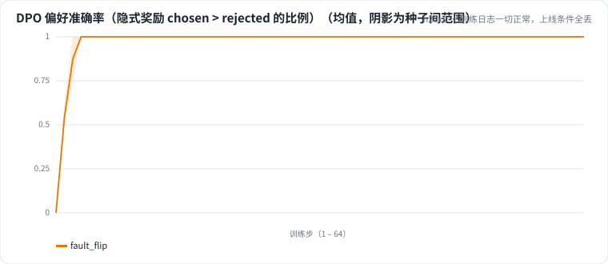

<!-- 本页由 python -m labkit docs 从 ../lesson.yaml 和 results/ 生成，不要手改 -->

[← 时间花在哪](14-cost.md) · [课程首页](../README.md) · [诊断：偏好对方向 →](16-diagnose.md)

# 第 15 步 / 共 17 步：训练日志一切正常，上线条件全丢

> 阶段 6 / 7：**诊断故障** · 场景：`fault_flip`（对照 `baseline`）

同事复现 dpo_rule（规则偏好对、同分布 prompt）。训练日志看起来很健康：DPO loss 稳定下降，偏好准确率很快到 1。评估时发现问题。

## 这一步跑了什么

| 场景 | 作用 | 说明 | 相对基线改了什么 | 种子（H20） |
| - | - | - | - | - |
| `baseline` | 对照 | 只做 SFT（与 L05 基线同配置），偏好阶段的起点和对照 | `pref_method=none` | 3 |
| `fault_flip` | 本步 | 规则偏好对的 chosen / rejected 对调（"删掉条件"成了被偏好的一方） | `pref_method=dpo`, `pref_pairs=rule`, `pref_flip=True` | 3 |

## 先预测

**合成验证集（SFT 是满分）的条件保留率会怎样？**

- **A.** 和 SFT 差不多（±10 个点以内）
- **B.** 掉 10 - 30 个点
- **C.** 掉 30 个点以上

> 先选定一个（记下来），再展开下面的实测。dev 差异小于 6.7 个点（两条样本）、排除型合成集差异小于 5 个点（三条样本）或小于种子间波动，都按“差不多”算。

## 实测

展开实测：H20 · Qwen2.5-7B · SFT + 偏好阶段 · 每个场景 3 种子（已有 6 / 6 个运行）

| 场景 | 类型 | 合成验证 条件保留率 | dev 条件保留率 | dev 全对率 | 偏好准确率（末步） | 合成验证 条件保留率：与 `baseline` 差 | 合成验证 条件保留率：各种子 | 断言 |
| - | - | - | - | - | - | - | - | - |
| `baseline` | 基线 | 100.0% ± 0.0 | 87.3% ± 7.3 | 78.9% ± 5.1 | — | — | s0 100.0% / s1 100.0% / s2 100.0% | 通过 |
| `fault_flip` | 教学故障 | 0.0% ± 0.0 | 0.0% ± 0.0 | 0.0% ± 0.0 | 1.00 ± 0.00 | -100.0 个点 | s0 0.0% / s1 0.0% / s2 0.0% | 通过 |

**dev 错误类型分布**（每个运行的错误条数，多种子取均值；dev 共 30 条，一条样本可能有多个错误）

| 错误类型 | `baseline` | `fault_flip` |
| - | - | - |
| 格式错误 | 0.0 | 30.0 |
| 漏条件 | 2.7 | 0.0 |
| 漏卖点 | 1.7 | 0.0 |
| 无依据内容 | 1.3 | 0.0 |
| 多条件 | 1.0 | 0.0 |
| 多优惠（原文无此优惠或把否定句当优惠） | 0.7 | 0.0 |
| 多卖点 | 0.3 | 0.0 |
| 漏优惠 | 0.3 | 0.0 |

运行目录（每个目录里有 `summary.json` 指标、`evidence.json` 证据摘要、`predictions.jsonl` 逐条预测、`log.txt` 日志）：

- `baseline` [s0](../../../results/h20x8/L07/baseline/s0-606cc1/) · [s1](../../../results/h20x8/L07/baseline/s1-4e1f34/) · [s2](../../../results/h20x8/L07/baseline/s2-c2b0c4/)
- `fault_flip` [s0](../../../results/h20x8/L07/fault_flip/s0-4190ee/) · [s1](../../../results/h20x8/L07/fault_flip/s1-cbf11d/) · [s2](../../../results/h20x8/L07/fault_flip/s2-1291f3/)

---

[← 时间花在哪](14-cost.md) · [课程首页](../README.md) · [诊断：偏好对方向 →](16-diagnose.md)
