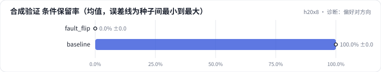

<!-- 本页由 python -m labkit docs 从 ../lesson.yaml 和 results/ 生成，不要手改 -->

[← 训练日志一切正常，上线条件全丢](15-fault.md) · [课程首页](../README.md) · [回顾 →](17-keycard.md)

# 第 16 步 / 共 17 步：诊断：偏好对方向

> 阶段 6 / 7：**诊断故障** · 场景：`baseline`（对照 `fault_flip`）

训练 loss、偏好准确率、梯度范数都正常，SFT 部分和 dpo_rule 完全一样。按需逐级点开线索，然后点选根因。

## 这一步跑了什么

| 场景 | 作用 | 说明 | 相对基线改了什么 | 种子（H20） |
| - | - | - | - | - |
| `fault_flip` | 对照 | 规则偏好对的 chosen / rejected 对调（"删掉条件"成了被偏好的一方） | `pref_method=dpo`, `pref_pairs=rule`, `pref_flip=True` | 3 |
| `baseline` | 本步 | 只做 SFT（与 L05 基线同配置），偏好阶段的起点和对照 | `pref_method=none` | 3 |

## 线索

逐条展开，看到能下判断为止。

线索 1

看错误类型分布：故障场景的错误几乎全是哪一类？和规则 rejected 的构造方式对得上吗？

线索 2

看合成验证集的分项：格式合法率 2% ± 2%、卖点 F1 3% ± 3%、条件保留率 0% ± 0%。如果是学习率或 β 把模型弄坏，坏的应该不止一项。

线索 3

看偏好准确率：末步 1.00 ± 0.00。模型完全学会了你给它的偏好。那份偏好本身对吗？打开运行目录的 trace.json，看 pairs 里 chosen 的 condition 字段。

## 先预测

**根因是什么？**

- **A.** 学习率太大，DPO 把 SFT 学到的东西冲掉了
- **B.** β 太小，模型偏离参考模型太远
- **C.** 偏好对的 chosen 和 rejected 写反了：删掉条件的回答被当成了 chosen
- **D.** 参考模型用错了，用的是基础模型而不是 SFT 模型

> 先选定一个（记下来），再展开下面的实测。dev 差异小于 6.7 个点（两条样本）、排除型合成集差异小于 5 个点（三条样本）或小于种子间波动，都按“差不多”算。

## 实测

展开实测：H20 · Qwen2.5-7B · SFT + 偏好阶段 · 每个场景 3 种子（已有 6 / 6 个运行）

| 场景 | 类型 | 合成验证 条件保留率 | 合成验证 卖点 F1 | 合成验证 格式合法率 | dev 条件保留率 | 合成验证 条件保留率：与 `fault_flip` 差 | 合成验证 条件保留率：各种子 | 断言 |
| - | - | - | - | - | - | - | - | - |
| `fault_flip` | 教学故障 | 0.0% ± 0.0 | 3.0% ± 3.0 | 1.7% ± 1.7 | 0.0% ± 0.0 | — | s0 0.0% / s1 0.0% / s2 0.0% | 通过 |
| `baseline` | 基线 | 100.0% ± 0.0 | 100.0% ± 0.0 | 100.0% ± 0.0 | 87.3% ± 7.3 | +100.0 个点 | s0 100.0% / s1 100.0% / s2 100.0% | 通过 |

运行目录（每个目录里有 `summary.json` 指标、`evidence.json` 证据摘要、`predictions.jsonl` 逐条预测、`log.txt` 日志）：

- `fault_flip` [s0](../../../results/h20x8/L07/fault_flip/s0-4190ee/) · [s1](../../../results/h20x8/L07/fault_flip/s1-cbf11d/) · [s2](../../../results/h20x8/L07/fault_flip/s2-1291f3/)
- `baseline` [s0](../../../results/h20x8/L07/baseline/s0-606cc1/) · [s1](../../../results/h20x8/L07/baseline/s1-4e1f34/) · [s2](../../../results/h20x8/L07/baseline/s2-c2b0c4/)

---

[← 训练日志一切正常，上线条件全丢](15-fault.md) · [课程首页](../README.md) · [回顾 →](17-keycard.md)
