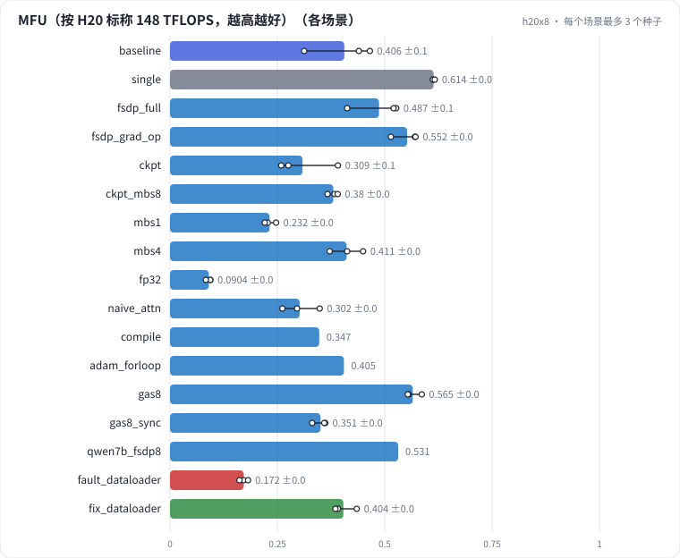

# L08 训练效率与 8 卡并行：MFU 与损失树、显存四部分、DDP 与 FSDP、重计算、精度、kernel、梯度累积，7B 单卡 OOM

用类 Qwen2.5-1.5B 的形状（随机初始化、随机 token），在 8 张 H20 上把训练效率的损失树逐项量一遍：单卡 MFU 和显存四部分、DDP 和 FSDP、激活重计算、mbs、精度、attention 实现、torch.compile、优化器实现、梯度累积的同步；再回到 7B：单卡全参在哪一步 OOM、8 卡 FSDP 能跑多快。最后诊断一次"数据在主进程做 CPU 分词，GPU 空等"。

## 怎么学（只看 GitHub 就够）

按下面“步骤”表从第 1 步往下点。每一页先给问题和选项，**先选定一个再展开“实测”**；实测里有结果表、证据图和运行目录链接。作业进度见 [作业看板](../../jobs/README.md)。参考答案和解析只在私有工作台里。

## 任务

**出发点**：团队训练 7B 内容理解模型，MFU 只有 20% 左右，不知道时间花在哪。MFU（Model FLOPs Utilization）= 实际完成的模型 FLOPs ÷ 峰值算力，它把"慢"拆成一棵损失树：

```
MFU 损失 ─┬─ GPU 空等：数据加载、CPU 同步、通信没被计算盖住
          ├─ 算得不划算：fp32、矩阵太小（mbs）、kernel 没融合（attention、优化器）
          └─ 多算了：激活重计算（HFU > MFU）
```

这一课用 1.5B（单卡放得下）把每个分支量一遍，再回到 7B 看真实规模。显存同样拆成四部分：参数、梯度、优化器状态、激活与其他。

## 规模与边界

- **H20 档**：8 × H20（96 GB，bf16 稠密标称 148 TFLOPS，HBM 标称 4.0 TB/s，NVLink 标称 900 GB/s 双向）。每个运行独占整机；单卡场景只用第 0 张。每个运行开头自测 GEMM 算力、all-reduce 带宽和 HBM 带宽，讲义同时给"按标称"和"按实测"两个口径。
- **保留了**：类 Qwen2.5 结构（GQA、RoPE、SwiGLU、RMSNorm、151936 词表）、全参 AdamW、bf16 autocast、DDP / FSDP2、重计算、梯度累积。
- **缩小了**：随机 token，不看 loss；每个运行只跑 30 步（热身 5、测吞吐 15、逐阶段计时 10）。
- **未验证**：多机（跨机网络带宽低一个数量级，通信结论会变）、张量并行 / 流水线并行、长序列（> 8K）。

## 步骤

<!-- labkit:path -->
| # | 阶段 | 步骤 | 这一步回答的问题 | 场景 | H20 × 8 结果 |
| - | - | - | - | - | - |
| 1 | 理解任务 | [场景与痛点](steps/01-pain.md) | 7B 训练 MFU 只有 20%，时间到底花在哪？ | — | — |
| 2 | 理解任务 | [流程结构](steps/02-flow.md) |  | — | — |
| 3 | 理解任务 | [追踪](steps/03-trace.md) |  | — | — |
| 4 | 理解任务 | [代码导读](steps/04-code.md) |  | — | — |
| 5 | 先估算 | [先估算](steps/05-estimate.md) | 1.5B 全参 AdamW（混合精度）单卡的静态显存（不含激活）大约多少？ | — | — |
| 6 | 单卡 | [单卡 MFU](steps/06-single.md) | 单卡的 MFU 大约多少？ | `single` | 3 / 3 |
| 7 | 单卡 | [单卡显存构成](steps/07-memory.md) | 激活与其他占峰值显存的多少？ | `single` | 3 / 3 |
| 8 | 8 卡并行 | [DDP 8 卡](steps/08-ddp.md) | DDP 8 卡的每卡吞吐是单卡的多少？ | `baseline` | 3 / 3 |
| 9 | 8 卡并行 | [FSDP FULL_SHARD](steps/09-fsdp.md) | FULL_SHARD 的每卡峰值显存比 DDP 少多少 GB？ | `fsdp_full` | 3 / 3 |
| 10 | 8 卡并行 | [梯度累积不用 no_sync](steps/10-gas.md) | 每个 micro step 都同步，步时是 no_sync 的几倍？ | `gas8_sync` | 3 / 3 |
| 11 | 算得划不划算 | [激活重计算](steps/11-ckpt.md) | 开重计算后每卡吞吐是原来的多少？ | `ckpt` | 3 / 3 |
| 12 | 算得划不划算 | [mbs 2 → 1](steps/12-mbs.md) | mbs 1 的 MFU 是 mbs 2 的多少？ | `mbs1` | 3 / 3 |
| 13 | 算得划不划算 | [全 fp32](steps/13-precision.md) | fp32 的每卡吞吐是 bf16 的多少？ | `fp32` | 3 / 3 |
| 14 | 算得划不划算 | [attention 实现](steps/14-kernels.md) | 手写 attention 的峰值显存比 SDPA 多多少 GB？ | `naive_attn` `compile` `adam_forloop` | 5 / 5 |
| 15 | 回到 7B | [7B 单卡全参](steps/15-7b-oom.md) | 在哪一步 OOM？ | `qwen7b_single` | 1 / 1 |
| 16 | 回到 7B | [7B FSDP 8 卡](steps/16-7b-fsdp.md) | 7B FSDP 8 卡的 MFU 大约多少？ | `qwen7b_fsdp8` | 1 / 1 |
| 17 | 故障 | [换成在线分词](steps/17-fault.md) | MFU 是基线的多少？ | `fault_dataloader` | 3 / 3 |
| 18 | 故障 | [诊断：MFU 掉在哪](steps/18-diagnose.md) | 根因是什么？ | `fault_dataloader` | 3 / 3 |
| 19 | 带走 | [回顾](steps/19-keycard.md) |  | — | — |
<!-- /labkit:path -->

## 场景与结果

<!-- labkit:results -->
<details><summary>展开结果（先自己预测，再看）</summary>

**h20x8**：8 × NVIDIA H20，每个运行独占整机 8 张卡（单卡场景只用第 0 张）。类 Qwen2.5 结构随机初始化、随机 token；1.5B 为主，7B 看真实规模；seq 2048、每卡 mbs 2、bf16、SDPA（已有 46 / 46 个运行）

| 场景 | 类型 | MFU | 每卡 tokens/s | 峰值显存 GB | 步时 ms | 等数据占比 | GPU 空闲占比 | 断言 |
| - | - | - | - | - | - | - | - | - |
| `baseline` | 基线 | 0.4058 ± 0.0820 (n=3) | 6133.7000 ± 1240.3143 (n=3) | 48.8900 ± 0.0000 (n=3) | 687.5167 ± 81.2216 (n=3) | 0.0001 ± 0.0000 (n=3) | 0.0171 ± 0.0036 (n=3) | 通过 |
| `single` | 参照 | 0.6137 ± 0.0024 (n=3) | 9276.9667 ± 36.8449 (n=3) | 48.8600 ± 0.0000 (n=3) | 453.7033 ± 1.9822 (n=3) | 0.0002 ± 0.0001 (n=3) | 0.0198 ± 0.0021 (n=3) | 通过 |
| `fsdp_full` | 候选改动 | 0.4866 ± 0.0642 (n=3) | 7356.4000 ± 969.9260 (n=3) | 22.3400 ± 0.0000 (n=3) | 599.8667 ± 101.4305 (n=3) | 0.0001 ± 0.0000 (n=3) | 0.0085 ± 0.0029 (n=3) | 通过 |
| `fsdp_grad_op` | 候选改动 | 0.5521 ± 0.0327 (n=3) | 8346.2333 ± 494.9882 (n=3) | 25.4400 ± 0.0000 (n=3) | 497.8800 ± 4.7042 (n=3) | 0.0012 ± 0.0019 (n=3) | 0.0134 ± 0.0036 (n=3) | 通过 |
| `ckpt` | 候选改动 | 0.3085 ± 0.0719 (n=3) | 4664.3667 ± 1087.4421 (n=3) | 34.8000 ± 0.0000 (n=3) | 939.3967 ± 150.6628 (n=3) | 0.0001 ± 0.0000 (n=3) | 0.0150 ± 0.0021 (n=3) | 通过 |
| `ckpt_mbs8` | 候选改动 | 0.3802 ± 0.0120 (n=3) | 5747.1667 ± 181.3094 (n=3) | 63.0100 ± 0.0000 (n=3) | 2803.4633 ± 218.9136 (n=3) | 0.0000 ± 0.0000 (n=3) | 0.0046 ± 0.0006 (n=3) | 通过 |
| `mbs1` | 候选改动 | 0.2318 ± 0.0137 (n=3) | 3505.3333 ± 207.1788 (n=3) | 38.4000 ± 0.0000 (n=3) | 529.8300 ± 7.3231 (n=3) | 0.0002 ± 0.0001 (n=3) | 0.0209 ± 0.0047 (n=3) |  |
| `mbs4` | 候选改动 | 0.4112 ± 0.0389 (n=3) | 6217.0667 ± 587.2831 (n=3) | 69.7500 ± 0.0000 (n=3) | 1344.2567 ± 100.5998 (n=3) | 0.0001 ± 0.0000 (n=3) | 0.0099 ± 0.0011 (n=3) |  |
| `fp32` | 候选改动 | 0.0904 ± 0.0059 (n=3) | 1366.9667 ± 88.8467 (n=3) | 55.6400 ± 0.0000 (n=3) | 2975.2300 ± 46.4556 (n=3) | 0.0000 ± 0.0000 (n=3) | 0.0024 ± 0.0003 (n=3) | 通过 |
| `naive_attn` | 候选改动 | 0.3020 ± 0.0438 (n=3) | 4565.1667 ± 662.0702 (n=3) | 66.4000 ± 0.0000 (n=3) | 865.5133 ± 141.0433 (n=3) | 0.0001 ± 0.0000 (n=3) | 0.0146 ± 0.0009 (n=3) | 通过 |
| `compile` | 候选改动 | 0.3475 | 5253.0000 | 48.1900 | 776.9100 | 0.0001 | 0.0090 |  |
| `adam_forloop` | 候选改动 | 0.4049 | 6121.0000 | 48.8900 | 761.0300 | 0.0001 | 0.0186 |  |
| `gas8` | 候选改动 | 0.5653 ± 0.0182 (n=3) | 8545.4667 ± 274.7236 (n=3) | 55.0700 ± 0.0000 (n=3) | 3875.2633 ± 47.7366 (n=3) | 0.0010 ± 0.0001 (n=3) | 0.0177 ± 0.0015 (n=3) | 通过 |
| `gas8_sync` | 候选改动 | 0.3505 ± 0.0170 (n=3) | 5298.9000 ± 256.1956 (n=3) | 48.8900 ± 0.0000 (n=3) | 5430.6333 ± 606.5591 (n=3) | 0.0007 ± 0.0001 (n=3) | 0.0152 ± 0.0009 (n=3) | 通过 |
| `qwen7b_single` | 候选改动 | — | — | 97.8500 | — | — | — | 通过 |
| `qwen7b_fsdp8` | 候选改动 | 0.5312 | 1800.9000 | 46.6200 | 2090.9500 | 0.0000 | 0.0024 | 通过 |
| `fault_dataloader` | 教学故障 | 0.1718 ± 0.0099 (n=3) | 2596.3333 ± 149.3045 (n=3) | 48.8900 ± 0.0000 (n=3) | 1764.4767 ± 47.9513 (n=3) | 0.5703 ± 0.0148 (n=3) | 0.5464 ± 0.0313 (n=3) | 通过 |
| `fix_dataloader` | 修复 | 0.4037 ± 0.0271 (n=3) | 6103.2333 ± 408.8693 (n=3) | 48.8900 ± 0.0000 (n=3) | 689.0433 ± 81.2510 (n=3) | 0.0004 ± 0.0001 (n=3) | 0.0171 ± 0.0027 (n=3) | 通过 |

</details>
<!-- /labkit:results -->

## 证据图

<!-- labkit:figures -->
<details><summary>展开证据图（先自己预测，再看）</summary>

- **h20x8**：[主指标](figures/h20x8-metrics.svg)

  

</details>
<!-- /labkit:figures -->

## 代码

<!-- labkit:code -->
| 代码段 | 位置 |
| - | - |
| `gpu_random` | [projects/trainperf/data.py#L14](../../projects/trainperf/data.py#L14) |
| `cpu_pipeline` | [projects/trainperf/data.py#L21](../../projects/trainperf/data.py#L21) |
| `breakdown` | [projects/trainperf/measure.py#L12](../../projects/trainperf/measure.py#L12) |
| `prof` | [projects/trainperf/measure.py#L43](../../projects/trainperf/measure.py#L43) |
| `attention` | [projects/trainperf/model.py#L40](../../projects/trainperf/model.py#L40) |
| `param_counts` | [projects/trainperf/model.py#L115](../../projects/trainperf/model.py#L115) |
| `flops` | [projects/trainperf/model.py#L130](../../projects/trainperf/model.py#L130) |
| `wrap` | [projects/trainperf/train.py#L37](../../projects/trainperf/train.py#L37) |
| `step_timing` | [projects/trainperf/train.py#L141](../../projects/trainperf/train.py#L141) |
| `spawn` | [projects/trainperf/train.py#L263](../../projects/trainperf/train.py#L263) |
| `mfu` | [projects/trainperf/train.py#L298](../../projects/trainperf/train.py#L298) |
<!-- /labkit:code -->
