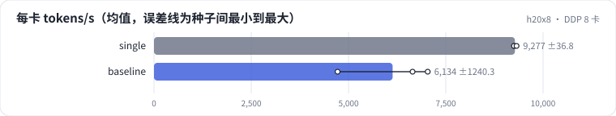
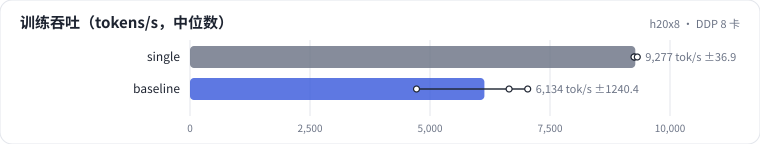

<!-- 本页由 python -m labkit docs 从 ../lesson.yaml 和 results/ 生成，不要手改 -->

[← 单卡显存构成](07-memory.md) · [课程首页](../README.md) · [FSDP FULL_SHARD →](09-fsdp.md)

# 第 8 步 / 共 19 步：DDP 8 卡

> 阶段 4 / 8：**8 卡并行** · 场景：`baseline`（对照 `single`）

同样的模型和 mbs，DDP 8 卡：每卡一份完整的模型，每步 all-reduce 梯度（约 6 GB，分桶、和反向重叠）。看每卡吞吐。

## 这一步跑了什么

| 场景 | 作用 | 说明 | 相对基线改了什么 | 种子（H20 × 8） |
| - | - | - | - | - |
| `single` | 对照 | 单卡（不并行） | `strategy=none`, `world_size=1` | 3 |
| `baseline` | 本步 | 基线：1.5B，DDP 8 卡，seq 2048，mbs 2，bf16，SDPA，fused AdamW | — | 3 |

## 先预测

**DDP 8 卡的每卡吞吐是单卡的多少？**

- **A.** 不到 80%
- **B.** 80% - 95%
- **C.** 95% 以上

> 先选定一个（记下来），再展开下面的实测。性能测量的种子只影响随机输入；吞吐差小于 5% 或小于种子间波动，都按“差不多”算。

## 实测

展开实测：H20 × 8 · 类 Qwen2.5-1.5B / 7B · seq 2048 · bf16 · 3 种子（部分 1 种子）（已有 6 / 6 个运行）

| 场景 | 类型 | 每卡 tokens/s | 反向 ms | 暴露的通信 ms | 峰值 GB | 每卡 tokens/s：与 `single` 差 | 每卡 tokens/s：各种子 | 断言 |
| - | - | - | - | - | - | - | - | - |
| `single` | 参照 | 9,277 ± 37 | 280 ± 0 | 0.0 ± 0.0 | 48.9 ± 0.0 | — | s0 9,260 / s1 9,251 / s2 9,319 | 通过 |
| `baseline` | 基线 | 6,134 ± 1,240 | 523 ± 81 | 220.2 ± 88.2 | 48.9 ± 0.0 | -3,143 | s0 4,719 / s1 7,035 / s2 6,647 | 通过 |

运行目录（每个目录里有 `summary.json` 指标、`evidence.json` 证据摘要、`predictions.jsonl` 逐条预测、`log.txt` 日志）：

- `single` [s0](../../../results/h20x8/L08/single/s0-2a864f/) · [s1](../../../results/h20x8/L08/single/s1-b8026d/) · [s2](../../../results/h20x8/L08/single/s2-81f014/)
- `baseline` [s0](../../../results/h20x8/L08/baseline/s0-cb39a6/) · [s1](../../../results/h20x8/L08/baseline/s1-ef300b/) · [s2](../../../results/h20x8/L08/baseline/s2-8206db/)

---

[← 单卡显存构成](07-memory.md) · [课程首页](../README.md) · [FSDP FULL_SHARD →](09-fsdp.md)
