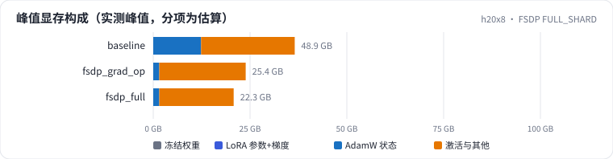
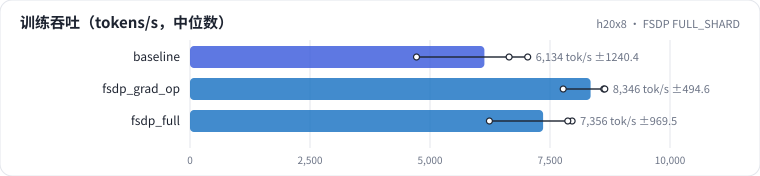

<!-- 本页由 python -m labkit docs 从 ../lesson.yaml 和 results/ 生成，不要手改 -->

[← DDP 8 卡](08-ddp.md) · [课程首页](../README.md) · [梯度累积不用 no_sync →](10-gas.md)

# 第 9 步 / 共 19 步：FSDP FULL_SHARD

> 阶段 4 / 8：**8 卡并行** · 场景：`fsdp_full`（对照 `baseline`）

从 DDP 换成 FSDP2 FULL_SHARD：参数、梯度、优化器状态都切成 8 份，每层用之前 all-gather、用完释放。另有一个"前向后不释放"（≈ ZeRO-2）的对照。

## 这一步跑了什么

| 场景 | 作用 | 说明 | 相对基线改了什么 | 种子（H20 × 8） |
| - | - | - | - | - |
| `baseline` | 对照 | 基线：1.5B，DDP 8 卡，seq 2048，mbs 2，bf16，SDPA，fused AdamW | — | 3 |
| `fsdp_grad_op` | 参照 | FSDP2 前向后不释放整份参数（≈ ZeRO-2） | `strategy=fsdp_grad_op` | 3 |
| `fsdp_full` | 本步 | FSDP2 FULL_SHARD（≈ ZeRO-3） | `strategy=fsdp_full` | 3 |

## 先预测

**FULL_SHARD 的每卡峰值显存比 DDP 少多少 GB？**

- **A.** 少 30 GB 以上
- **B.** 少 15 - 30 GB
- **C.** 少 3 - 15 GB
- **D.** 少不到 3 GB

> 先选定一个（记下来），再展开下面的实测。性能测量的种子只影响随机输入；吞吐差小于 5% 或小于种子间波动，都按“差不多”算。

## 实测

展开实测：H20 × 8 · 类 Qwen2.5-1.5B / 7B · seq 2048 · bf16 · 3 种子（部分 1 种子）（已有 9 / 9 个运行）

| 场景 | 类型 | 峰值 GB | 优化器 GB | 每卡 tokens/s | 峰值 GB：与 `baseline` 差 | 峰值 GB：各种子 | 断言 |
| - | - | - | - | - | - | - | - |
| `baseline` | 基线 | 48.9 ± 0.0 | 12.36 ± 0.00 | 6,134 ± 1,240 | — | s0 48.9 / s1 48.9 / s2 48.9 | 通过 |
| `fsdp_grad_op` | 候选改动 | 25.4 ± 0.0 | 1.56 ± 0.00 | 8,346 ± 495 | -23.5 | s0 25.4 / s1 25.4 / s2 25.4 | 通过 |
| `fsdp_full` | 候选改动 | 22.3 ± 0.0 | 1.56 ± 0.00 | 7,356 ± 970 | -26.6 | s0 22.3 / s1 22.3 / s2 22.3 | 通过 |

运行目录（每个目录里有 `summary.json` 指标、`evidence.json` 证据摘要、`predictions.jsonl` 逐条预测、`log.txt` 日志）：

- `baseline` [s0](../../../results/h20x8/L08/baseline/s0-cb39a6/) · [s1](../../../results/h20x8/L08/baseline/s1-ef300b/) · [s2](../../../results/h20x8/L08/baseline/s2-8206db/)
- `fsdp_grad_op` [s0](../../../results/h20x8/L08/fsdp_grad_op/s0-ecc10f/) · [s1](../../../results/h20x8/L08/fsdp_grad_op/s1-df5187/) · [s2](../../../results/h20x8/L08/fsdp_grad_op/s2-152c18/)
- `fsdp_full` [s0](../../../results/h20x8/L08/fsdp_full/s0-c286d4/) · [s1](../../../results/h20x8/L08/fsdp_full/s1-50e180/) · [s2](../../../results/h20x8/L08/fsdp_full/s2-806d64/)

---

[← DDP 8 卡](08-ddp.md) · [课程首页](../README.md) · [梯度累积不用 no_sync →](10-gas.md)
