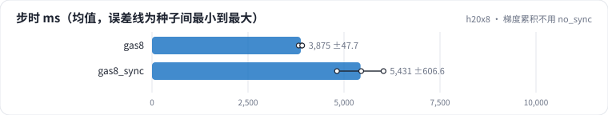

<!-- 本页由 python -m labkit docs 从 ../lesson.yaml 和 results/ 生成，不要手改 -->

[← FSDP FULL_SHARD](09-fsdp.md) · [课程首页](../README.md) · [激活重计算 →](11-ckpt.md)

# 第 10 步 / 共 19 步：梯度累积不用 no_sync

> 阶段 4 / 8：**8 卡并行** · 场景：`gas8_sync`（对照 `gas8`）

梯度累积 8 步。一种用 no_sync（只在第 8 个 micro step 同步），一种每个 micro step 都 all-reduce（多了 7 次 6 GB 的通信）。

## 这一步跑了什么

| 场景 | 作用 | 说明 | 相对基线改了什么 | 种子（H20 × 8） |
| - | - | - | - | - |
| `gas8` | 对照 | 梯度累积 8 步（no_sync） | `grad_accum=8` | 3 |
| `gas8_sync` | 本步 | 梯度累积 8 步，每个 micro step 都同步 | `grad_accum=8`, `no_sync=False` | 3 |

## 先预测

**每个 micro step 都同步，步时是 no_sync 的几倍？**

- **A.** 不到 1.03 倍
- **B.** 1.03 - 1.15 倍
- **C.** 1.15 倍以上

> 先选定一个（记下来），再展开下面的实测。性能测量的种子只影响随机输入；吞吐差小于 5% 或小于种子间波动，都按“差不多”算。

## 实测

展开实测：H20 × 8 · 类 Qwen2.5-1.5B / 7B · seq 2048 · bf16 · 3 种子（部分 1 种子）（已有 6 / 6 个运行）

| 场景 | 类型 | 步时 ms | 每步同步次数 | 步时 ms：与 `gas8` 差 | 步时 ms：各种子 | 断言 |
| - | - | - | - | - | - | - |
| `gas8` | 候选改动 | 3875 ± 48 | 1 ± 0 | — | s0 3895 / s1 3821 / s2 3910 | 通过 |
| `gas8_sync` | 候选改动 | 5431 ± 607 | 8 ± 0 | +1555 | s0 5448 / s1 6028 / s2 4816 | 通过 |

运行目录（每个目录里有 `summary.json` 指标、`evidence.json` 证据摘要、`predictions.jsonl` 逐条预测、`log.txt` 日志）：

- `gas8` [s0](../../../results/h20x8/L08/gas8/s0-d56e78/) · [s1](../../../results/h20x8/L08/gas8/s1-bc42b1/) · [s2](../../../results/h20x8/L08/gas8/s2-780359/)
- `gas8_sync` [s0](../../../results/h20x8/L08/gas8_sync/s0-fa1a73/) · [s1](../../../results/h20x8/L08/gas8_sync/s1-8d8a25/) · [s2](../../../results/h20x8/L08/gas8_sync/s2-3a75d1/)

---

[← FSDP FULL_SHARD](09-fsdp.md) · [课程首页](../README.md) · [激活重计算 →](11-ckpt.md)
