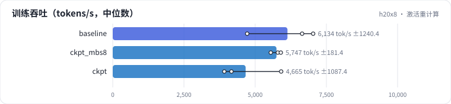

<!-- 本页由 python -m labkit docs 从 ../lesson.yaml 和 results/ 生成，不要手改 -->

[← 梯度累积不用 no_sync](10-gas.md) · [课程首页](../README.md) · [mbs 2 → 1 →](12-mbs.md)

# 第 11 步 / 共 19 步：激活重计算

> 阶段 5 / 8：**算得划不划算** · 场景：`ckpt`（对照 `baseline`）

DDP 8 卡基础上开全量重计算：每层只存输入，反向时重算这一层的前向。多算约 1/3 的 FLOPs。另有一个"重计算 + mbs 8"的对照。

## 这一步跑了什么

| 场景 | 作用 | 说明 | 相对基线改了什么 | 种子（H20 × 8） |
| - | - | - | - | - |
| `baseline` | 对照 | 基线：1.5B，DDP 8 卡，seq 2048，mbs 2，bf16，SDPA，fused AdamW | — | 3 |
| `ckpt_mbs8` | 参照 | 重计算 + mbs 8（省下的显存换更大的 batch） | `ckpt=full`, `mbs=8` | 3 |
| `ckpt` | 本步 | 全量激活重计算 | `ckpt=full` | 3 |

## 先预测

**开重计算后每卡吞吐是原来的多少？**

- **A.** 不到 67%
- **B.** 67% - 80%
- **C.** 80% - 95%
- **D.** 95% 以上

> 先选定一个（记下来），再展开下面的实测。性能测量的种子只影响随机输入；吞吐差小于 5% 或小于种子间波动，都按“差不多”算。

## 实测

展开实测：H20 × 8 · 类 Qwen2.5-1.5B / 7B · seq 2048 · bf16 · 3 种子（部分 1 种子）（已有 9 / 9 个运行）

| 场景 | 类型 | 每卡 tokens/s | 激活与其他 GB | HFU | 每卡 tokens/s：与 `baseline` 差 | 每卡 tokens/s：各种子 | 断言 |
| - | - | - | - | - | - | - | - |
| `baseline` | 基线 | 6,134 ± 1,240 | 24.2 ± 0.0 | 40.6% ± 8.2% | — | s0 4,719 / s1 7,035 / s2 6,647 | 通过 |
| `ckpt_mbs8` | 候选改动 | 5,747 ± 181 | 38.3 ± 0.0 | 50.7% ± 1.6% | -387 | s0 5,793 / s1 5,547 / s2 5,901 | 通过 |
| `ckpt` | 候选改动 | 4,664 ± 1,087 | 10.1 ± 0.0 | 41.1% ± 9.6% | -1,469 | s0 5,912 / s1 3,916 / s2 4,166 | 通过 |

运行目录（每个目录里有 `summary.json` 指标、`evidence.json` 证据摘要、`predictions.jsonl` 逐条预测、`log.txt` 日志）：

- `baseline` [s0](../../../results/h20x8/L08/baseline/s0-cb39a6/) · [s1](../../../results/h20x8/L08/baseline/s1-ef300b/) · [s2](../../../results/h20x8/L08/baseline/s2-8206db/)
- `ckpt_mbs8` [s0](../../../results/h20x8/L08/ckpt_mbs8/s0-271791/) · [s1](../../../results/h20x8/L08/ckpt_mbs8/s1-05225e/) · [s2](../../../results/h20x8/L08/ckpt_mbs8/s2-6d754f/)
- `ckpt` [s0](../../../results/h20x8/L08/ckpt/s0-561819/) · [s1](../../../results/h20x8/L08/ckpt/s1-0f1a29/) · [s2](../../../results/h20x8/L08/ckpt/s2-84029d/)

---

[← 梯度累积不用 no_sync](10-gas.md) · [课程首页](../README.md) · [mbs 2 → 1 →](12-mbs.md)
