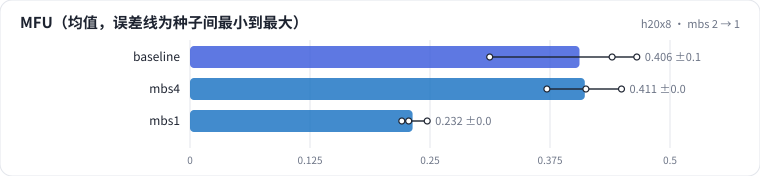

<!-- 本页由 python -m labkit docs 从 ../lesson.yaml 和 results/ 生成，不要手改 -->

[← 激活重计算](11-ckpt.md) · [课程首页](../README.md) · [全 fp32 →](13-precision.md)

# 第 12 步 / 共 19 步：mbs 2 → 1

> 阶段 5 / 8：**算得划不划算** · 场景：`mbs1`（对照 `baseline`）

每卡 micro batch 从 2 条降到 1 条序列。矩阵乘的 M 维 = mbs × T：从 4096 降到 2048。另有 mbs 4 的对照。

## 这一步跑了什么

| 场景 | 作用 | 说明 | 相对基线改了什么 | 种子（H20 × 8） |
| - | - | - | - | - |
| `baseline` | 对照 | 基线：1.5B，DDP 8 卡，seq 2048，mbs 2，bf16，SDPA，fused AdamW | — | 3 |
| `mbs4` | 参照 | mbs 4 | `mbs=4` | 3 |
| `mbs1` | 本步 | mbs 1 | `mbs=1` | 3 |

## 先预测

**mbs 1 的 MFU 是 mbs 2 的多少？**

- **A.** 不到 80%
- **B.** 80% - 95%
- **C.** 95% 以上

> 先选定一个（记下来），再展开下面的实测。性能测量的种子只影响随机输入；吞吐差小于 5% 或小于种子间波动，都按“差不多”算。

## 实测

展开实测：H20 × 8 · 类 Qwen2.5-1.5B / 7B · seq 2048 · bf16 · 3 种子（部分 1 种子）（已有 9 / 9 个运行）

| 场景 | 类型 | MFU | 峰值 GB | 优化器占比 | MFU：与 `baseline` 差 | MFU：各种子 | 断言 |
| - | - | - | - | - | - | - | - |
| `baseline` | 基线 | 40.6% ± 8.2% | 48.9 ± 0.0 | 2.2% ± 0.2% | — | s0 31.2% / s1 46.5% / s2 44.0% | 通过 |
| `mbs4` | 候选改动 | 41.1% ± 3.9% | 69.8 ± 0.0 | 1.1% ± 0.1% | +0.5% | s0 37.2% / s1 45.0% / s2 41.2% |  |
| `mbs1` | 候选改动 | 23.2% ± 1.4% | 38.4 ± 0.0 | 3.3% ± 0.6% | -17.4% | s0 22.8% / s1 24.7% / s2 22.1% |  |

运行目录（每个目录里有 `summary.json` 指标、`evidence.json` 证据摘要、`predictions.jsonl` 逐条预测、`log.txt` 日志）：

- `baseline` [s0](../../../results/h20x8/L08/baseline/s0-cb39a6/) · [s1](../../../results/h20x8/L08/baseline/s1-ef300b/) · [s2](../../../results/h20x8/L08/baseline/s2-8206db/)
- `mbs4` [s0](../../../results/h20x8/L08/mbs4/s0-335e25/) · [s1](../../../results/h20x8/L08/mbs4/s1-0b545e/) · [s2](../../../results/h20x8/L08/mbs4/s2-25d4e9/)
- `mbs1` [s0](../../../results/h20x8/L08/mbs1/s0-004708/) · [s1](../../../results/h20x8/L08/mbs1/s1-1fe3b0/) · [s2](../../../results/h20x8/L08/mbs1/s2-4d5150/)

---

[← 激活重计算](11-ckpt.md) · [课程首页](../README.md) · [全 fp32 →](13-precision.md)
