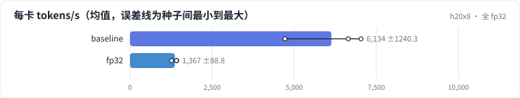
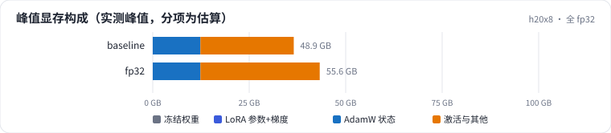
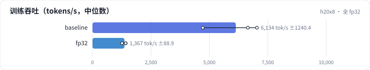

<!-- 本页由 python -m labkit docs 从 ../lesson.yaml 和 results/ 生成，不要手改 -->

[← mbs 2 → 1](12-mbs.md) · [课程首页](../README.md) · [attention 实现 →](14-kernels.md)

# 第 13 步 / 共 19 步：全 fp32

> 阶段 5 / 8：**算得划不划算** · 场景：`fp32`（对照 `baseline`）

不开 autocast、不开 TF32：所有矩阵乘都是 fp32，走 CUDA core 而不是 Tensor Core。

## 这一步跑了什么

| 场景 | 作用 | 说明 | 相对基线改了什么 | 种子（H20 × 8） |
| - | - | - | - | - |
| `baseline` | 对照 | 基线：1.5B，DDP 8 卡，seq 2048，mbs 2，bf16，SDPA，fused AdamW | — | 3 |
| `fp32` | 本步 | 全 fp32（不开 TF32） | `precision=fp32` | 3 |

## 先预测

**fp32 的每卡吞吐是 bf16 的多少？**

- **A.** 不到 25%
- **B.** 25% - 50%
- **C.** 50% - 80%
- **D.** 80% 以上

> 先选定一个（记下来），再展开下面的实测。性能测量的种子只影响随机输入；吞吐差小于 5% 或小于种子间波动，都按“差不多”算。

## 实测

展开实测：H20 × 8 · 类 Qwen2.5-1.5B / 7B · seq 2048 · bf16 · 3 种子（部分 1 种子）（已有 6 / 6 个运行）

| 场景 | 类型 | 每卡 tokens/s | 峰值 GB | 每卡 tokens/s：与 `baseline` 差 | 每卡 tokens/s：各种子 | 断言 |
| - | - | - | - | - | - | - |
| `baseline` | 基线 | 6,134 ± 1,240 | 48.9 ± 0.0 | — | s0 4,719 / s1 7,035 / s2 6,647 | 通过 |
| `fp32` | 候选改动 | 1,367 ± 89 | 55.6 ± 0.0 | -4,767 | s0 1,420 / s1 1,416 / s2 1,264 | 通过 |

运行目录（每个目录里有 `summary.json` 指标、`evidence.json` 证据摘要、`predictions.jsonl` 逐条预测、`log.txt` 日志）：

- `baseline` [s0](../../../results/h20x8/L08/baseline/s0-cb39a6/) · [s1](../../../results/h20x8/L08/baseline/s1-ef300b/) · [s2](../../../results/h20x8/L08/baseline/s2-8206db/)
- `fp32` [s0](../../../results/h20x8/L08/fp32/s0-9a39cd/) · [s1](../../../results/h20x8/L08/fp32/s1-e2ad39/) · [s2](../../../results/h20x8/L08/fp32/s2-93005d/)

---

[← mbs 2 → 1](12-mbs.md) · [课程首页](../README.md) · [attention 实现 →](14-kernels.md)
