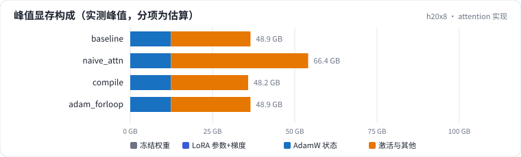
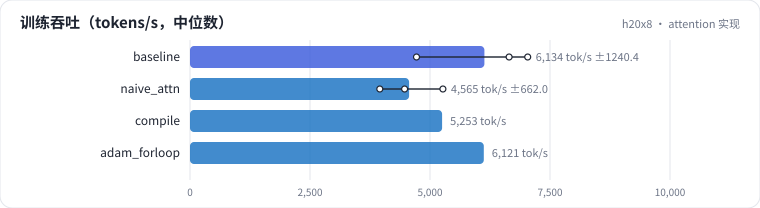

<!-- 本页由 python -m labkit docs 从 ../lesson.yaml 和 results/ 生成，不要手改 -->

[← 全 fp32](13-precision.md) · [课程首页](../README.md) · [7B 单卡全参 →](15-7b-oom.md)

# 第 14 步 / 共 19 步：attention 实现

> 阶段 5 / 8：**算得划不划算** · 场景：`naive_attn` `compile` `adam_forloop`（对照 `baseline`）

attention 从 SDPA（flash）换成手写：显式算 [mbs, 12, 2048, 2048] 的打分和 softmax，每层存下来给反向用。另有 torch.compile 和"AdamW 逐参数循环"两个对照。

## 这一步跑了什么

| 场景 | 作用 | 说明 | 相对基线改了什么 | 种子（H20 × 8） |
| - | - | - | - | - |
| `baseline` | 对照 | 基线：1.5B，DDP 8 卡，seq 2048，mbs 2，bf16，SDPA，fused AdamW | — | 3 |
| `naive_attn` | 本步 | 手写 attention（显式 [B, H, T, T]） | `attn=naive` | 3 |
| `compile` | 本步 | torch.compile 每个层 | `compile=True` | 1 |
| `adam_forloop` | 本步 | AdamW 逐参数循环实现（不 fused、不 foreach） | `adam=forloop` | 1 |

## 先预测

**手写 attention 的峰值显存比 SDPA 多多少 GB？**

- **A.** 不到 2 GB
- **B.** 2 - 10 GB
- **C.** 10 GB 以上

> 先选定一个（记下来），再展开下面的实测。性能测量的种子只影响随机输入；吞吐差小于 5% 或小于种子间波动，都按“差不多”算。

## 实测

展开实测：H20 × 8 · 类 Qwen2.5-1.5B / 7B · seq 2048 · bf16 · 3 种子（部分 1 种子）（已有 8 / 8 个运行）

| 场景 | 类型 | 峰值 GB | 每卡 tokens/s | 优化器 ms | 峰值 GB：与 `baseline` 差 | 峰值 GB：各种子 | 断言 |
| - | - | - | - | - | - | - | - |
| `baseline` | 基线 | 48.9 ± 0.0 | 6,134 ± 1,240 | 15 ± 0 | — | s0 48.9 / s1 48.9 / s2 48.9 | 通过 |
| `naive_attn` | 候选改动 | 66.4 ± 0.0 | 4,565 ± 662 | 15 ± 0 | +17.5 | s0 66.4 / s1 66.4 / s2 66.4 | 通过 |
| `compile` | 候选改动 | 48.2 | 5,253 | 15 | -0.7 | s0 48.2 |  |
| `adam_forloop` | 候选改动 | 48.9 | 6,121 | 38 | -0.0 | s0 48.9 |  |

运行目录（每个目录里有 `summary.json` 指标、`evidence.json` 证据摘要、`predictions.jsonl` 逐条预测、`log.txt` 日志）：

- `baseline` [s0](../../../results/h20x8/L08/baseline/s0-cb39a6/) · [s1](../../../results/h20x8/L08/baseline/s1-ef300b/) · [s2](../../../results/h20x8/L08/baseline/s2-8206db/)
- `naive_attn` [s0](../../../results/h20x8/L08/naive_attn/s0-dcc83c/) · [s1](../../../results/h20x8/L08/naive_attn/s1-d707d9/) · [s2](../../../results/h20x8/L08/naive_attn/s2-e7ccc4/)
- `compile` [s0](../../../results/h20x8/L08/compile/s0-2f5092/)
- `adam_forloop` [s0](../../../results/h20x8/L08/adam_forloop/s0-c4d96c/)

---

[← 全 fp32](13-precision.md) · [课程首页](../README.md) · [7B 单卡全参 →](15-7b-oom.md)
