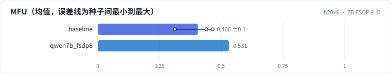
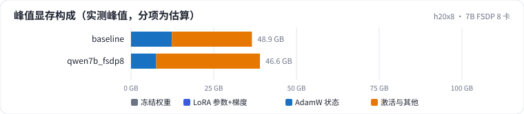

<!-- 本页由 python -m labkit docs 从 ../lesson.yaml 和 results/ 生成，不要手改 -->

[← 7B 单卡全参](15-7b-oom.md) · [课程首页](../README.md) · [换成在线分词 →](17-fault.md)

# 第 16 步 / 共 19 步：7B FSDP 8 卡

> 阶段 6 / 8：**回到 7B** · 场景：`qwen7b_fsdp8`（对照 `baseline`）

7B 用 FSDP2 FULL_SHARD 8 卡，mbs 2，seq 2048。每层前向、反向前都要 all-gather 这一层的整份参数（bf16，约 0.45 GB），通信量是 DDP 的约 1.5 倍。

## 这一步跑了什么

| 场景 | 作用 | 说明 | 相对基线改了什么 | 种子（H20 × 8） |
| - | - | - | - | - |
| `baseline` | 对照 | 基线：1.5B，DDP 8 卡，seq 2048，mbs 2，bf16，SDPA，fused AdamW | — | 3 |
| `qwen7b_fsdp8` | 本步 | 7B FSDP2 FULL_SHARD 8 卡（mbs 2） | `preset=qwen7b`, `strategy=fsdp_full` | 1 |

## 先预测

**7B FSDP 8 卡的 MFU 大约多少？**

- **A.** 不到 20%
- **B.** 20% - 35%
- **C.** 35% - 50%
- **D.** 50% 以上

> 先选定一个（记下来），再展开下面的实测。性能测量的种子只影响随机输入；吞吐差小于 5% 或小于种子间波动，都按“差不多”算。

## 实测

展开实测：H20 × 8 · 类 Qwen2.5-1.5B / 7B · seq 2048 · bf16 · 3 种子（部分 1 种子）（已有 4 / 4 个运行）

| 场景 | 类型 | MFU | 每卡 tokens/s | 峰值 GB | 暴露的通信 ms | MFU：与 `baseline` 差 | MFU：各种子 | 断言 |
| - | - | - | - | - | - | - | - | - |
| `baseline` | 基线 | 40.6% ± 8.2% | 6,134 ± 1,240 | 48.9 ± 0.0 | 220 ± 88 | — | s0 31.2% / s1 46.5% / s2 44.0% | 通过 |
| `qwen7b_fsdp8` | 候选改动 | 53.1% | 1,801 | 46.6 | 226 | +12.5% | s0 53.1% | 通过 |

运行目录（每个目录里有 `summary.json` 指标、`evidence.json` 证据摘要、`predictions.jsonl` 逐条预测、`log.txt` 日志）：

- `baseline` [s0](../../../results/h20x8/L08/baseline/s0-cb39a6/) · [s1](../../../results/h20x8/L08/baseline/s1-ef300b/) · [s2](../../../results/h20x8/L08/baseline/s2-8206db/)
- `qwen7b_fsdp8` [s0](../../../results/h20x8/L08/qwen7b_fsdp8/s0-89b424/)

---

[← 7B 单卡全参](15-7b-oom.md) · [课程首页](../README.md) · [换成在线分词 →](17-fault.md)
