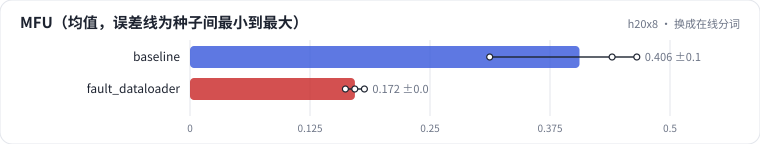

<!-- 本页由 python -m labkit docs 从 ../lesson.yaml 和 results/ 生成，不要手改 -->

[← 7B FSDP 8 卡](16-7b-fsdp.md) · [课程首页](../README.md) · [诊断：MFU 掉在哪 →](18-diagnose.md)

# 第 17 步 / 共 19 步：换成在线分词

> 阶段 7 / 8：**故障** · 场景：`fault_dataloader`（对照 `baseline`）

同事把随机 token 换成"真实"的数据管线：每条样本在线做文本规范化、分词和 BPE 合并（纯 Python），DataLoader 的 num_workers 用默认的 0。训练正常，loss 正常，nvidia-smi 也间歇显示 GPU 在忙。

## 这一步跑了什么

| 场景 | 作用 | 说明 | 相对基线改了什么 | 种子（H20 × 8） |
| - | - | - | - | - |
| `baseline` | 对照 | 基线：1.5B，DDP 8 卡，seq 2048，mbs 2，bf16，SDPA，fused AdamW | — | 3 |
| `fault_dataloader` | 本步 | 数据在每个 rank 的主进程里做 CPU 规范化 + 分词（num_workers 0） | `data=cpu_pipeline`, `num_workers=0` | 3 |

## 先预测

**MFU 是基线的多少？**

- **A.** 不到 60%
- **B.** 60% - 90%
- **C.** 90% 以上

> 先选定一个（记下来），再展开下面的实测。性能测量的种子只影响随机输入；吞吐差小于 5% 或小于种子间波动，都按“差不多”算。

## 实测

展开实测：H20 × 8 · 类 Qwen2.5-1.5B / 7B · seq 2048 · bf16 · 3 种子（部分 1 种子）（已有 6 / 6 个运行）

| 场景 | 类型 | MFU | 等数据占比 | GPU 空闲占比 | MFU：与 `baseline` 差 | MFU：各种子 | 断言 |
| - | - | - | - | - | - | - | - |
| `baseline` | 基线 | 40.6% ± 8.2% | 0.0% ± 0.0% | 1.7% ± 0.4% | — | s0 31.2% / s1 46.5% / s2 44.0% | 通过 |
| `fault_dataloader` | 教学故障 | 17.2% ± 1.0% | 57.0% ± 1.5% | 54.6% ± 3.1% | -23.4% | s0 17.2% / s1 18.2% / s2 16.2% | 通过 |

运行目录（每个目录里有 `summary.json` 指标、`evidence.json` 证据摘要、`predictions.jsonl` 逐条预测、`log.txt` 日志）：

- `baseline` [s0](../../../results/h20x8/L08/baseline/s0-cb39a6/) · [s1](../../../results/h20x8/L08/baseline/s1-ef300b/) · [s2](../../../results/h20x8/L08/baseline/s2-8206db/)
- `fault_dataloader` [s0](../../../results/h20x8/L08/fault_dataloader/s0-8dbf0e/) · [s1](../../../results/h20x8/L08/fault_dataloader/s1-9cfafc/) · [s2](../../../results/h20x8/L08/fault_dataloader/s2-0a5d37/)

---

[← 7B FSDP 8 卡](16-7b-fsdp.md) · [课程首页](../README.md) · [诊断：MFU 掉在哪 →](18-diagnose.md)
