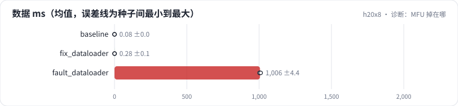

<!-- 本页由 python -m labkit docs 从 ../lesson.yaml 和 results/ 生成，不要手改 -->

[← 换成在线分词](17-fault.md) · [课程首页](../README.md) · [回顾 →](19-keycard.md)

# 第 18 步 / 共 19 步：诊断：MFU 掉在哪

> 阶段 7 / 8：**故障** · 场景：`fault_dataloader`（对照 `baseline`）

模型、并行方式都没变，只换了数据来源。按需逐级点开线索，然后点选根因。

## 这一步跑了什么

| 场景 | 作用 | 说明 | 相对基线改了什么 | 种子（H20 × 8） |
| - | - | - | - | - |
| `baseline` | 对照 | 基线：1.5B，DDP 8 卡，seq 2048，mbs 2，bf16，SDPA，fused AdamW | — | 3 |
| `fix_dataloader` | 参照 | 同样的 CPU 预处理，4 个 worker + 锁页内存 + 预取 | `data=cpu_pipeline`, `num_workers=4`, `pin_memory=True` | 3 |
| `fault_dataloader` | 本步 | 数据在每个 rank 的主进程里做 CPU 规范化 + 分词（num_workers 0） | `data=cpu_pipeline`, `num_workers=0` | 3 |

## 线索

逐条展开，看到能下判断为止。

线索 1

步时分解：数据 1006 ± 4 ms（基线 0.1 ± 0.0），前向 164 ± 0、反向 580 ± 47 ms（基线 149 ± 14、523 ± 81）。

线索 2

profiler：每步 kernel 计算 442 ± 15 ms（基线 450 ± 21），GPU 空闲占比 55% ± 3%（基线 2% ± 0%）。

线索 3

配置：num_workers = 0；每个 rank 每步要处理 mbs 条样本；机器 CPU 核数 384 ± 0。

## 先预测

**根因是什么？**

- **A.** 梯度通信没有和计算重叠
- **B.** 数据在训练主进程里同步做 CPU 预处理，GPU 空等
- **C.** 显存碎片导致分配器反复整理
- **D.** mbs 太小，矩阵乘吃不饱

> 先选定一个（记下来），再展开下面的实测。性能测量的种子只影响随机输入；吞吐差小于 5% 或小于种子间波动，都按“差不多”算。

## 实测

展开实测：H20 × 8 · 类 Qwen2.5-1.5B / 7B · seq 2048 · bf16 · 3 种子（部分 1 种子）（已有 9 / 9 个运行）

| 场景 | 类型 | 数据 ms | 反向 ms | GPU 空闲 | MFU | 数据 ms：与 `baseline` 差 | 数据 ms：各种子 | 断言 |
| - | - | - | - | - | - | - | - | - |
| `baseline` | 基线 | 0 ± 0 | 523 ± 81 | 1.7% ± 0.4% | 40.6% ± 8.2% | — | s0 0 / s1 0 / s2 0 | 通过 |
| `fix_dataloader` | 修复 | 0 ± 0 | 528 ± 68 | 1.7% ± 0.3% | 40.4% ± 2.7% | +0 | s0 0 / s1 0 / s2 0 | 通过 |
| `fault_dataloader` | 教学故障 | 1006 ± 4 | 580 ± 47 | 54.6% ± 3.1% | 17.2% ± 1.0% | +1006 | s0 1003 / s1 1003 / s2 1011 | 通过 |

运行目录（每个目录里有 `summary.json` 指标、`evidence.json` 证据摘要、`predictions.jsonl` 逐条预测、`log.txt` 日志）：

- `baseline` [s0](../../../results/h20x8/L08/baseline/s0-cb39a6/) · [s1](../../../results/h20x8/L08/baseline/s1-ef300b/) · [s2](../../../results/h20x8/L08/baseline/s2-8206db/)
- `fix_dataloader` [s0](../../../results/h20x8/L08/fix_dataloader/s0-1140cc/) · [s1](../../../results/h20x8/L08/fix_dataloader/s1-4f67d9/) · [s2](../../../results/h20x8/L08/fix_dataloader/s2-12350d/)
- `fault_dataloader` [s0](../../../results/h20x8/L08/fault_dataloader/s0-8dbf0e/) · [s1](../../../results/h20x8/L08/fault_dataloader/s1-9cfafc/) · [s2](../../../results/h20x8/L08/fault_dataloader/s2-0a5d37/)

---

[← 换成在线分词](17-fault.md) · [课程首页](../README.md) · [回顾 →](19-keycard.md)
