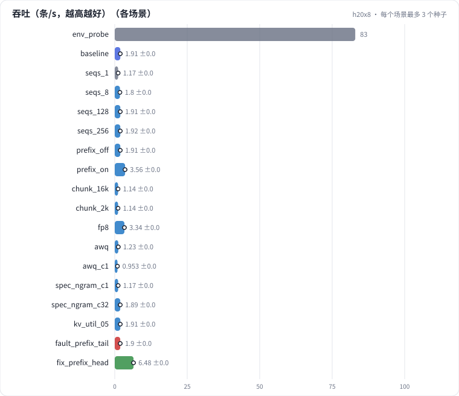

# L09 推理性能与 vLLM 服务：长输入短输出的 7B 打标，TTFT / TPOT 对照屋顶线、batch 拐点、前缀缓存、chunked prefill、FP8 与 AWQ、投机解码、KV 显存与并发

业务里的 7B 打标是"长输入、短输出"：每条 4096 token 进、50 token 出。在 H20 上用 vLLM 把推理的成本逐项量一遍：单条 prefill 和 decode 对照屋顶线、max_num_seqs 的拐点、前缀缓存、每步 token 预算（chunked prefill）、FP8 和 AWQ 量化、投机解码、KV 显存和并发上限；最后诊断一次"共享的打标规范放在内容后面，前缀缓存一条都没命中"。

## 怎么学（只看 GitHub 就够）

按下面“步骤”表从第 1 步往下点。每一页先给问题和选项，**先选定一个再展开“实测”**；实测里有结果表、证据图和运行目录链接。作业进度见 [作业看板](../../jobs/README.md)。参考答案和解析只在私有工作台里。

## 任务

**出发点**：内容理解模型（类 Qwen2.5-7B）每天要给几千万条内容打标。每条输入是一段打标规范加一条内容，约 4096 token；输出是一个 50 token 左右的 JSON。上线前要回答：一张 H20 每秒能打多少条？延迟多少？哪些旋钮值得调？

推理的成本分两段，瓶颈完全不同：

```
prefill：一次处理 4096 个输入 token，矩阵乘 [4096, 3584] × [3584, N]，算术强度几千 → 算力瓶颈
decode ：每步每条请求 1 个 token，矩阵乘 [B, 3584] × [3584, N]，要把 15 GB 权重读一遍 → 带宽瓶颈（B 小时）
```

长输入短输出时 prefill 的 FLOPs 是大头。这一课先用屋顶线估出两段各自的下限，再在 vLLM 上逐个旋钮量实际效果。

## 规模与边界

- **H20 档**：NVIDIA H20（96 GB，bf16 稠密标称 148 TFLOPS，FP8 296 TFLOPS，HBM 标称 4.0 TB/s，算力 / 带宽拐点约 37 FLOP/B），每个运行独占 1 张卡。vLLM 0.11（V1 引擎）装在独立环境里。
- **保留了**：Qwen2.5-7B-Instruct 原始权重（bf16）和官方 AWQ 版、真实的聊天模板、贪心解码、流式输出计时（TTFT / TPOT / ITL 的口径和 vLLM 自带的 benchmark_serving 一致）。
- **缩小了**：内容是合成的中文商品描述（长度按 token 精确控制）；输出固定 50 token（忽略 EOS），各配置的工作量完全相同；单卡、单个 vLLM 实例。
- **未验证**：多卡张量并行、PD 分离、真实线上流量的长度分布、OpenAI 接口层（HTTP、反序列化）的开销。

## 步骤

<!-- labkit:path -->
| # | 阶段 | 步骤 | 这一步回答的问题 | 场景 | H20 结果 |
| - | - | - | - | - | - |
| 1 | 理解任务 | [场景与痛点](steps/01-pain.md) | 一张 H20 每秒能打多少条？调哪个旋钮最值？ | — | — |
| 2 | 理解任务 | [流程结构](steps/02-flow.md) |  | — | — |
| 3 | 理解任务 | [追踪](steps/03-trace.md) |  | — | — |
| 4 | 理解任务 | [代码导读](steps/04-code.md) |  | — | — |
| 5 | 先估算 | [先估算](steps/05-estimate.md) | 单条 4096 token 的 prefill，理论下限大约多少？ | — | — |
| 6 | 单条请求 | [单条 prefill](steps/06-ttft.md) | 实测 TTFT 是屋顶线下限的几倍？ | `seqs_1` | 3 / 3 |
| 7 | 单条请求 | [单条 decode](steps/07-tpot.md) | 实测 TPOT 是屋顶线下限的几倍？ | `seqs_1` | 3 / 3 |
| 8 | 并发 | [max_num_seqs 的拐点](steps/08-batch.md) | max_num_seqs 从 8 加到 256，吞吐（条/s）变成几倍？ | `seqs_256` `seqs_1` `seqs_8` `baseline` `seqs_128` | 15 / 15 |
| 9 | 并发 | [并发的代价](steps/09-latency.md) | max_num_seqs 256 的 TPOT p50 是基线（32）的几倍？ | `seqs_256` `seqs_8` `baseline` `seqs_128` | 12 / 12 |
| 10 | 并发 | [KV 显存与并发上限](steps/10-kv.md) | 吞吐是 utilization 0.9 时（同样 max_num_seqs 256）的多少？ | `kv_util_05` | 3 / 3 |
| 11 | 省 FLOPs 还是省字节 | [前缀缓存](steps/11-prefix.md) | 开缓存后，吞吐是关缓存的几倍？ | `prefix_on` | 3 / 3 |
| 12 | 省 FLOPs 还是省字节 | [每步 token 预算（chunked prefill）](steps/12-chunk.md) | 预算从 16384 降到 2048，ITL p99（相邻两个输出之间最长的那批间隔）变成多少？ | `chunk_2k` | 3 / 3 |
| 13 | 省 FLOPs 还是省字节 | [FP8](steps/13-fp8.md) | 吞吐是 bf16 基线的几倍？ | `fp8` | 3 / 3 |
| 14 | 省 FLOPs 还是省字节 | [AWQ INT4](steps/14-awq.md) | 同样 256 条、max_num_seqs 32，吞吐是 bf16 基线的几倍？ | `awq` | 3 / 3 |
| 15 | 省 FLOPs 还是省字节 | [投机解码](steps/15-spec.md) | TPOT 变成不投机时的多少？ | `spec_ngram_c1` | 3 / 3 |
| 16 | 故障 | [规范挪到内容后面](steps/16-fault.md) | 吞吐是基线（没有共享部分）的几倍？ | `fault_prefix_tail` | 3 / 3 |
| 17 | 故障 | [诊断：缓存为什么没命中](steps/17-diagnose.md) | 根因是什么？ | `fault_prefix_tail` | 3 / 3 |
| 18 | 带走 | [回顾](steps/18-keycard.md) |  | — | — |
<!-- /labkit:path -->

## 场景与结果

<!-- labkit:results -->
<details><summary>展开结果（先自己预测，再看）</summary>

**h20x8**：8 × NVIDIA H20（96 GB，bf16 稠密标称 148 TFLOPS，HBM 标称 4.0 TB/s），每个运行独占 1 张卡。vLLM 0.11 装在独立环境 vllm-env 里；Qwen2.5-7B-Instruct bf16，每条输入 4096 token、输出 50 token（忽略 EOS），贪心解码（已有 52 / 55 个运行）

| 场景 | 类型 | 条/s | 输入 tok/s | TTFT p50 ms | TPOT p50 ms | ITL p99 ms | 前缀命中率 | 同时 decode 最多 | 断言 |
| - | - | - | - | - | - | - | - | - | - |
| `env_probe` | 参照 | 82.9510 | 84941.5000 | 111.8200 | 3.5800 | 23.3400 | 0.4688 | 8.0000 | 通过 |
| `baseline` | 基线 | 1.9133 ± 0.0045 (n=3) | 7836.8667 ± 19.7662 (n=3) | 66785.4467 ± 238.1528 (n=3) | 309.9967 ± 0.6243 (n=3) | 1014.4900 ± 2.7735 (n=3) | 0.0000 ± 0.0000 (n=3) | 32.0000 ± 0.0000 (n=3) | 通过 |
| `seqs_1` | 参照 | 1.1743 ± 0.0107 (n=3) | 4810.0667 ± 42.8591 (n=3) | 6941.6933 ± 116.6361 (n=3) | 6.7267 ± 0.0737 (n=3) | 12.8067 ± 0.2194 (n=3) | 0.0000 ± 0.0000 (n=3) | 1.0000 ± 0.0000 (n=3) | 通过 |
| `seqs_8` | 候选改动 | 1.7960 ± 0.0098 (n=3) | 7356.0333 ± 42.1143 (n=3) | 71497.9567 ± 317.0834 (n=3) | 80.0300 ± 0.4812 (n=3) | 515.5800 ± 4.1188 (n=3) | 0.0000 ± 0.0000 (n=3) | 8.0000 ± 0.0000 (n=3) | 通过 |
| `seqs_128` | 候选改动 | 1.9120 ± 0.0072 (n=3) | 7831.9333 ± 30.5507 (n=3) | 66509.7700 ± 336.0222 (n=3) | 1026.9033 ± 5.9911 (n=3) | 1090.1933 ± 22.8973 (n=3) | 0.0000 ± 0.0000 (n=3) | 98.0000 ± 0.0000 (n=3) | 通过 |
| `seqs_256` | 候选改动 | 1.9170 ± 0.0108 (n=3) | 7851.2000 ± 45.7708 (n=3) | 66424.3333 ± 435.5337 (n=3) | 1024.4800 ± 6.4135 (n=3) | 1058.6633 ± 20.8076 (n=3) | 0.0000 ± 0.0000 (n=3) | 98.0000 ± 0.0000 (n=3) | 通过 |
| `prefix_off` | 候选改动 | 1.9090 ± 0.0075 (n=3) | 7820.4333 ± 30.0282 (n=3) | 66976.9400 ± 481.9414 (n=3) | 310.5567 ± 0.7853 (n=3) | 1027.1067 ± 22.3235 (n=3) | 0.0000 ± 0.0000 (n=3) | 32.0000 ± 0.0000 (n=3) | 通过 |
| `prefix_on` | 候选改动 | 3.5563 ± 0.0215 (n=3) | 14566.3333 ± 89.2041 (n=3) | 36046.5667 ± 281.7142 (n=3) | 157.4933 ± 1.6381 (n=3) | 1040.1467 ± 7.3643 (n=3) | 0.4981 ± 0.0001 (n=3) | 32.0000 ± 0.0000 (n=3) | 通过 |
| `chunk_16k` | 候选改动 | 1.1450 ± 0.0213 (n=3) | 4689.3000 ± 85.9527 (n=3) | 647.6100 ± 78.8290 (n=3) | 23.4133 ± 4.3998 (n=3) | 686.8567 ± 268.5651 (n=3) | 0.0000 ± 0.0000 (n=3) | 19.0000 ± 6.2450 (n=3) | 通过 |
| `chunk_2k` | 候选改动 | 1.1447 ± 0.0207 (n=3) | 4687.7333 ± 85.7108 (n=3) | 849.3633 ± 52.0137 (n=3) | 26.2833 ± 2.7720 (n=3) | 268.2800 ± 1.4564 (n=3) | 0.0000 ± 0.0000 (n=3) | 18.6667 ± 5.6862 (n=3) | 通过 |
| `fp8` | 候选改动 | 3.3387 ± 0.0222 (n=3) | 13674.1333 ± 90.5707 (n=3) | 37934.2767 ± 237.0747 (n=3) | 178.3033 ± 1.0929 (n=3) | 584.3667 ± 4.8094 (n=3) | 0.0000 ± 0.0000 (n=3) | 32.0000 ± 0.0000 (n=3) | 通过 |
| `awq` | 候选改动 | 1.2303 ± 0.0021 (n=3) | 5040.2667 ± 7.7822 (n=3) | 103988.2633 ± 210.5435 (n=3) | 481.8533 ± 0.9023 (n=3) | 1607.4367 ± 2.7523 (n=3) | 0.0000 ± 0.0000 (n=3) | 32.0000 ± 0.0000 (n=3) | 通过 |
| `awq_c1` | 候选改动 | 0.9527 ± 0.0049 (n=3) | 3902.8667 ± 19.2115 (n=3) | 8659.0533 ± 53.7718 (n=3) | 5.2233 ± 0.0153 (n=3) | 8.9067 ± 0.1193 (n=3) | 0.0000 ± 0.0000 (n=3) | 1.0000 ± 0.0000 (n=3) | 通过 |
| `spec_ngram_c1` | 候选改动 | 1.1737 ± 0.0423 (n=3) | 4806.8667 ± 172.9937 (n=3) | 6983.8700 ± 422.6079 (n=3) | 6.8067 ± 0.0896 (n=3) | 13.8100 ± 0.6842 (n=3) | 0.0000 ± 0.0000 (n=3) | 1.0000 ± 0.0000 (n=3) | 通过 |
| `spec_ngram_c32` | 候选改动 | 1.8887 ± 0.0186 (n=3) | 7736.6333 ± 76.1903 (n=3) | 67569.7700 ± 687.2131 (n=3) | 320.1200 ± 2.1394 (n=3) | 1014.3367 ± 7.6305 (n=3) | 0.0000 ± 0.0000 (n=3) | 32.0000 ± 0.0000 (n=3) | 通过 |
| `spec_draft_c1` | 候选改动 | 待生成 | 待生成 | 待生成 | 待生成 | 待生成 | 待生成 | 待生成 | |
| `kv_util_05` | 候选改动 | 1.9123 ± 0.0106 (n=3) | 7832.9333 ± 43.1919 (n=3) | 66512.8933 ± 342.5845 (n=3) | 1025.9700 ± 5.4259 (n=3) | 1066.3833 ± 36.1353 (n=3) | 0.0000 ± 0.0000 (n=3) | 98.0000 ± 0.0000 (n=3) | 通过 |
| `fault_prefix_tail` | 教学故障 | 1.9037 ± 0.0025 (n=3) | 7797.7333 ± 10.0201 (n=3) | 67232.9567 ± 221.0325 (n=3) | 311.5500 ± 0.6180 (n=3) | 1033.4533 ± 14.6878 (n=3) | 0.0000 ± 0.0000 (n=3) | 32.0000 ± 0.0000 (n=3) | 通过 |
| `fix_prefix_head` | 修复 | 6.4793 ± 0.0296 (n=3) | 26539.6667 ± 122.0825 (n=3) | 19688.2067 ± 71.5776 (n=3) | 79.7367 ± 0.5036 (n=3) | 1047.2900 ± 3.4798 (n=3) | 0.7471 ± 0.0000 (n=3) | 32.0000 ± 0.0000 (n=3) | 通过 |

</details>
<!-- /labkit:results -->

## 证据图

<!-- labkit:figures -->
<details><summary>展开证据图（先自己预测，再看）</summary>

- **h20x8**：[主指标](figures/h20x8-metrics.svg)

  

</details>
<!-- /labkit:figures -->

## 代码

<!-- labkit:code -->
| 代码段 | 位置 |
| - | - |
| `engine_args` | [projects/vllmserve/bench_worker.py#L39](../../projects/vllmserve/bench_worker.py#L39) |
| `client` | [projects/vllmserve/bench_worker.py#L82](../../projects/vllmserve/bench_worker.py#L82) |
| `roofline` | [projects/vllmserve/experiment.py#L38](../../projects/vllmserve/experiment.py#L38) |
| `subprocess` | [projects/vllmserve/experiment.py#L99](../../projects/vllmserve/experiment.py#L99) |
| `build` | [projects/vllmserve/prompts.py#L82](../../projects/vllmserve/prompts.py#L82) |
| `hardware` | [projects/vllmserve/roofline.py#L16](../../projects/vllmserve/roofline.py#L16) |
| `hardware_class` | [projects/vllmserve/roofline.py#L17](../../projects/vllmserve/roofline.py#L17) |
| `hardware_table` | [projects/vllmserve/roofline.py#L42](../../projects/vllmserve/roofline.py#L42) |
| `estimate` | [projects/vllmserve/roofline.py#L66](../../projects/vllmserve/roofline.py#L66) |
| `estimate_inputs` | [projects/vllmserve/roofline.py#L67](../../projects/vllmserve/roofline.py#L67) |
| `estimate_times` | [projects/vllmserve/roofline.py#L84](../../projects/vllmserve/roofline.py#L84) |
| `matmul` | [projects/vllmserve/roofline.py#L120](../../projects/vllmserve/roofline.py#L120) |
| `model_shape` | [projects/vllmserve/roofline.py#L162](../../projects/vllmserve/roofline.py#L162) |
| `prefill_decode` | [projects/vllmserve/roofline.py#L197](../../projects/vllmserve/roofline.py#L197) |
| `prefill_fn` | [projects/vllmserve/roofline.py#L198](../../projects/vllmserve/roofline.py#L198) |
| `decode_fn` | [projects/vllmserve/roofline.py#L218](../../projects/vllmserve/roofline.py#L218) |
| `max_batch` | [projects/vllmserve/roofline.py#L234](../../projects/vllmserve/roofline.py#L234) |
| `latency` | [projects/vllmserve/stats.py#L30](../../projects/vllmserve/stats.py#L30) |
| `engine_metrics` | [projects/vllmserve/stats.py#L93](../../projects/vllmserve/stats.py#L93) |
<!-- /labkit:code -->
