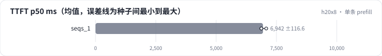

<!-- 本页由 python -m labkit docs 从 ../lesson.yaml 和 results/ 生成，不要手改 -->

[← 先估算](05-estimate.md) · [课程首页](../README.md) · [单条 decode →](07-tpot.md)

# 第 6 步 / 共 18 步：单条 prefill

> 阶段 3 / 7：**单条请求** · 场景：`seqs_1`

一次只跑一条（max_num_seqs 1，16 条依次处理）。这时 TTFT 就是单条 4096 token 的 prefill（加上一点调度开销），屋顶线下限 414 ms。

## 这一步跑了什么

| 场景 | 作用 | 说明 | 相对基线改了什么 | 种子（H20） |
| - | - | - | - | - |
| `seqs_1` | 本步 | 一次只跑一条（max_num_seqs 1，16 条）：TTFT 就是单条 prefill，TPOT 就是 batch=1 的 decode 一步 | `max_num_seqs=1`, `num_prompts=16` | 3 |

## 先预测

**实测 TTFT 是屋顶线下限的几倍？**

- **A.** 不到 1.2 倍
- **B.** 1.2 - 1.6 倍
- **C.** 1.6 - 2.5 倍
- **D.** 2.5 倍以上

> 先选定一个（记下来），再展开下面的实测。性能测量的种子只换内容文本和到达时间；吞吐差小于 5% 或小于种子间波动，都按“差不多”算。

## 实测

展开实测：H20 · vLLM 0.11 · Qwen2.5-7B-Instruct bf16 · 输入 4096 / 输出 50 token · 3 种子（每个运行 1 张卡）（已有 3 / 3 个运行）

| 场景 | 类型 | TTFT p50 ms | 屋顶线 ms | prefill MFU | TTFT p50 ms：各种子 | 断言 |
| - | - | - | - | - | - | - |
| `seqs_1` | 参照 | 6942 ± 117 | 414 ± 0 | 6% ± 0% | s0 6874 / s1 6875 / s2 7076 | 通过 |

运行目录（每个目录里有 `summary.json` 指标、`evidence.json` 证据摘要、`predictions.jsonl` 逐条预测、`log.txt` 日志）：

- `seqs_1` [s0](../../../results/h20x8/L09/seqs_1/s0-c6d0e0/) · [s1](../../../results/h20x8/L09/seqs_1/s1-5faa10/) · [s2](../../../results/h20x8/L09/seqs_1/s2-d9c4e9/)

---

[← 先估算](05-estimate.md) · [课程首页](../README.md) · [单条 decode →](07-tpot.md)
