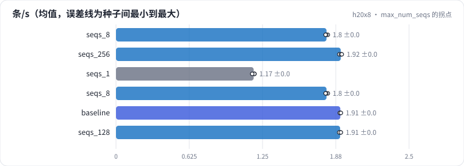

<!-- 本页由 python -m labkit docs 从 ../lesson.yaml 和 results/ 生成，不要手改 -->

[← 单条 decode](07-tpot.md) · [课程首页](../README.md) · [并发的代价 →](09-latency.md)

# 第 8 步 / 共 18 步：max_num_seqs 的拐点

> 阶段 4 / 7：**并发** · 场景：`seqs_256` `seqs_1` `seqs_8` `baseline` `seqs_128`（对照 `seqs_8`）

256 条请求同时到达，只改 max_num_seqs（同时在跑的请求上限）：1、8、32（基线）、128、256。decode 的权重读取会被同一步里的所有请求分摊，batch 越大 decode 越划算。

## 这一步跑了什么

| 场景 | 作用 | 说明 | 相对基线改了什么 | 种子（H20） |
| - | - | - | - | - |
| `seqs_8` | 对照 | max_num_seqs 8 | `max_num_seqs=8` | 3 |
| `seqs_256` | 本步 | max_num_seqs 256 | `max_num_seqs=256` | 3 |
| `seqs_1` | 本步 | 一次只跑一条（max_num_seqs 1，16 条依次发送，前一条完成再发下一条）：TTFT 就是单条 prefill，TPOT 就是 batch=1 的 decode 一步 | `max_num_seqs=1`, `num_prompts=16` | 3 |
| `seqs_8` | 本步 | max_num_seqs 8 | `max_num_seqs=8` | 3 |
| `baseline` | 本步 | 基线：7B bf16，256 条同时到达，max_num_seqs 32，每步 token 预算 8192，前缀缓存开（没有共享前缀） | — | 3 |
| `seqs_128` | 本步 | max_num_seqs 128 | `max_num_seqs=128` | 3 |

## 先预测

**max_num_seqs 从 8 加到 256，吞吐（条/s）变成几倍？**

- **A.** 不到 1.2 倍（基本不变）
- **B.** 1.2 - 2 倍
- **C.** 2 倍以上

> 先选定一个（记下来），再展开下面的实测。性能测量的种子只换内容文本和到达时间；吞吐差小于 5% 或小于种子间波动，都按“差不多”算。

## 实测

展开实测：H20 · vLLM 0.11 · Qwen2.5-7B-Instruct bf16 · 输入 4096 / 输出 50 token · 3 种子（每个运行 1 张卡）（已有 18 / 15 个运行）

| 场景 | 类型 | 条/s | 同时 decode 最多 | 等效 MFU | 条/s：与 `seqs_8` 差 | 条/s：各种子 | 断言 |
| - | - | - | - | - | - | - | - |
| `seqs_8` | 候选改动 | 1.80 ± 0.01 | 8 ± 0 | 75% ± 0% | — | s0 1.81 / s1 1.79 / s2 1.79 | 通过 |
| `seqs_256` | 候选改动 | 1.92 ± 0.01 | 98 ± 0 | 80% ± 0% | +0.12 | s0 1.91 / s1 1.92 / s2 1.93 | 通过 |
| `seqs_1` | 参照 | 1.17 ± 0.01 | 1 ± 0 | 49% ± 0% | -0.62 | s0 1.18 / s1 1.18 / s2 1.16 | 通过 |
| `seqs_8` | 候选改动 | 1.80 ± 0.01 | 8 ± 0 | 75% ± 0% | — | s0 1.81 / s1 1.79 / s2 1.79 | 通过 |
| `baseline` | 基线 | 1.91 ± 0.00 | 32 ± 0 | 80% ± 0% | +0.12 | s0 1.91 / s1 1.91 / s2 1.92 | 通过 |
| `seqs_128` | 候选改动 | 1.91 ± 0.01 | 98 ± 0 | 80% ± 0% | +0.12 | s0 1.91 / s1 1.90 / s2 1.92 | 通过 |

运行目录（每个目录里有 `summary.json` 指标、`evidence.json` 证据摘要、`predictions.jsonl` 逐条预测、`log.txt` 日志）：

- `seqs_8` [s0](../../../results/h20x8/L09/seqs_8/s0-0a0d90/) · [s1](../../../results/h20x8/L09/seqs_8/s1-f870e0/) · [s2](../../../results/h20x8/L09/seqs_8/s2-0e8630/)
- `seqs_256` [s0](../../../results/h20x8/L09/seqs_256/s0-769fd9/) · [s1](../../../results/h20x8/L09/seqs_256/s1-39c312/) · [s2](../../../results/h20x8/L09/seqs_256/s2-683846/)
- `seqs_1` [s0](../../../results/h20x8/L09/seqs_1/s0-c6d0e0/) · [s1](../../../results/h20x8/L09/seqs_1/s1-5faa10/) · [s2](../../../results/h20x8/L09/seqs_1/s2-d9c4e9/)
- `seqs_8` [s0](../../../results/h20x8/L09/seqs_8/s0-0a0d90/) · [s1](../../../results/h20x8/L09/seqs_8/s1-f870e0/) · [s2](../../../results/h20x8/L09/seqs_8/s2-0e8630/)
- `baseline` [s0](../../../results/h20x8/L09/baseline/s0-627ae3/) · [s1](../../../results/h20x8/L09/baseline/s1-000c30/) · [s2](../../../results/h20x8/L09/baseline/s2-288be9/)
- `seqs_128` [s0](../../../results/h20x8/L09/seqs_128/s0-6ac681/) · [s1](../../../results/h20x8/L09/seqs_128/s1-e597fb/) · [s2](../../../results/h20x8/L09/seqs_128/s2-9d1c7f/)

---

[← 单条 decode](07-tpot.md) · [课程首页](../README.md) · [并发的代价 →](09-latency.md)
