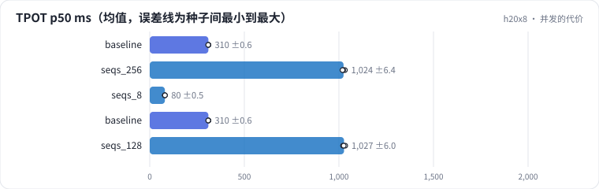

<!-- 本页由 python -m labkit docs 从 ../lesson.yaml 和 results/ 生成，不要手改 -->

[← max_num_seqs 的拐点](08-batch.md) · [课程首页](../README.md) · [KV 显存与并发上限 →](10-kv.md)

# 第 9 步 / 共 18 步：并发的代价

> 阶段 4 / 7：**并发** · 场景：`seqs_256` `seqs_8` `baseline` `seqs_128`（对照 `baseline`）

同一组运行，看延迟。max_num_seqs 越大，同时在 decode 的请求越多；而每一步里只要还有请求在等 prefill，就会塞进一块 prefill（每步 token 预算 8192）。

## 这一步跑了什么

| 场景 | 作用 | 说明 | 相对基线改了什么 | 种子（H20） |
| - | - | - | - | - |
| `baseline` | 对照 | 基线：7B bf16，256 条同时到达，max_num_seqs 32，每步 token 预算 8192，前缀缓存开（没有共享前缀） | — | 3 |
| `seqs_256` | 本步 | max_num_seqs 256 | `max_num_seqs=256` | 3 |
| `seqs_8` | 本步 | max_num_seqs 8 | `max_num_seqs=8` | 3 |
| `baseline` | 本步 | 基线：7B bf16，256 条同时到达，max_num_seqs 32，每步 token 预算 8192，前缀缓存开（没有共享前缀） | — | 3 |
| `seqs_128` | 本步 | max_num_seqs 128 | `max_num_seqs=128` | 3 |

## 先预测

**max_num_seqs 256 的 TPOT p50 是基线（32）的几倍？**

- **A.** 不到 1.5 倍
- **B.** 1.5 - 4 倍
- **C.** 4 倍以上

> 先选定一个（记下来），再展开下面的实测。性能测量的种子只换内容文本和到达时间；吞吐差小于 5% 或小于种子间波动，都按“差不多”算。

## 实测

展开实测：H20 · vLLM 0.11 · Qwen2.5-7B-Instruct bf16 · 输入 4096 / 输出 50 token · 3 种子（每个运行 1 张卡）（已有 15 / 12 个运行）

| 场景 | 类型 | TPOT p50 ms | TTFT p50 ms | 条/s | TPOT p50 ms：与 `baseline` 差 | TPOT p50 ms：各种子 | 断言 |
| - | - | - | - | - | - | - | - |
| `baseline` | 基线 | 310 ± 1 | 66,785 ± 238 | 1.91 ± 0.00 | — | s0 310 / s1 311 / s2 309 | 通过 |
| `seqs_256` | 候选改动 | 1024 ± 6 | 66,424 ± 436 | 1.92 ± 0.01 | +714 | s0 1032 / s1 1022 / s2 1019 | 通过 |
| `seqs_8` | 候选改动 | 80 ± 0 | 71,498 ± 317 | 1.80 ± 0.01 | -230 | s0 80 / s1 80 / s2 80 | 通过 |
| `baseline` | 基线 | 310 ± 1 | 66,785 ± 238 | 1.91 ± 0.00 | — | s0 310 / s1 311 / s2 309 | 通过 |
| `seqs_128` | 候选改动 | 1027 ± 6 | 66,510 ± 336 | 1.91 ± 0.01 | +717 | s0 1022 / s1 1034 / s2 1025 | 通过 |

运行目录（每个目录里有 `summary.json` 指标、`evidence.json` 证据摘要、`predictions.jsonl` 逐条预测、`log.txt` 日志）：

- `baseline` [s0](../../../results/h20x8/L09/baseline/s0-627ae3/) · [s1](../../../results/h20x8/L09/baseline/s1-000c30/) · [s2](../../../results/h20x8/L09/baseline/s2-288be9/)
- `seqs_256` [s0](../../../results/h20x8/L09/seqs_256/s0-769fd9/) · [s1](../../../results/h20x8/L09/seqs_256/s1-39c312/) · [s2](../../../results/h20x8/L09/seqs_256/s2-683846/)
- `seqs_8` [s0](../../../results/h20x8/L09/seqs_8/s0-0a0d90/) · [s1](../../../results/h20x8/L09/seqs_8/s1-f870e0/) · [s2](../../../results/h20x8/L09/seqs_8/s2-0e8630/)
- `baseline` [s0](../../../results/h20x8/L09/baseline/s0-627ae3/) · [s1](../../../results/h20x8/L09/baseline/s1-000c30/) · [s2](../../../results/h20x8/L09/baseline/s2-288be9/)
- `seqs_128` [s0](../../../results/h20x8/L09/seqs_128/s0-6ac681/) · [s1](../../../results/h20x8/L09/seqs_128/s1-e597fb/) · [s2](../../../results/h20x8/L09/seqs_128/s2-9d1c7f/)

---

[← max_num_seqs 的拐点](08-batch.md) · [课程首页](../README.md) · [KV 显存与并发上限 →](10-kv.md)
