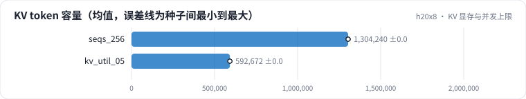

<!-- 本页由 python -m labkit docs 从 ../lesson.yaml 和 results/ 生成，不要手改 -->

[← 并发的代价](09-latency.md) · [课程首页](../README.md) · [前缀缓存 →](11-prefix.md)

# 第 10 步 / 共 18 步：KV 显存与并发上限

> 阶段 4 / 7：**并发** · 场景：`kv_util_05`（对照 `seqs_256`）

max_num_seqs 256 不变，把 gpu_memory_utilization 从 0.9 降到 0.5：权重 15.2 GB 和激活不变，KV cache 只剩约四成，4K 请求最多只能同时放一百多条。

## 这一步跑了什么

| 场景 | 作用 | 说明 | 相对基线改了什么 | 种子（H20） |
| - | - | - | - | - |
| `seqs_256` | 对照 | max_num_seqs 256 | `max_num_seqs=256` | 3 |
| `kv_util_05` | 本步 | max_num_seqs 256，gpu_memory_utilization 0.5（KV cache 只剩约四成） | `max_num_seqs=256`, `gpu_memory_utilization=0.5` | 3 |

## 先预测

**吞吐是 utilization 0.9 时（同样 max_num_seqs 256）的多少？**

- **A.** 不到 80%
- **B.** 80% - 110%（基本不变）
- **C.** 110% 以上

> 先选定一个（记下来），再展开下面的实测。性能测量的种子只换内容文本和到达时间；吞吐差小于 5% 或小于种子间波动，都按“差不多”算。

## 实测

展开实测：H20 · vLLM 0.11 · Qwen2.5-7B-Instruct bf16 · 输入 4096 / 输出 50 token · 3 种子（每个运行 1 张卡）（已有 6 / 6 个运行）

| 场景 | 类型 | KV token 容量 | 并发上限（引擎估） | 同时 decode 最多 | 条/s | 条/s：与 `seqs_256` 差 | 条/s：各种子 | 断言 |
| - | - | - | - | - | - | - | - | - |
| `seqs_256` | 候选改动 | 1,304,240 ± 0 | 314 ± 0 | 98 ± 0 | 1.92 ± 0.01 | — | s0 1.91 / s1 1.92 / s2 1.93 | 通过 |
| `kv_util_05` | 候选改动 | 592,672 ± 0 | 142 ± 0 | 98 ± 0 | 1.91 ± 0.01 | -0.00 | s0 1.91 / s1 1.90 / s2 1.92 | 通过 |

运行目录（每个目录里有 `summary.json` 指标、`evidence.json` 证据摘要、`predictions.jsonl` 逐条预测、`log.txt` 日志）：

- `seqs_256` [s0](../../../results/h20x8/L09/seqs_256/s0-769fd9/) · [s1](../../../results/h20x8/L09/seqs_256/s1-39c312/) · [s2](../../../results/h20x8/L09/seqs_256/s2-683846/)
- `kv_util_05` [s0](../../../results/h20x8/L09/kv_util_05/s0-8edf96/) · [s1](../../../results/h20x8/L09/kv_util_05/s1-36a07b/) · [s2](../../../results/h20x8/L09/kv_util_05/s2-83950f/)

---

[← 并发的代价](09-latency.md) · [课程首页](../README.md) · [前缀缓存 →](11-prefix.md)
