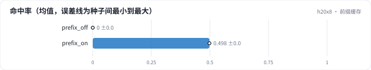

<!-- 本页由 python -m labkit docs 从 ../lesson.yaml 和 results/ 生成，不要手改 -->

[← KV 显存与并发上限](10-kv.md) · [课程首页](../README.md) · [每步 token 预算（chunked prefill） →](12-chunk.md)

# 第 11 步 / 共 18 步：前缀缓存

> 阶段 5 / 7：**省 FLOPs 还是省字节** · 场景：`prefix_on`（对照 `prefix_off`）

现在每条请求的前 2048 token 是所有请求共享的打标规范（后 2048 是各自的内容）。对比前缀缓存关和开。

## 这一步跑了什么

| 场景 | 作用 | 说明 | 相对基线改了什么 | 种子（H20） |
| - | - | - | - | - |
| `prefix_off` | 对照 | 前 2048 token 是所有请求共享的打标规范，前缀缓存关 | `shared_prefix=2048`, `enable_prefix_caching=False` | 3 |
| `prefix_on` | 本步 | 前 2048 token 共享，前缀缓存开 | `shared_prefix=2048` | 3 |

## 先预测

**开缓存后，吞吐是关缓存的几倍？**

- **A.** 不到 1.2 倍
- **B.** 1.2 - 1.6 倍
- **C.** 1.6 - 2.5 倍
- **D.** 2.5 倍以上

> 先选定一个（记下来），再展开下面的实测。性能测量的种子只换内容文本和到达时间；吞吐差小于 5% 或小于种子间波动，都按“差不多”算。

## 实测

展开实测：H20 · vLLM 0.11 · Qwen2.5-7B-Instruct bf16 · 输入 4096 / 输出 50 token · 3 种子（每个运行 1 张卡）（已有 6 / 6 个运行）

| 场景 | 类型 | 命中率 | 条/s | TTFT p50 ms | 条/s：与 `prefix_off` 差 | 条/s：各种子 | 断言 |
| - | - | - | - | - | - | - | - |
| `prefix_off` | 候选改动 | 0% ± 0% | 1.91 ± 0.01 | 66,977 ± 482 | — | s0 1.91 / s1 1.90 / s2 1.92 | 通过 |
| `prefix_on` | 候选改动 | 50% ± 0% | 3.56 ± 0.02 | 36,047 ± 282 | +1.65 | s0 3.55 / s1 3.58 / s2 3.54 | 通过 |

运行目录（每个目录里有 `summary.json` 指标、`evidence.json` 证据摘要、`predictions.jsonl` 逐条预测、`log.txt` 日志）：

- `prefix_off` [s0](../../../results/h20x8/L09/prefix_off/s0-b5cc6e/) · [s1](../../../results/h20x8/L09/prefix_off/s1-ad7752/) · [s2](../../../results/h20x8/L09/prefix_off/s2-d3d908/)
- `prefix_on` [s0](../../../results/h20x8/L09/prefix_on/s0-50552a/) · [s1](../../../results/h20x8/L09/prefix_on/s1-827fb2/) · [s2](../../../results/h20x8/L09/prefix_on/s2-bc8614/)

---

[← KV 显存与并发上限](10-kv.md) · [课程首页](../README.md) · [每步 token 预算（chunked prefill） →](12-chunk.md)
