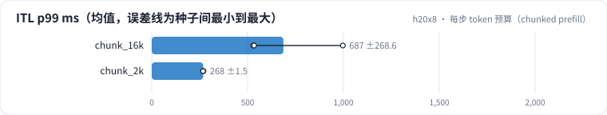

<!-- 本页由 python -m labkit docs 从 ../lesson.yaml 和 results/ 生成，不要手改 -->

[← 前缀缓存](11-prefix.md) · [课程首页](../README.md) · [FP8 →](13-fp8.md)

# 第 12 步 / 共 18 步：每步 token 预算（chunked prefill）

> 阶段 5 / 7：**省 FLOPs 还是省字节** · 场景：`chunk_2k`（对照 `chunk_16k`）

换成在线场景：请求按每秒 1 条随机到达（200 条），看用户体验。每步 token 预算 16384 时，一条 4096 的 prefill 一步做完，这一步正在 decode 的请求全都要等；预算 2048 时，prefill 被切成 2048 一块，和 decode 拼在一起分几步做。

## 这一步跑了什么

| 场景 | 作用 | 说明 | 相对基线改了什么 | 种子（H20） |
| - | - | - | - | - |
| `chunk_16k` | 对照 | 在线到达 1 条/s（200 条），每步 token 预算 16384：一条 4096 的 prefill 一步做完，正在 decode 的请求跟着等 | `request_rate=1.0`, `num_prompts=200`, `max_num_batched_tokens=16384` | 3 |
| `chunk_2k` | 本步 | 在线到达 1 条/s（200 条），每步 token 预算 2048：prefill 切成 2048 的块和 decode 拼在一起 | `request_rate=1.0`, `num_prompts=200`, `max_num_batched_tokens=2048` | 3 |

## 先预测

**预算从 16384 降到 2048，ITL p99（相邻两个输出之间最长的那批间隔）变成多少？**

- **A.** 不到原来的 60%
- **B.** 原来的 60% - 90%
- **C.** 90% 以上（差不多或更差）

> 先选定一个（记下来），再展开下面的实测。性能测量的种子只换内容文本和到达时间；吞吐差小于 5% 或小于种子间波动，都按“差不多”算。

## 实测

展开实测：H20 · vLLM 0.11 · Qwen2.5-7B-Instruct bf16 · 输入 4096 / 输出 50 token · 3 种子（每个运行 1 张卡）（已有 6 / 6 个运行）

| 场景 | 类型 | ITL p99 ms | ITL p50 ms | TTFT p50 ms | ITL p99 ms：与 `chunk_16k` 差 | ITL p99 ms：各种子 | 断言 |
| - | - | - | - | - | - | - | - |
| `chunk_16k` | 候选改动 | 687 ± 269 | 7.0 ± 0.0 | 648 ± 79 | — | s0 530 / s1 997 / s2 534 | 通过 |
| `chunk_2k` | 候选改动 | 268 ± 1 | 7.1 ± 0.2 | 849 ± 52 | -419 | s0 270 / s1 267 / s2 268 | 通过 |

运行目录（每个目录里有 `summary.json` 指标、`evidence.json` 证据摘要、`predictions.jsonl` 逐条预测、`log.txt` 日志）：

- `chunk_16k` [s0](../../../results/h20x8/L09/chunk_16k/s0-c4deac/) · [s1](../../../results/h20x8/L09/chunk_16k/s1-4fd653/) · [s2](../../../results/h20x8/L09/chunk_16k/s2-71640e/)
- `chunk_2k` [s0](../../../results/h20x8/L09/chunk_2k/s0-c75a44/) · [s1](../../../results/h20x8/L09/chunk_2k/s1-201f73/) · [s2](../../../results/h20x8/L09/chunk_2k/s2-85d382/)

---

[← 前缀缓存](11-prefix.md) · [课程首页](../README.md) · [FP8 →](13-fp8.md)
