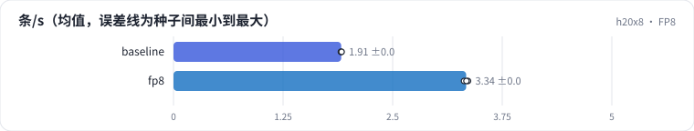

<!-- 本页由 python -m labkit docs 从 ../lesson.yaml 和 results/ 生成，不要手改 -->

[← 每步 token 预算（chunked prefill）](12-chunk.md) · [课程首页](../README.md) · [AWQ INT4 →](14-awq.md)

# 第 13 步 / 共 18 步：FP8

> 阶段 5 / 7：**省 FLOPs 还是省字节** · 场景：`fp8`（对照 `baseline`）

加载 bf16 权重后在线转成 FP8（W8A8：权重按通道、激活按 token 动态量化），矩阵乘走 H20 的 FP8 Tensor Core，标称算力 296 TFLOPS，是 bf16 的 2 倍；权重字节也减半。

## 这一步跑了什么

| 场景 | 作用 | 说明 | 相对基线改了什么 | 种子（H20） |
| - | - | - | - | - |
| `baseline` | 对照 | 基线：7B bf16，256 条同时到达，max_num_seqs 32，每步 token 预算 8192，前缀缓存开（没有共享前缀） | — | 3 |
| `fp8` | 本步 | FP8 W8A8（在线量化） | `quantization=fp8` | 3 |

## 先预测

**吞吐是 bf16 基线的几倍？**

- **A.** 不到 1.15 倍
- **B.** 1.15 - 1.6 倍
- **C.** 1.6 - 2.2 倍
- **D.** 2.2 倍以上

> 先选定一个（记下来），再展开下面的实测。性能测量的种子只换内容文本和到达时间；吞吐差小于 5% 或小于种子间波动，都按“差不多”算。

## 实测

展开实测：H20 · vLLM 0.11 · Qwen2.5-7B-Instruct bf16 · 输入 4096 / 输出 50 token · 3 种子（每个运行 1 张卡）（已有 6 / 6 个运行）

| 场景 | 类型 | 条/s | KV token 容量 | TTFT p50 ms | 条/s：与 `baseline` 差 | 条/s：各种子 | 断言 |
| - | - | - | - | - | - | - | - |
| `baseline` | 基线 | 1.91 ± 0.00 | 1,309,728 ± 0 | 66,785 ± 238 | — | s0 1.91 / s1 1.91 / s2 1.92 | 通过 |
| `fp8` | 候选改动 | 3.34 ± 0.02 | 1,428,645 ± 628 | 37,934 ± 237 | +1.43 | s0 3.36 / s1 3.31 / s2 3.34 | 通过 |

运行目录（每个目录里有 `summary.json` 指标、`evidence.json` 证据摘要、`predictions.jsonl` 逐条预测、`log.txt` 日志）：

- `baseline` [s0](../../../results/h20x8/L09/baseline/s0-627ae3/) · [s1](../../../results/h20x8/L09/baseline/s1-000c30/) · [s2](../../../results/h20x8/L09/baseline/s2-288be9/)
- `fp8` [s0](../../../results/h20x8/L09/fp8/s0-48f08d/) · [s1](../../../results/h20x8/L09/fp8/s1-8875ae/) · [s2](../../../results/h20x8/L09/fp8/s2-376c9a/)

---

[← 每步 token 预算（chunked prefill）](12-chunk.md) · [课程首页](../README.md) · [AWQ INT4 →](14-awq.md)
