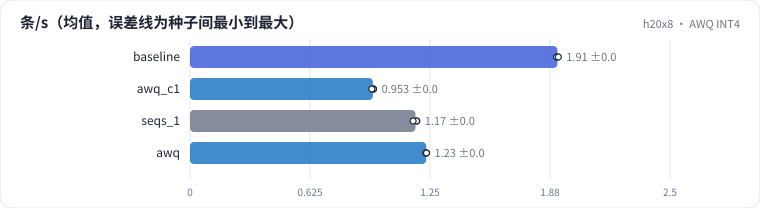

<!-- 本页由 python -m labkit docs 从 ../lesson.yaml 和 results/ 生成，不要手改 -->

[← FP8](13-fp8.md) · [课程首页](../README.md) · [投机解码 →](15-spec.md)

# 第 14 步 / 共 18 步：AWQ INT4

> 阶段 5 / 7：**省 FLOPs 还是省字节** · 场景：`awq`（对照 `baseline`）

换成官方的 AWQ 版（权重 INT4，激活仍是 16 位，W4A16），vLLM 用 awq_marlin kernel：矩阵乘时把 INT4 权重在片上解包成 16 位再算。权重从 15.2 GB 降到约 4 GB，但计算仍是 16 位 Tensor Core。

## 这一步跑了什么

| 场景 | 作用 | 说明 | 相对基线改了什么 | 种子（H20） |
| - | - | - | - | - |
| `baseline` | 对照 | 基线：7B bf16，256 条同时到达，max_num_seqs 32，每步 token 预算 8192，前缀缓存开（没有共享前缀） | — | 3 |
| `awq_c1` | 参照 | AWQ INT4，一次只跑一条（max_num_seqs 1，16 条） | `model=qwen2.5-7b-awq`, `max_num_seqs=1`, `num_prompts=16` | 3 |
| `seqs_1` | 参照 | 一次只跑一条（max_num_seqs 1，16 条）：TTFT 就是单条 prefill，TPOT 就是 batch=1 的 decode 一步 | `max_num_seqs=1`, `num_prompts=16` | 3 |
| `awq` | 本步 | AWQ INT4 权重（W4A16，awq_marlin） | `model=qwen2.5-7b-awq` | 3 |

## 先预测

**同样 256 条、max_num_seqs 32，吞吐是 bf16 基线的几倍？**

- **A.** 不到 0.9 倍（变慢）
- **B.** 0.9 - 1.15 倍（差不多）
- **C.** 1.15 倍以上（变快）

> 先选定一个（记下来），再展开下面的实测。性能测量的种子只换内容文本和到达时间；吞吐差小于 5% 或小于种子间波动，都按“差不多”算。

## 实测

展开实测：H20 · vLLM 0.11 · Qwen2.5-7B-Instruct bf16 · 输入 4096 / 输出 50 token · 3 种子（每个运行 1 张卡）（已有 12 / 12 个运行）

| 场景 | 类型 | 条/s | TPOT p50 ms | TTFT p50 ms | 条/s：与 `baseline` 差 | 条/s：各种子 | 断言 |
| - | - | - | - | - | - | - | - |
| `baseline` | 基线 | 1.91 ± 0.00 | 310.00 ± 0.62 | 66,785 ± 238 | — | s0 1.91 / s1 1.91 / s2 1.92 | 通过 |
| `awq_c1` | 候选改动 | 0.95 ± 0.00 | 5.22 ± 0.02 | 8,659 ± 54 | -0.96 | s0 0.96 / s1 0.95 / s2 0.95 | 通过 |
| `seqs_1` | 参照 | 1.17 ± 0.01 | 6.73 ± 0.07 | 6,942 ± 117 | -0.74 | s0 1.18 / s1 1.18 / s2 1.16 | 通过 |
| `awq` | 候选改动 | 1.23 ± 0.00 | 481.85 ± 0.90 | 103,988 ± 211 | -0.68 | s0 1.23 / s1 1.23 / s2 1.23 | 通过 |

运行目录（每个目录里有 `summary.json` 指标、`evidence.json` 证据摘要、`predictions.jsonl` 逐条预测、`log.txt` 日志）：

- `baseline` [s0](../../../results/h20x8/L09/baseline/s0-627ae3/) · [s1](../../../results/h20x8/L09/baseline/s1-000c30/) · [s2](../../../results/h20x8/L09/baseline/s2-288be9/)
- `awq_c1` [s0](../../../results/h20x8/L09/awq_c1/s0-0c810e/) · [s1](../../../results/h20x8/L09/awq_c1/s1-b550ab/) · [s2](../../../results/h20x8/L09/awq_c1/s2-a39ffb/)
- `seqs_1` [s0](../../../results/h20x8/L09/seqs_1/s0-c6d0e0/) · [s1](../../../results/h20x8/L09/seqs_1/s1-5faa10/) · [s2](../../../results/h20x8/L09/seqs_1/s2-d9c4e9/)
- `awq` [s0](../../../results/h20x8/L09/awq/s0-b93bf1/) · [s1](../../../results/h20x8/L09/awq/s1-8e4f2e/) · [s2](../../../results/h20x8/L09/awq/s2-463705/)

---

[← FP8](13-fp8.md) · [课程首页](../README.md) · [投机解码 →](15-spec.md)
