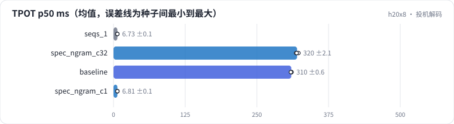

<!-- 本页由 python -m labkit docs 从 ../lesson.yaml 和 results/ 生成，不要手改 -->

[← AWQ INT4](14-awq.md) · [课程首页](../README.md) · [规范挪到内容后面 →](16-fault.md)

# 第 15 步 / 共 18 步：投机解码

> 阶段 5 / 7：**省 FLOPs 还是省字节** · 场景：`spec_ngram_c1`（对照 `seqs_1`）

n-gram 投机（不需要草稿模型）：用最近生成的几个 token 去输入里找相同的片段，把它后面的 4 个 token 当草稿，目标模型一步验证 5 个位置。打标输出的 JSON 会原文摘录内容里的卖点和优惠，看起来草稿应该常能对上。先看一次只跑一条（16 条）。

## 这一步跑了什么

| 场景 | 作用 | 说明 | 相对基线改了什么 | 种子（H20） |
| - | - | - | - | - |
| `seqs_1` | 对照 | 一次只跑一条（max_num_seqs 1，16 条依次发送，前一条完成再发下一条）：TTFT 就是单条 prefill，TPOT 就是 batch=1 的 decode 一步 | `max_num_seqs=1`, `num_prompts=16` | 3 |
| `spec_ngram_c32` | 参照 | n-gram 投机（k=4），max_num_seqs 32（256 条） | `spec=ngram` | 3 |
| `baseline` | 参照 | 基线：7B bf16，256 条同时到达，max_num_seqs 32，每步 token 预算 8192，前缀缓存开（没有共享前缀） | — | 3 |
| `spec_ngram_c1` | 本步 | n-gram 投机（k=4），一次只跑一条（16 条） | `spec=ngram`, `max_num_seqs=1`, `num_prompts=16` | 3 |

## 先预测

**TPOT 变成不投机时的多少？**

- **A.** 不到 60%（快很多）
- **B.** 60% - 90%
- **C.** 90% - 110%（差不多）
- **D.** 110% 以上（变慢）

> 先选定一个（记下来），再展开下面的实测。性能测量的种子只换内容文本和到达时间；吞吐差小于 5% 或小于种子间波动，都按“差不多”算。

## 实测

展开实测：H20 · vLLM 0.11 · Qwen2.5-7B-Instruct bf16 · 输入 4096 / 输出 50 token · 3 种子（每个运行 1 张卡）（已有 12 / 12 个运行）

| 场景 | 类型 | TPOT p50 ms | 平均接受长度 | 条/s | TPOT p50 ms：与 `seqs_1` 差 | TPOT p50 ms：各种子 | 断言 |
| - | - | - | - | - | - | - | - |
| `seqs_1` | 参照 | 6.73 ± 0.07 | — | 1.17 ± 0.01 | — | s0 6.70 / s1 6.67 / s2 6.81 | 通过 |
| `spec_ngram_c32` | 候选改动 | 320.12 ± 2.14 | 2.22 ± 0.04 | 1.89 ± 0.02 | +313.39 | s0 322.54 / s1 318.48 / s2 319.34 | 通过 |
| `baseline` | 基线 | 310.00 ± 0.62 | — | 1.91 ± 0.00 | +303.27 | s0 310.15 / s1 310.53 / s2 309.31 | 通过 |
| `spec_ngram_c1` | 候选改动 | 6.81 ± 0.09 | 2.41 ± 0.08 | 1.17 ± 0.04 | +0.08 | s0 6.91 / s1 6.75 / s2 6.76 | 通过 |

运行目录（每个目录里有 `summary.json` 指标、`evidence.json` 证据摘要、`predictions.jsonl` 逐条预测、`log.txt` 日志）：

- `seqs_1` [s0](../../../results/h20x8/L09/seqs_1/s0-c6d0e0/) · [s1](../../../results/h20x8/L09/seqs_1/s1-5faa10/) · [s2](../../../results/h20x8/L09/seqs_1/s2-d9c4e9/)
- `spec_ngram_c32` [s0](../../../results/h20x8/L09/spec_ngram_c32/s0-de219b/) · [s1](../../../results/h20x8/L09/spec_ngram_c32/s1-24079b/) · [s2](../../../results/h20x8/L09/spec_ngram_c32/s2-9b256c/)
- `baseline` [s0](../../../results/h20x8/L09/baseline/s0-627ae3/) · [s1](../../../results/h20x8/L09/baseline/s1-000c30/) · [s2](../../../results/h20x8/L09/baseline/s2-288be9/)
- `spec_ngram_c1` [s0](../../../results/h20x8/L09/spec_ngram_c1/s0-b957ed/) · [s1](../../../results/h20x8/L09/spec_ngram_c1/s1-8fb25a/) · [s2](../../../results/h20x8/L09/spec_ngram_c1/s2-387650/)

---

[← AWQ INT4](14-awq.md) · [课程首页](../README.md) · [规范挪到内容后面 →](16-fault.md)
