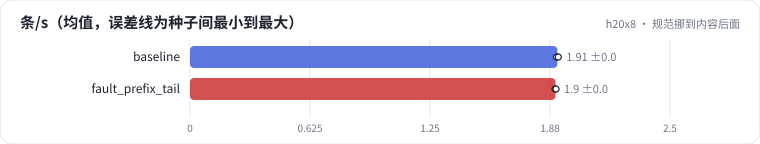

<!-- 本页由 python -m labkit docs 从 ../lesson.yaml 和 results/ 生成，不要手改 -->

[← 投机解码](15-spec.md) · [课程首页](../README.md) · [诊断：缓存为什么没命中 →](17-diagnose.md)

# 第 16 步 / 共 18 步：规范挪到内容后面

> 阶段 6 / 7：**故障** · 场景：`fault_prefix_tail`（对照 `baseline`）

业务方把 prompt 改了：3072 token 的打标规范从开头挪到了内容后面（理由是"让模型最后看到指令，效果更好"），内容缩到 1000 token 左右，总长还是 4096。前缀缓存开着，配置一个字没动。按理说规范占了四分之三，缓存能省很多。

## 这一步跑了什么

| 场景 | 作用 | 说明 | 相对基线改了什么 | 种子（H20） |
| - | - | - | - | - |
| `baseline` | 对照 | 基线：7B bf16，256 条同时到达，max_num_seqs 32，每步 token 预算 8192，前缀缓存开（没有共享前缀） | — | 3 |
| `fault_prefix_tail` | 本步 | 故障：3072 token 的打标规范放在内容后面（前缀缓存开着，但每条请求的开头都不同） | `shared_prefix=3072`, `prefix_position=tail` | 3 |

## 先预测

**吞吐是基线（没有共享部分）的几倍？**

- **A.** 不到 0.85 倍
- **B.** 0.85 - 1.15 倍（差不多）
- **C.** 1.15 - 2 倍
- **D.** 2 倍以上

> 先选定一个（记下来），再展开下面的实测。性能测量的种子只换内容文本和到达时间；吞吐差小于 5% 或小于种子间波动，都按“差不多”算。

## 实测

展开实测：H20 · vLLM 0.11 · Qwen2.5-7B-Instruct bf16 · 输入 4096 / 输出 50 token · 3 种子（每个运行 1 张卡）（已有 6 / 6 个运行）

| 场景 | 类型 | 条/s | 命中率 | TTFT p50 ms | 条/s：与 `baseline` 差 | 条/s：各种子 | 断言 |
| - | - | - | - | - | - | - | - |
| `baseline` | 基线 | 1.91 ± 0.00 | 0.0% ± 0.0% | 66,785 ± 238 | — | s0 1.91 / s1 1.91 / s2 1.92 | 通过 |
| `fault_prefix_tail` | 教学故障 | 1.90 ± 0.00 | 0.0% ± 0.0% | 67,233 ± 221 | -0.01 | s0 1.90 / s1 1.90 / s2 1.91 | 通过 |

运行目录（每个目录里有 `summary.json` 指标、`evidence.json` 证据摘要、`predictions.jsonl` 逐条预测、`log.txt` 日志）：

- `baseline` [s0](../../../results/h20x8/L09/baseline/s0-627ae3/) · [s1](../../../results/h20x8/L09/baseline/s1-000c30/) · [s2](../../../results/h20x8/L09/baseline/s2-288be9/)
- `fault_prefix_tail` [s0](../../../results/h20x8/L09/fault_prefix_tail/s0-7f0d04/) · [s1](../../../results/h20x8/L09/fault_prefix_tail/s1-137557/) · [s2](../../../results/h20x8/L09/fault_prefix_tail/s2-1ed01f/)

---

[← 投机解码](15-spec.md) · [课程首页](../README.md) · [诊断：缓存为什么没命中 →](17-diagnose.md)
