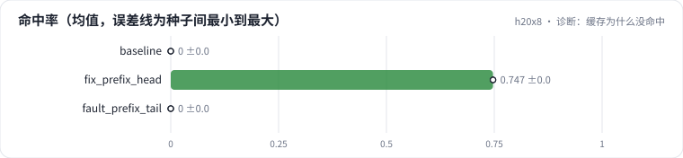

<!-- 本页由 python -m labkit docs 从 ../lesson.yaml 和 results/ 生成，不要手改 -->

[← 规范挪到内容后面](16-fault.md) · [课程首页](../README.md) · [回顾 →](18-keycard.md)

# 第 17 步 / 共 18 步：诊断：缓存为什么没命中

> 阶段 6 / 7：**故障** · 场景：`fault_prefix_tail`（对照 `baseline`）

引擎配置没变，只改了 prompt 的拼法。按需逐级点开线索，然后点选根因。

## 这一步跑了什么

| 场景 | 作用 | 说明 | 相对基线改了什么 | 种子（H20） |
| - | - | - | - | - |
| `baseline` | 对照 | 基线：7B bf16，256 条同时到达，max_num_seqs 32，每步 token 预算 8192，前缀缓存开（没有共享前缀） | — | 3 |
| `fix_prefix_head` | 参照 | 修复：同样 3072 token 的规范放回开头 | `shared_prefix=3072`, `prefix_position=head` | 3 |
| `fault_prefix_tail` | 本步 | 故障：3072 token 的打标规范放在内容后面（前缀缓存开着，但每条请求的开头都不同） | `shared_prefix=3072`, `prefix_position=tail` | 3 |

## 线索

逐条展开，看到能下判断为止。

线索 1

前缀命中率：0.0% ± 0.0%（引擎配置里 enable_prefix_caching = true）；TTFT p50 67,233 ± 221 ms（基线 66,785 ± 238 ms）。

线索 2

追踪：前两条请求开头相同的 token 数 3 ± 0；KV 块大小 16 token。

线索 3

KV 容量 1,310,453 ± 628 token；max_num_seqs 32 ± 0，和基线相同。

## 先预测

**根因是什么？**

- **A.** 前缀缓存没有开
- **B.** 共享的规范放在内容后面，每条请求的开头都不同，按块哈希的前缀匹配不上
- **C.** KV cache 太小，缓存的块很快被挤掉
- **D.** max_num_seqs 太小，请求之间没有重叠

> 先选定一个（记下来），再展开下面的实测。性能测量的种子只换内容文本和到达时间；吞吐差小于 5% 或小于种子间波动，都按“差不多”算。

## 实测

展开实测：H20 · vLLM 0.11 · Qwen2.5-7B-Instruct bf16 · 输入 4096 / 输出 50 token · 3 种子（每个运行 1 张卡）（已有 9 / 9 个运行）

| 场景 | 类型 | 命中率 | 条/s | TTFT p50 ms | 命中率：与 `baseline` 差 | 命中率：各种子 | 断言 |
| - | - | - | - | - | - | - | - |
| `baseline` | 基线 | 0.0% ± 0.0% | 1.91 ± 0.00 | 66,785 ± 238 | — | s0 0.0% / s1 0.0% / s2 0.0% | 通过 |
| `fix_prefix_head` | 修复 | 74.7% ± 0.0% | 6.48 ± 0.03 | 19,688 ± 72 | +74.7% | s0 74.7% / s1 74.7% / s2 74.7% | 通过 |
| `fault_prefix_tail` | 教学故障 | 0.0% ± 0.0% | 1.90 ± 0.00 | 67,233 ± 221 | +0.0% | s0 0.0% / s1 0.0% / s2 0.0% | 通过 |

运行目录（每个目录里有 `summary.json` 指标、`evidence.json` 证据摘要、`predictions.jsonl` 逐条预测、`log.txt` 日志）：

- `baseline` [s0](../../../results/h20x8/L09/baseline/s0-627ae3/) · [s1](../../../results/h20x8/L09/baseline/s1-000c30/) · [s2](../../../results/h20x8/L09/baseline/s2-288be9/)
- `fix_prefix_head` [s0](../../../results/h20x8/L09/fix_prefix_head/s0-8bd5be/) · [s1](../../../results/h20x8/L09/fix_prefix_head/s1-e2acc0/) · [s2](../../../results/h20x8/L09/fix_prefix_head/s2-8facb0/)
- `fault_prefix_tail` [s0](../../../results/h20x8/L09/fault_prefix_tail/s0-7f0d04/) · [s1](../../../results/h20x8/L09/fault_prefix_tail/s1-137557/) · [s2](../../../results/h20x8/L09/fault_prefix_tail/s2-1ed01f/)

---

[← 规范挪到内容后面](16-fault.md) · [课程首页](../README.md) · [回顾 →](18-keycard.md)
