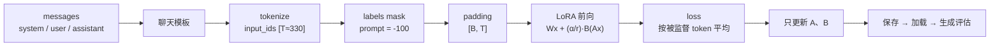
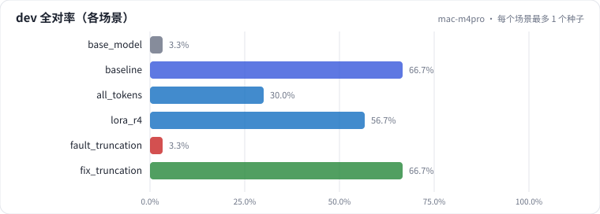
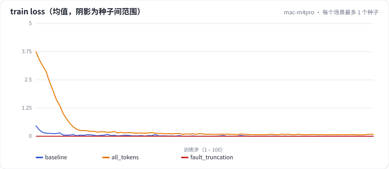
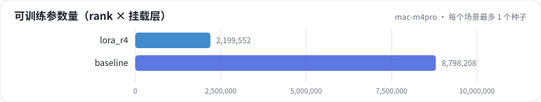
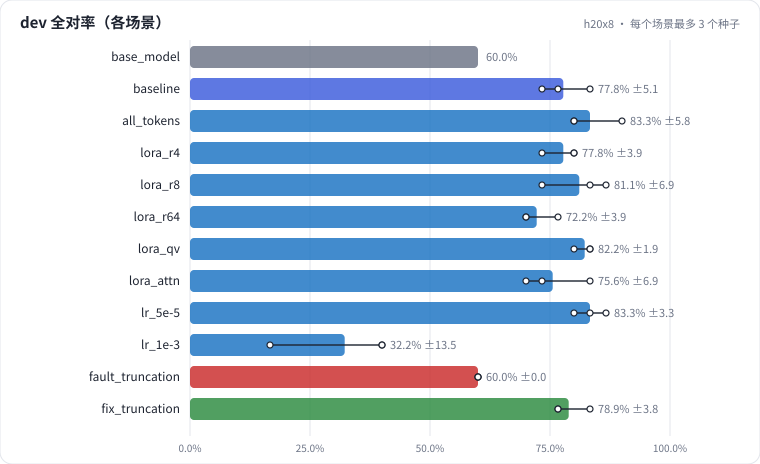
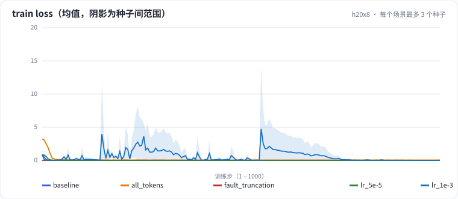
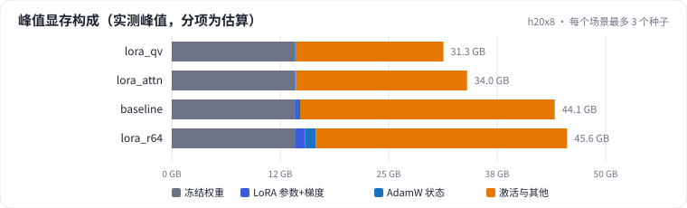
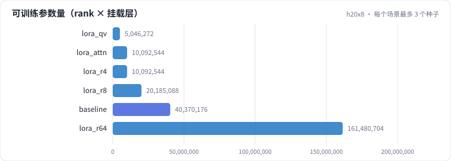

# L05 SFT 与 LoRA：广告元素抽取（课程编号 L1）

在 Qwen2.5-7B 上用 LoRA 做广告元素抽取 SFT。先看清一条样本从 messages 到 labels mask 到 loss 的全过程，再按"基础模型 → SFT → rank → 挂载层 → 成本 → 学习率 → 监督口径 → 截断故障"的顺序逐个看预先跑好的结果。

> **怎么学（只看 GitHub 就够）**：从 [第 1 步](steps/01-pain.md) 开始，每页底部都有"下一步"。每一步先读问题、自己选定一个答案，再展开"实测"折叠块对照。实测是 8 × H20 上预先跑好的结果（Qwen2.5-7B、每个场景 3 个种子）；H20 结果还没推回时，页面先显示 Mac 小规模历史结果作对照，并明确标注。H20 正在跑什么、跑到哪了，看 [作业看板](../../jobs/README.md)。

- **项目代码**：[`projects/adextract/`](../../projects/adextract/)（合成数据 `synth.py` → 编码 `data.py` → 模型 `modeling.py` → 训练 `train.py` → 推理 `infer.py` → 评测 `schema.py`，入口 `experiment.py`）
- **场景清单**：[`scenarios.yaml`](scenarios.yaml)（每个场景相对基线改了什么、断言）；**讲义源**：[`lesson.yaml`](lesson.yaml)（`steps/` 由它和结果自动生成）
- **前置**：causal LM 的 next-token loss；LoRA 的 \(y = Wx + \frac{\alpha}{r} BAx\)

## 步骤

<!-- labkit:path -->
| # | 阶段 | 步骤 | 这一步回答的问题 | 场景 | H20 结果 |
| - | - | - | - | - | - |
| 1 | 理解任务 | [场景与痛点](steps/01-pain.md) | 7B 上做结构化抽取，为什么用 LoRA？它带来哪三个问题？ | — | — |
| 2 | 理解任务 | [流程结构](steps/02-flow.md) | 一条样本从 messages 到参数更新经过哪几步？每步的张量形状？ | — | — |
| 3 | 先估算 | [先估算](steps/03-estimate.md) | 可训练参数、全参显存、被监督 token 占比各是多少？ | — | — |
| 4 | 看清内部 | [追踪一条样本](steps/04-trace.md) | `<\|im_end\|>` 被监督了吗？logits 第二维为什么只有几十？ | — | — |
| 5 | 看清内部 | [代码导读](steps/05-code.md) | 关键代码在哪几行？ | — | — |
| 6 | 逐个揭晓 | [基础模型（不训练）](steps/06-base-model.md) | 零样本的 7B Instruct 模型，dev 全对率（所有字段都对）大约多少？ | `base_model` | 1 / 1 |
| 7 | 逐个揭晓 | [LoRA SFT 基线](steps/07-sft.md) | 和基础模型相比，SFT 后 dev 全对率（3 种子均值）提升多少？ | `baseline` | 3 / 3 |
| 8 | 逐个揭晓 | [LoRA rank：4 / 8 / 16 / 64](steps/08-rank.md) | r 从 16 提到 64（可训练参数 ×4），dev 全对率（3 种子均值）会怎样？ | `lora_r4` `lora_r8` `lora_r64` | 9 / 9 |
| 9 | 逐个揭晓 | [挂载层：q,v / 注意力 / 注意力 + MLP](steps/09-target.md) | 只挂 q,v（可训练参数约为基线的 1/8），dev 全对率（3 种子均值）相比 7 类全挂会怎样？ | `lora_qv` `lora_attn` | 6 / 6 |
| 10 | 逐个揭晓 | [成本：显存与吞吐](steps/10-cost.md) | r=64（可训练参数从约 4000 万到约 1.6 亿）比 r=16 峰值显存多多少？ | `lora_r64` `lora_qv` `lora_attn` | 9 / 9 |
| 11 | 逐个揭晓 | [学习率：5e-5 / 2e-4 / 1e-3](steps/11-lr.md) | 学习率 2e-4 → 1e-3（5 倍），dev 全对率（3 种子均值）会怎样？ | `lr_5e-5` `lr_1e-3` | 6 / 6 |
| 12 | 逐个揭晓 | [监督口径：整段都算 loss](steps/12-supervision.md) | 整段对话都算 loss，dev 全对率（3 种子均值）会怎样？ | `all_tokens` | 3 / 3 |
| 13 | 逐个揭晓 | [截断故障：max_len=256](steps/13-fault.md) | 这个配置下，dev 全对率会接近谁？ | `fault_truncation` | 3 / 3 |
| 14 | 诊断故障 | [诊断故障](steps/14-diagnose.md) | 根因是什么？ | `fix_truncation` | 3 / 3 |
| 15 | 回顾 | [回顾：全部场景一览](steps/15-review.md) | 全部场景一张表；自查能不能讲清每个结论的"为什么" | — | — |
<!-- /labkit:path -->

## 任务

从广告文案中抽取商品品类、卖点、优惠及其适用条件，输出结构化 JSON。原文没写的信息必须为空，不能编造。

| 输入 | 期望输出 |
| - | - |
| 跑鞋轻量透气，第二件半价，指定款参加 | `{"category":"跑鞋","selling_points":["轻量","透气"],"promotions":[{"offer":"第二件半价","condition":"指定款"}]}` |

训练集是模板生成的合成数据（H20 4000 条 / Mac 历史 400 条），dev、test 各 30 条人工撰写。主指标是 dev **全对率**（所有字段都对）；dev 一条样本 = 3.3 个百分点。详见 [第 1 步](steps/01-pain.md)。

## 流程结构

每一环的张量形状和对应代码见 [第 2 步](steps/02-flow.md)、[第 5 步](steps/05-code.md)。

每个运行目录里的 `evidence.json` 是证据摘要（loss 曲线、显存峰值与构成、吞吐、可训练参数），网页交互图和下方静态图都读它。

## 关键代码

<!-- labkit:code -->
| 代码段 | 位置 |
| - | - |
| `encode` | [projects/adextract/data.py#L57](../../projects/adextract/data.py#L57) |
| `collate` | [projects/adextract/data.py#L88](../../projects/adextract/data.py#L88) |
| `generate` | [projects/adextract/infer.py#L13](../../projects/adextract/infer.py#L13) |
| `lora` | [projects/adextract/modeling.py#L56](../../projects/adextract/modeling.py#L56) |
| `messages` | [projects/adextract/prompts.py#L29](../../projects/adextract/prompts.py#L29) |
| `score_one` | [projects/adextract/schema.py#L82](../../projects/adextract/schema.py#L82) |
| `aggregate` | [projects/adextract/schema.py#L137](../../projects/adextract/schema.py#L137) |
| `make_ad` | [projects/adextract/synth.py#L85](../../projects/adextract/synth.py#L85) |
| `generate` | [projects/adextract/synth.py#L134](../../projects/adextract/synth.py#L134) |
| `loss` | [projects/adextract/train.py#L14](../../projects/adextract/train.py#L14) |
| `train_loop` | [projects/adextract/train.py#L72](../../projects/adextract/train.py#L72) |
<!-- /labkit:code -->

## 场景与结果

- **h20x8**：Qwen2.5-7B-Instruct（bf16），4000 条训练样本，每个场景 3 个种子，单卡一个运行。
- **mac-m4pro**（历史）：Qwen2.5-0.5B-Instruct，400 条训练样本，1 个种子。7B 和 0.5B 用同一套 tokenizer，prompt 长度相同，截断故障在两档上同样出现（由断言 `supervised_tokens_total == 0` 自动确认）。
- **mac-smoke**：只验证流程能跑通，不进表。

<!-- labkit:results -->

展开结果（先自己预测，再看）

**mac-m4pro**：Apple M4 Pro（MPS），Qwen2.5-0.5B-Instruct，400 条合成训练样本。课程原始数字的来源（已有 6 / 6 个运行）

| 场景 | 类型 | dev 全对率 | dev 格式合法率 | 合成验证全对率 | 断言 |
| - | - | - | - | - | - |
| `base_model` | 参照 | 0.0333 | 1.0000 | 0.0333 |  |
| `baseline` | 基线 | 0.6667 | 1.0000 | 0.9500 | 通过 |
| `all_tokens` | 候选改动 | 0.3000 | 1.0000 | 0.7667 |  |
| `lora_r4` | 候选改动 | 0.5667 | 1.0000 | 0.7667 |  |
| `fault_truncation` | 教学故障 | 0.0333 | 1.0000 | 0.0333 | 通过 |
| `fix_truncation` | 修复 | 0.6667 | 1.0000 | 0.9500 | 通过 |

**h20x8**：8 × NVIDIA H20，Qwen2.5-7B-Instruct（bf16），4000 条合成训练样本，每个场景 3 个种子（已有 34 / 34 个运行）

| 场景 | 类型 | dev 全对率 | dev 格式合法率 | 合成验证全对率 | 断言 |
| - | - | - | - | - | - |
| `base_model` | 参照 | 0.6000 | 1.0000 | 0.6333 |  |
| `baseline` | 基线 | 0.7778 ± 0.0509 (n=3) | 1.0000 ± 0.0000 (n=3) | 1.0000 ± 0.0000 (n=3) | 通过 |
| `all_tokens` | 候选改动 | 0.8333 ± 0.0577 (n=3) | 1.0000 ± 0.0000 (n=3) | 1.0000 ± 0.0000 (n=3) |  |
| `lora_r4` | 候选改动 | 0.7778 ± 0.0385 (n=3) | 1.0000 ± 0.0000 (n=3) | 1.0000 ± 0.0000 (n=3) |  |
| `lora_r8` | 候选改动 | 0.8111 ± 0.0694 (n=3) | 1.0000 ± 0.0000 (n=3) | 1.0000 ± 0.0000 (n=3) | 通过 |
| `lora_r64` | 候选改动 | 0.7222 ± 0.0385 (n=3) | 1.0000 ± 0.0000 (n=3) | 0.9833 ± 0.0289 (n=3) | 通过 |
| `lora_qv` | 候选改动 | 0.8222 ± 0.0192 (n=3) | 1.0000 ± 0.0000 (n=3) | 1.0000 ± 0.0000 (n=3) | 通过 |
| `lora_attn` | 候选改动 | 0.7555 ± 0.0694 (n=3) | 1.0000 ± 0.0000 (n=3) | 1.0000 ± 0.0000 (n=3) | 通过 |
| `lr_5e-5` | 候选改动 | 0.8333 ± 0.0334 (n=3) | 1.0000 ± 0.0000 (n=3) | 1.0000 ± 0.0000 (n=3) |  |
| `lr_1e-3` | 候选改动 | 0.3222 ± 0.1347 (n=3) | 0.9667 ± 0.0577 (n=3) | 0.9222 ± 0.1058 (n=3) |  |
| `fault_truncation` | 教学故障 | 0.6000 ± 0.0000 (n=3) | 1.0000 ± 0.0000 (n=3) | 0.6333 ± 0.0000 (n=3) | 通过 |
| `fix_truncation` | 修复 | 0.7889 ± 0.0385 (n=3) | 1.0000 ± 0.0000 (n=3) | 1.0000 ± 0.0000 (n=3) | 通过 |

<!-- /labkit:results -->

## 证据图

<!-- labkit:figures -->

展开证据图（先自己预测，再看）

- **mac-m4pro**：[主指标](figures/mac-m4pro-metrics.svg)、[train loss 曲线](figures/mac-m4pro-loss.svg)、[可训练参数量](figures/mac-m4pro-params.svg)

  

  

  
- **h20x8**：[主指标](figures/h20x8-metrics.svg)、[train loss 曲线](figures/h20x8-loss.svg)、[峰值显存构成](figures/h20x8-memory.svg)、[可训练参数量](figures/h20x8-params.svg)

  

  

  

  

<!-- /labkit:figures -->
