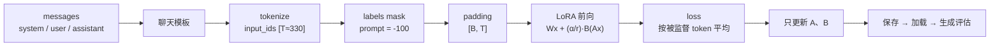

# L05 SFT 与 LoRA：广告元素抽取（课程编号 L1）

在 Qwen2.5-7B 上用 LoRA 做广告元素抽取 SFT。先看清一条样本从 messages 到 labels mask 到 loss 的全过程，再按"基础模型 → SFT → rank → 挂载层 → 成本 → 学习率 → 监督口径 → 截断故障"的顺序逐个看预先跑好的结果。

- **项目代码**：[`projects/adextract/`](../../projects/adextract/)（合成数据 `synth.py` → 编码 `data.py` → 模型 `modeling.py` → 训练 `train.py` → 推理 `infer.py` → 评测 `schema.py`，入口 `experiment.py`）
- **场景清单**：[`scenarios.yaml`](scenarios.yaml)
- **前置**：causal LM 的 next-token loss；LoRA 的 \(y = Wx + \frac{\alpha}{r} BAx\)

## 任务

从广告文案中抽取商品品类、卖点、优惠及其适用条件，输出结构化 JSON。原文没写的信息必须为空，不能编造。

| 输入 | 期望输出 |
| - | - |
| 跑鞋轻量透气，第二件半价，指定款参加 | `{"category":"跑鞋","selling_points":["轻量","透气"],"promotions":[{"offer":"第二件半价","condition":"指定款"}]}` |

难点在条件：必须保留"指定款"，不能写成所有跑鞋都半价。

| 集合 | 条数 | 来源 |
| - | - | - |
| 训练集 | 4000（H20）/ 400（Mac 历史） | 模板生成的教学合成数据，16 个品类、虚构品牌 |
| dev | 30 | 人工撰写并逐条核对（[`evalsets/dev.jsonl`](../../projects/adextract/evalsets/)） |
| 合成验证集 | 60 | 同一生成器、不同种子 |
| test | 30 | 人工撰写，保留到阶段性最终检验 |

指标（规则评测，见 `schema.py` 的 `score_one`）：**全对率**（所有字段都对）、格式合法率、品类准确率、卖点 F1、优惠召回、条件保留率、无依据率（编造）。dev 只有 30 条，一条样本 = 3.3 个百分点；H20 档每个场景 3 个种子。

## 流程结构

## 学习路径（网页上逐步点选预测、揭晓；这里是结果的静态版本）

| 步 | 问题 | 场景 |
| - | - | - |
| 基础模型 | 零样本 7B Instruct 的全对率是多少？错在哪？ | `base_model` |
| SFT 基线 | LoRA r=16、挂 7 类线性层、assistant-only、2 轮，提升多少？ | `baseline` |
| rank | r = 4 / 8 / 16 / 64，可训练参数差 16 倍，效果差多少？ | `lora_r4` `lora_r8` `lora_r64` |
| 挂载层 | 只挂 q,v / 注意力 4 个 / 注意力 + MLP 7 个 | `lora_qv` `lora_attn` |
| 成本 | rank、挂载层对峰值显存和吞吐的影响 | `evidence.json` 的 `memory` `throughput` |
| 学习率 | 5e-5 / 2e-4 / 1e-3 | `lr_5e-5` `lr_1e-3` |
| 监督口径 | 整段对话都算 loss | `all_tokens` |
| 截断故障 | `max_len=256` + 右截断：训练正常结束，loss 很低，效果等于没训练。为什么？ | `fault_truncation` → `fix_truncation` |

每个运行目录里的 `evidence.json` 是证据摘要（loss 曲线、显存峰值与构成、吞吐、可训练参数），网页交互图和下方静态图都读它。

## 关键代码

<!-- labkit:code -->
| 代码段 | 位置 |
| - | - |
| `encode` | [projects/adextract/data.py#L57](../../projects/adextract/data.py#L57) |
| `collate` | [projects/adextract/data.py#L88](../../projects/adextract/data.py#L88) |
| `generate` | [projects/adextract/infer.py#L13](../../projects/adextract/infer.py#L13) |
| `lora` | [projects/adextract/modeling.py#L56](../../projects/adextract/modeling.py#L56) |
| `messages` | [projects/adextract/prompts.py#L29](../../projects/adextract/prompts.py#L29) |
| `score_one` | [projects/adextract/schema.py#L82](../../projects/adextract/schema.py#L82) |
| `aggregate` | [projects/adextract/schema.py#L137](../../projects/adextract/schema.py#L137) |
| `make_ad` | [projects/adextract/synth.py#L85](../../projects/adextract/synth.py#L85) |
| `generate` | [projects/adextract/synth.py#L134](../../projects/adextract/synth.py#L134) |
| `loss` | [projects/adextract/train.py#L14](../../projects/adextract/train.py#L14) |
| `train_loop` | [projects/adextract/train.py#L72](../../projects/adextract/train.py#L72) |
<!-- /labkit:code -->

## 场景与结果

- **h20x8**：Qwen2.5-7B-Instruct（bf16），4000 条训练样本，每个场景 3 个种子，单卡一个运行。
- **mac-m4pro**（历史）：Qwen2.5-0.5B-Instruct，400 条训练样本，1 个种子。7B 和 0.5B 用同一套 tokenizer，prompt 长度相同，截断故障在两档上同样出现（由断言 `supervised_tokens_total == 0` 自动确认）。
- **mac-smoke**：只验证流程能跑通，不进表。

<!-- labkit:results -->

展开结果（先自己预测，再看）

**mac-m4pro**：Apple M4 Pro（MPS），Qwen2.5-0.5B-Instruct，400 条合成训练样本。课程原始数字的来源（已有 6 / 6 个运行）

| 场景 | 类型 | dev 全对率 | dev 格式合法率 | 合成验证全对率 | 断言 |
| - | - | - | - | - | - |
| `base_model` | 参照 | 0.0333 | 1.0000 | 0.0333 |  |
| `baseline` | 基线 | 0.6667 | 1.0000 | 0.9500 | 通过 |
| `all_tokens` | 候选改动 | 0.3000 | 1.0000 | 0.7667 |  |
| `lora_r4` | 候选改动 | 0.5667 | 1.0000 | 0.7667 |  |
| `fault_truncation` | 教学故障 | 0.0333 | 1.0000 | 0.0333 | 通过 |
| `fix_truncation` | 修复 | 0.6667 | 1.0000 | 0.9500 | 通过 |

**h20x8**：8 × NVIDIA H20，Qwen2.5-7B-Instruct（bf16），4000 条合成训练样本，每个场景 3 个种子（已有 0 / 34 个运行）

_还没有结果：等待批量运行。_

<!-- /labkit:results -->

## 证据图

<!-- labkit:figures -->

展开证据图（先自己预测，再看）

- **mac-m4pro**：[主指标](figures/mac-m4pro-metrics.svg)、[train loss 曲线](figures/mac-m4pro-loss.svg)、[可训练参数量](figures/mac-m4pro-params.svg)

  

  

  
- **h20x8**：还没有结果，图在结果推回后自动生成。

<!-- /labkit:figures -->
