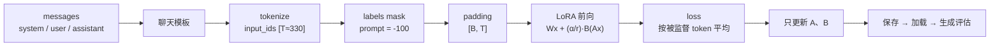

<!-- 本页由 python -m labkit docs 从 ../lesson.yaml 和 results/ 生成，不要手改 -->

[← 场景与痛点](01-pain.md) · [课程首页](../README.md) · [先估算 →](03-estimate.md)

# 第 2 步 / 共 15 步：流程结构

> 阶段 1 / 6：**理解任务**

一条样本从对话到参数更新经过 9 个环节（B = batch 8，T = 样本长度约 330，V = 词表 151936，d = 3584，r = LoRA 秩）。

| 环节 | 输入输出 / 形状 | 说明 | 代码 |
| - | - | - | - |
| 1. messages | system / user / assistant 三段文本 | 训练和推理调用同一个 build_messages，保证 prompt 一致。 | [`adextract/prompts.py#L30-L38`](../../../projects/adextract/prompts.py#L30-L38) |
| 2. 聊天模板 | 一段字符串 | Qwen2.5 模板：`<\|im_start\|>role\n内容<\|im_end\|>\n`。assistant 的开头 `<\|im_start\|>assistant\n` 属于 prompt。 | [`adextract/data.py#L58-L84`](../../../projects/adextract/data.py#L58-L84) |
| 3. tokenize | input_ids [T]（约 330） | prompt 约 290 个 token，回复约 40 个。 | [`adextract/data.py#L58-L84`](../../../projects/adextract/data.py#L58-L84) |
| 4. labels mask | labels [T]，prompt 位置 = -100 | 只有回复和 `<\|im_end\|>` 参与 loss。超长样本按 truncation 规则丢弃或截断。 | [`adextract/data.py#L58-L84`](../../../projects/adextract/data.py#L58-L84) |
| 5. padding | input_ids / labels / attention_mask [B, T] | 训练右侧补齐、labels 补 -100；推理左侧补齐。 | [`adextract/data.py#L89-L101`](../../../projects/adextract/data.py#L89-L101) |
| 6. LoRA 前向 | y = Wx + (α/r)·B(Ax)；A [r, d_in]，B [d_out, r] | W 冻结（bf16），只有 A、B 可训练；B 初始化为 0。 | [`adextract/modeling.py#L57-L73`](../../../projects/adextract/modeling.py#L57-L73) |
| 7. loss | logits [B, T_keep, V] → 标量 | 错一位对齐（位置 t 预测 t+1）；只在被监督位置之后算 lm_head（logits_to_keep），按被监督 token 总数平均。 | [`adextract/train.py#L15-L42`](../../../projects/adextract/train.py#L15-L42) |
| 8. 反向与更新 | 只有 A、B 有梯度 | AdamW、warmup + 线性衰减、梯度裁剪 1.0；每轮结束算 dev_loss。 | [`adextract/train.py#L73-L134`](../../../projects/adextract/train.py#L73-L134) |
| 9. 保存 → 加载 → 生成评估 | 适配器约几十 MB | 释放模型、重新加载基础模型 + 适配器，核对两次输出一致；贪心解码到 `<\|im_end\|>` 停止，按规则逐字段评分。 | [`adextract/infer.py#L14-L36`](../../../projects/adextract/infer.py#L14-L36) |

---

[← 场景与痛点](01-pain.md) · [课程首页](../README.md) · [先估算 →](03-estimate.md)
