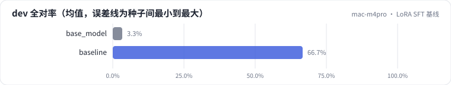
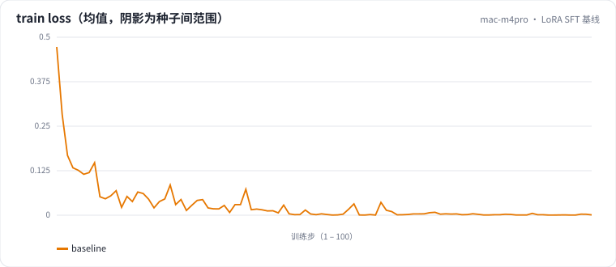

<!-- 本页由 python -m labkit docs 从 ../lesson.yaml 和 results/ 生成，不要手改 -->

[← 基础模型（不训练）](06-base-model.md) · [课程首页](../README.md) · [LoRA rank：4 / 8 / 16 / 64 →](08-rank.md)

# 第 7 步 / 共 15 步：LoRA SFT 基线

> 阶段 4 / 6：**逐个揭晓** · 场景：`baseline`（对照 `base_model`）

基线配置：4000 条合成样本，assistant-only 监督，LoRA r=16、α=32，挂 7 类线性层，lr 2e-4，batch 8，2 个 epoch。训练后保存适配器、重新加载核对。

## 这一步跑了什么

| 场景 | 作用 | 说明 | 相对基线改了什么 | 种子（H20） |
| - | - | - | - | - |
| `base_model` | 对照 | 不训练，直接评估基础模型（零样本） | `train_mode=none` | 1 |
| `baseline` | 本步 | 基线：LoRA r=16 挂注意力 + MLP，assistant-only 监督，2 轮 | — | 3 |

## 先预测

**和基础模型相比，SFT 后 dev 全对率（3 种子均值）提升多少？**

- **A.** 反而下降
- **B.** 提升不到 15 个点
- **C.** 提升 15 - 40 个点
- **D.** 提升 40 个点以上

> 先选定一个（记下来），再展开下面的实测。差异小于 3.3 个点（dev 一条样本）或小于种子间波动，都按“差不多”算。

## 实测

展开实测：H20 · Qwen2.5-7B · 3 种子（已有 0 / 4 个运行）

_还没有结果：H20 正在跑或还在排队，进度见 [作业看板](../../../jobs/README.md)。_

展开实测：Mac 历史档 · Qwen2.5-0.5B · 单种子（已有 2 / 2 个运行，只作对照，不能推断 7B 上的结论）

| 场景 | 类型 | dev 全对率 | 条件保留率 | 合成验证全对率 | 训练分钟 | dev 全对率：与 `base_model` 差 | dev 全对率：各种子 | 断言 |
| - | - | - | - | - | - | - | - | - |
| `base_model` | 参照 | 3.3% | 57.1% | 3.3% | — | — | s0 3.3% |  |
| `baseline` | 基线 | 66.7% | 66.7% | 95.0% | 2.6 | +63.3 个点 | s0 66.7% | 通过 |

**dev 错误类型分布**（每个运行的错误条数，多种子取均值；dev 共 30 条，一条样本可能有多个错误）

| 错误类型 | `base_model` | `baseline` |
| - | - | - |
| 品类错误 | 27.0 | 0.0 |
| 无依据内容 | 24.0 | 1.0 |
| 漏条件 | 9.0 | 6.0 |
| 多优惠（原文无此优惠或把否定句当优惠） | 7.0 | 2.0 |
| 漏优惠 | 7.0 | 3.0 |
| 多卖点 | 5.0 | 0.0 |
| 多条件 | 5.0 | 1.0 |
| 漏卖点 | 5.0 | 3.0 |

**逐样本：`base_model` → `baseline`**（dev 30 条；修好 = 对照错、本步对；弄坏 = 对照对、本步错）

| 种子 | 修好 | 弄坏 | 两边都对 | 两边都错 |
| - | - | - | - | - |
| s0（对照 s0） | 19 | 0 | 1 | 10 |

第一个种子里的例子（最多各 8 条；最后一列是出错一方的错误类型）：

| | 样本 | 文案 | 错误 |
| - | - | - | - |
| 修好 | `dev-02` | 这款防晒霜清爽不黏腻，SPF50+，下单立减30元，仅限今日 | 品类错误、多卖点、无依据内容 |
| 修好 | `dev-03` | 全新升级投影仪，1080P高清，自动对焦，会员到手价立省200元 | 品类错误、无依据内容 |
| 修好 | `dev-05` | 纯牛奶高钙低脂，口感醇厚，全国包邮 | 品类错误、无依据内容 |
| 修好 | `dev-06` | 【新品】小禾无线吸尘器，大吸力，续航60分钟。本品为新品，不参与店铺满减 | 品类错误、无依据内容 |
| 修好 | `dev-08` | 沐光精华液：淡纹紧致，温和不刺激。新客首单立减50元 | 品类错误、漏条件 |
| 修好 | `dev-09` | 极声降噪耳机，40dB深度降噪，单次续航8小时。直降200元 | 品类错误、多条件、无依据内容 |
| 修好 | `dev-10` | 森野有机大米，五常产地，软糯回甘。买两袋送一袋，限APP下单 | 品类错误、无依据内容 |
| 修好 | `dev-11` | 儿童安全座椅，ISOFIX硬接口，360度旋转。前50名下单赠遮阳帘 | 品类错误、无依据内容 |

运行目录（每个目录里有 `summary.json` 指标、`evidence.json` 证据摘要、`predictions.jsonl` 逐条预测、`log.txt` 日志）：

- `base_model` [s0](../../../results/mac-m4pro/L1/base_model/s0-3f30e8/)
- `baseline` [s0](../../../results/mac-m4pro/L1/baseline/s0-f8f01d/)

## 看完实测再想一步

逐样本"修好 / 弄坏"表：哪类样本被 SFT 修好了，有没有被弄坏的？合成验证集和 dev 的差距说明什么？

---

[← 基础模型（不训练）](06-base-model.md) · [课程首页](../README.md) · [LoRA rank：4 / 8 / 16 / 64 →](08-rank.md)
