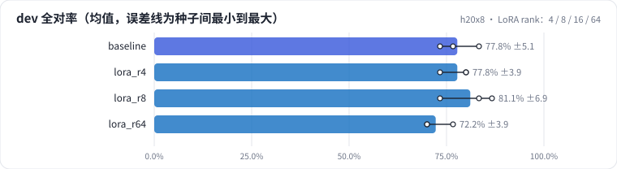
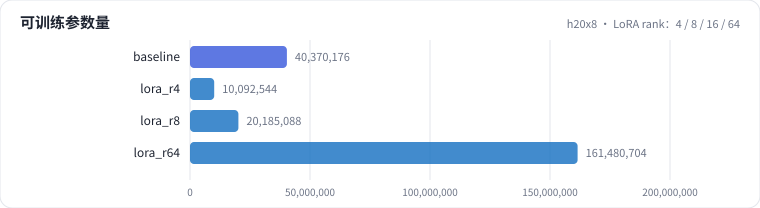
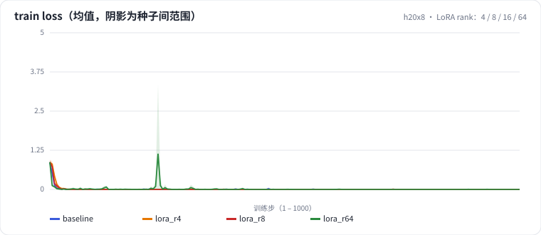
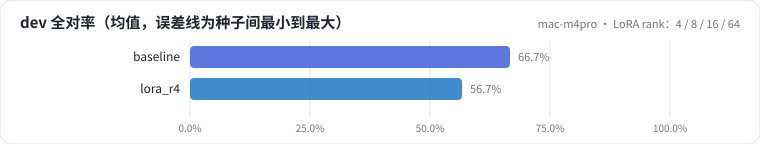
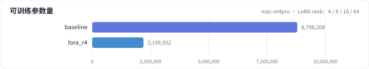
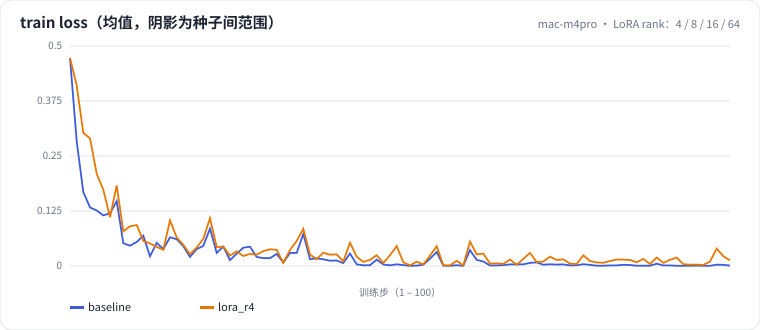

<!-- 本页由 python -m labkit docs 从 ../lesson.yaml 和 results/ 生成，不要手改 -->

[← LoRA SFT 基线](07-sft.md) · [课程首页](../README.md) · [挂载层：q,v / 注意力 / 注意力 + MLP →](09-target.md)

# 第 8 步 / 共 15 步：LoRA rank：4 / 8 / 16 / 64

> 阶段 4 / 6：**逐个揭晓** · 场景：`lora_r4` `lora_r8` `lora_r64`（对照 `baseline`）

只改 rank，α 同比例改（α/r 固定为 2，缩放系数不变）。可训练参数和 r 成正比：r=4 约 1000 万，r=64 约 1.6 亿。

## 这一步跑了什么

| 场景 | 作用 | 说明 | 相对基线改了什么 | 种子（H20） |
| - | - | - | - | - |
| `baseline` | 对照 | 基线：LoRA r=16 挂注意力 + MLP，assistant-only 监督，2 轮 | — | 3 |
| `lora_r4` | 本步 | LoRA 秩 16 → 4（alpha 同比缩小，缩放系数不变） | `lora_r=4`, `lora_alpha=8` | 3 |
| `lora_r8` | 本步 | LoRA 秩 16 → 8（alpha 16，缩放系数不变） | `lora_r=8`, `lora_alpha=16` | 3 |
| `lora_r64` | 本步 | LoRA 秩 16 → 64（alpha 128，缩放系数不变） | `lora_r=64`, `lora_alpha=128` | 3 |

## 先预测

**r 从 16 提到 64（可训练参数 ×4），dev 全对率（3 种子均值）会怎样？**

- **A.** 明显更好（> +6.7 个点，多对 2 条样本以上）
- **B.** 差不多（±6.7 个点以内，和种子间波动同一量级）
- **C.** 明显更差（< −6.7 个点）

> 先选定一个（记下来），再展开下面的实测。差异小于 3.3 个点（dev 一条样本）或小于种子间波动，都按“差不多”算。

## 实测

展开实测：H20 · Qwen2.5-7B · 3 种子（已有 12 / 12 个运行）

| 场景 | 类型 | dev 全对率 | 可训练参数 | 合成验证全对率 | dev loss（第 2 轮） | dev 全对率：与 `baseline` 差 | dev 全对率：各种子 | 断言 |
| - | - | - | - | - | - | - | - | - |
| `baseline` | 基线 | 77.8% ± 5.1 | 4,037 万 | 100.0% ± 0.0 | 0.100 ± 0.021 | — | s0 76.7% / s1 83.3% / s2 73.3% | 通过 |
| `lora_r4` | 候选改动 | 77.8% ± 3.9 | 1,009 万 | 100.0% ± 0.0 | 0.097 ± 0.006 | +0.0 个点 | s0 73.3% / s1 80.0% / s2 80.0% |  |
| `lora_r8` | 候选改动 | 81.1% ± 6.9 | 2,019 万 | 100.0% ± 0.0 | 0.108 ± 0.011 | +3.3 个点 | s0 83.3% / s1 86.7% / s2 73.3% | 通过 |
| `lora_r64` | 候选改动 | 72.2% ± 3.9 | 1.61 亿 | 98.3% ± 2.9 | 0.261 ± 0.033 | -5.6 个点 | s0 70.0% / s1 76.7% / s2 70.0% | 通过 |

运行目录（每个目录里有 `summary.json` 指标、`evidence.json` 证据摘要、`predictions.jsonl` 逐条预测、`log.txt` 日志）：

- `baseline` [s0](../../../results/h20x8/L1/baseline/s0-11e3fc/) · [s1](../../../results/h20x8/L1/baseline/s1-a5b97a/) · [s2](../../../results/h20x8/L1/baseline/s2-3083cc/)
- `lora_r4` [s0](../../../results/h20x8/L1/lora_r4/s0-e2fff5/) · [s1](../../../results/h20x8/L1/lora_r4/s1-0a51f1/) · [s2](../../../results/h20x8/L1/lora_r4/s2-d6dcd6/)
- `lora_r8` [s0](../../../results/h20x8/L1/lora_r8/s0-6a10cb/) · [s1](../../../results/h20x8/L1/lora_r8/s1-8ac85e/) · [s2](../../../results/h20x8/L1/lora_r8/s2-ff8914/)
- `lora_r64` [s0](../../../results/h20x8/L1/lora_r64/s0-d386de/) · [s1](../../../results/h20x8/L1/lora_r64/s1-f5cf18/) · [s2](../../../results/h20x8/L1/lora_r64/s2-57dd54/)

展开实测：Mac 历史档 · Qwen2.5-0.5B · 单种子（已有 2 / 2 个运行，只作对照，不能推断 7B 上的结论）

| 场景 | 类型 | dev 全对率 | 可训练参数 | 合成验证全对率 | dev loss（第 2 轮） | dev 全对率：与 `baseline` 差 | dev 全对率：各种子 | 断言 |
| - | - | - | - | - | - | - | - | - |
| `baseline` | 基线 | 66.7% | 880 万 | 95.0% | 0.303 | — | s0 66.7% | 通过 |
| `lora_r4` | 候选改动 | 56.7% | 220 万 | 76.7% | 0.226 | -10.0 个点 | s0 56.7% |  |

运行目录（每个目录里有 `summary.json` 指标、`evidence.json` 证据摘要、`predictions.jsonl` 逐条预测、`log.txt` 日志）：

- `baseline` [s0](../../../results/mac-m4pro/L1/baseline/s0-f8f01d/)
- `lora_r4` [s0](../../../results/mac-m4pro/L1/lora_r4/s0-934aac/)

## 看完实测再想一步

把"与对照差"和"各种子"两列放在一起看：差值有没有超过种子间的波动（约 5 个点）和 2 条样本？全对率分不出高下时，dev loss 有没有三个种子一致的差别？

---

[← LoRA SFT 基线](07-sft.md) · [课程首页](../README.md) · [挂载层：q,v / 注意力 / 注意力 + MLP →](09-target.md)
