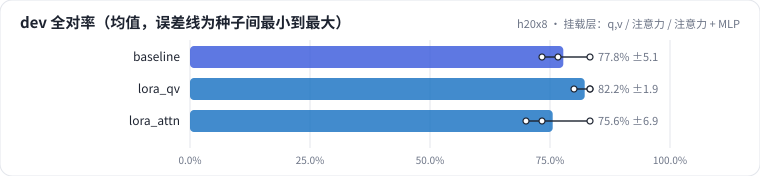
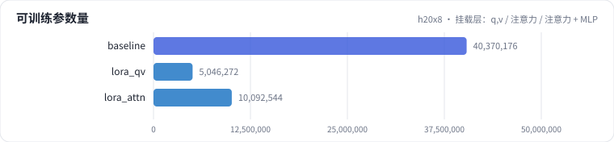

<!-- 本页由 python -m labkit docs 从 ../lesson.yaml 和 results/ 生成，不要手改 -->

[← LoRA rank：4 / 8 / 16 / 64](08-rank.md) · [课程首页](../README.md) · [成本：显存与吞吐 →](10-cost.md)

# 第 9 步 / 共 15 步：挂载层：q,v / 注意力 / 注意力 + MLP

> 阶段 4 / 6：**逐个揭晓** · 场景：`lora_qv` `lora_attn`（对照 `baseline`）

rank 固定 16，只改挂在哪些线性层：只挂 q_proj、v_proj（LoRA 论文的做法）、挂注意力 4 个投影、挂注意力 + MLP 共 7 个（基线，QLoRA 之后的常见默认）。

## 这一步跑了什么

| 场景 | 作用 | 说明 | 相对基线改了什么 | 种子（H20） |
| - | - | - | - | - |
| `baseline` | 对照 | 基线：LoRA r=16 挂注意力 + MLP，assistant-only 监督，2 轮 | — | 3 |
| `lora_qv` | 本步 | LoRA 只挂 q_proj / v_proj（r=16） | `lora_targets=qv` | 3 |
| `lora_attn` | 本步 | LoRA 挂注意力 q/k/v/o（不挂 MLP，r=16） | `lora_targets=attn` | 3 |

## 先预测

**只挂 q,v（可训练参数约为基线的 1/8），dev 全对率（3 种子均值）相比 7 类全挂会怎样？**

- **A.** 明显更好（> +6.7 个点，多对 2 条样本以上）
- **B.** 差不多（±6.7 个点以内，和种子间波动同一量级）
- **C.** 明显更差（< −6.7 个点）

> 先选定一个（记下来），再展开下面的实测。差异小于 3.3 个点（dev 一条样本）或小于种子间波动，都按“差不多”算。

## 实测

展开实测：H20 · Qwen2.5-7B · 3 种子（已有 9 / 9 个运行）

| 场景 | 类型 | dev 全对率 | 可训练参数 | 条件保留率 | 峰值显存 GB | dev 全对率：与 `baseline` 差 | dev 全对率：各种子 | 断言 |
| - | - | - | - | - | - | - | - | - |
| `baseline` | 基线 | 77.8% ± 5.1 | 4,037 万 | 90.5% ± 4.8 | 44.1 ± 0.0 | — | s0 76.7% / s1 83.3% / s2 73.3% | 通过 |
| `lora_qv` | 候选改动 | 82.2% ± 1.9 | 505 万 | 90.5% ± 4.8 | 31.3 ± 0.0 | +4.4 个点 | s0 83.3% / s1 83.3% / s2 80.0% | 通过 |
| `lora_attn` | 候选改动 | 75.6% ± 6.9 | 1,009 万 | 85.7% ± 0.0 | 34.0 ± 0.0 | -2.2 个点 | s0 70.0% / s1 83.3% / s2 73.3% | 通过 |

运行目录（每个目录里有 `summary.json` 指标、`evidence.json` 证据摘要、`predictions.jsonl` 逐条预测、`log.txt` 日志）：

- `baseline` [s0](../../../results/h20x8/L1/baseline/s0-11e3fc/) · [s1](../../../results/h20x8/L1/baseline/s1-a5b97a/) · [s2](../../../results/h20x8/L1/baseline/s2-3083cc/)
- `lora_qv` [s0](../../../results/h20x8/L1/lora_qv/s0-550f12/) · [s1](../../../results/h20x8/L1/lora_qv/s1-b4b03b/) · [s2](../../../results/h20x8/L1/lora_qv/s2-24af69/)
- `lora_attn` [s0](../../../results/h20x8/L1/lora_attn/s0-78af04/) · [s1](../../../results/h20x8/L1/lora_attn/s1-fc08ea/) · [s2](../../../results/h20x8/L1/lora_attn/s2-c29522/)

展开实测：Mac 历史档 · Qwen2.5-0.5B · 单种子（已有 1 / 1 个运行，只作对照，不能推断 7B 上的结论）

| 场景 | 类型 | dev 全对率 | 可训练参数 | 条件保留率 | 峰值显存 GB | dev 全对率：与 `baseline` 差 | dev 全对率：各种子 | 断言 |
| - | - | - | - | - | - | - | - | - |
| `baseline` | 基线 | 66.7% | 880 万 | 66.7% | — | — | s0 66.7% | 通过 |

运行目录（每个目录里有 `summary.json` 指标、`evidence.json` 证据摘要、`predictions.jsonl` 逐条预测、`log.txt` 日志）：

- `baseline` [s0](../../../results/mac-m4pro/L1/baseline/s0-f8f01d/)

## 看完实测再想一步

可训练参数差 8 倍，全对率的差值超过种子波动了吗？峰值显存差了多少（下一步"成本"细看）？

---

[← LoRA rank：4 / 8 / 16 / 64](08-rank.md) · [课程首页](../README.md) · [成本：显存与吞吐 →](10-cost.md)
