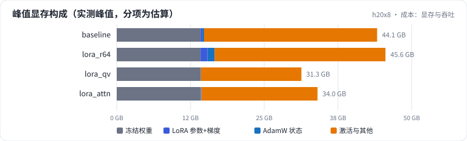
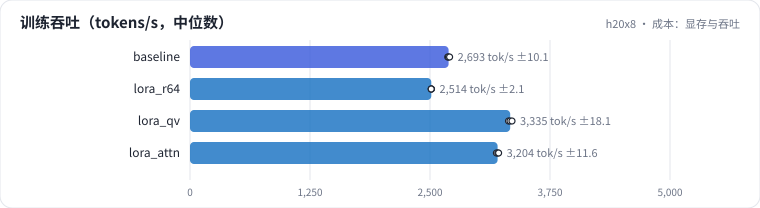

<!-- 本页由 python -m labkit docs 从 ../lesson.yaml 和 results/ 生成，不要手改 -->

[← 挂载层：q,v / 注意力 / 注意力 + MLP](09-target.md) · [课程首页](../README.md) · [学习率：5e-5 / 2e-4 / 1e-3 →](11-lr.md)

# 第 10 步 / 共 15 步：成本：显存与吞吐

> 阶段 4 / 6：**逐个揭晓** · 场景：`lora_r64` `lora_qv`（对照 `baseline`）

同一张 H20、同样的 batch 和序列长度，比较 r=16 基线、r=64、只挂 q,v 的峰值显存和训练吞吐。

## 这一步跑了什么

| 场景 | 作用 | 说明 | 相对基线改了什么 | 种子（H20） |
| - | - | - | - | - |
| `baseline` | 对照 | 基线：LoRA r=16 挂注意力 + MLP，assistant-only 监督，2 轮 | — | 3 |
| `lora_r64` | 本步 | LoRA 秩 16 → 64（alpha 128，缩放系数不变） | `lora_r=64`, `lora_alpha=128` | 3 |
| `lora_qv` | 本步 | LoRA 只挂 q_proj / v_proj（r=16） | `lora_targets=qv` | 3 |

## 先预测

**r=64（可训练参数从约 4000 万到约 1.6 亿）比 r=16 峰值显存多多少？**

- **A.** 不到 1 GB
- **B.** 1 - 5 GB
- **C.** 5 GB 以上

> 先选定一个（记下来），再展开下面的实测。差异小于 3.3 个点（dev 一条样本）或小于种子间波动，都按“差不多”算。

## 实测

展开实测：H20 · Qwen2.5-7B · 3 种子（已有 9 / 9 个运行）

| 场景 | 类型 | 峰值显存 GB | 可训练参数 | tokens/s（中位数） | 训练分钟 | 峰值显存 GB：与 `baseline` 差 | 峰值显存 GB：各种子 | 断言 |
| - | - | - | - | - | - | - | - | - |
| `baseline` | 基线 | 44.14 ± 0.01 | 4,037 万 ± 0 | 2,693 ± 10 | 15.1 ± 0.0 | — | s0 44.15 / s1 44.13 / s2 44.13 | 通过 |
| `lora_r64` | 候选改动 | 45.56 ± 0.02 | 1.61 亿 ± 0 | 2,514 ± 2 | 16.3 ± 0.0 | +1.43 | s0 45.58 / s1 45.56 / s2 45.55 | 通过 |
| `lora_qv` | 候选改动 | 31.30 ± 0.01 | 505 万 ± 0 | 3,335 ± 18 | 12.3 ± 0.1 | -12.84 | s0 31.29 / s1 31.29 / s2 31.31 | 通过 |

运行目录（每个目录里有 `summary.json` 指标、`evidence.json` 证据摘要、`predictions.jsonl` 逐条预测、`log.txt` 日志）：

- `baseline` [s0](../../../results/h20x8/L1/baseline/s0-11e3fc/) · [s1](../../../results/h20x8/L1/baseline/s1-a5b97a/) · [s2](../../../results/h20x8/L1/baseline/s2-3083cc/)
- `lora_r64` [s0](../../../results/h20x8/L1/lora_r64/s0-d386de/) · [s1](../../../results/h20x8/L1/lora_r64/s1-f5cf18/) · [s2](../../../results/h20x8/L1/lora_r64/s2-57dd54/)
- `lora_qv` [s0](../../../results/h20x8/L1/lora_qv/s0-550f12/) · [s1](../../../results/h20x8/L1/lora_qv/s1-b4b03b/) · [s2](../../../results/h20x8/L1/lora_qv/s2-24af69/)

展开实测：Mac 历史档 · Qwen2.5-0.5B · 单种子（已有 1 / 1 个运行，只作对照，不能推断 7B 上的结论）

| 场景 | 类型 | 峰值显存 GB | 可训练参数 | tokens/s（中位数） | 训练分钟 | 峰值显存 GB：与 `baseline` 差 | 峰值显存 GB：各种子 | 断言 |
| - | - | - | - | - | - | - | - | - |
| `baseline` | 基线 | — | 880 万 | 1,627 | 2.6 | — | — | 通过 |

运行目录（每个目录里有 `summary.json` 指标、`evidence.json` 证据摘要、`predictions.jsonl` 逐条预测、`log.txt` 日志）：

- `baseline` [s0](../../../results/mac-m4pro/L1/baseline/s0-f8f01d/)

## 看完实测再想一步

显存构成图里，"LoRA 参数+梯度"和"AdamW 状态"两段和"冻结权重""激活"比起来有多大？显存的大头在哪？

---

[← 挂载层：q,v / 注意力 / 注意力 + MLP](09-target.md) · [课程首页](../README.md) · [学习率：5e-5 / 2e-4 / 1e-3 →](11-lr.md)
