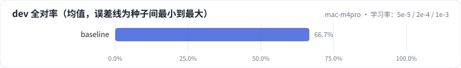
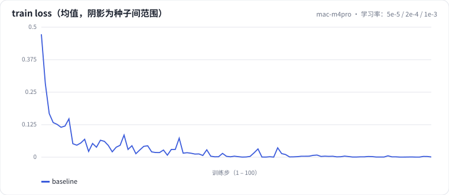

<!-- 本页由 python -m labkit docs 从 ../lesson.yaml 和 results/ 生成，不要手改 -->

[← 成本：显存与吞吐](10-cost.md) · [课程首页](../README.md) · [监督口径：整段都算 loss →](12-supervision.md)

# 第 11 步 / 共 15 步：学习率：5e-5 / 2e-4 / 1e-3

> 阶段 4 / 6：**逐个揭晓** · 场景：`lr_5e-5` `lr_1e-3`（对照 `baseline`）

只改峰值学习率（warmup 和线性衰减不变）。LoRA 常用 1e-4 到 3e-4，比全参微调大一个数量级，因为 B 从 0 开始、α/r 缩放又把更新压小了。

## 这一步跑了什么

| 场景 | 作用 | 说明 | 相对基线改了什么 | 种子（H20） |
| - | - | - | - | - |
| `baseline` | 对照 | 基线：LoRA r=16 挂注意力 + MLP，assistant-only 监督，2 轮 | — | 3 |
| `lr_5e-5` | 本步 | 学习率 2e-4 → 5e-5 | `lr=5e-05` | 3 |
| `lr_1e-3` | 本步 | 学习率 2e-4 → 1e-3 | `lr=0.001` | 3 |

## 先预测

**学习率 2e-4 → 1e-3（5 倍），dev 全对率（3 种子均值）会怎样？**

- **A.** 明显更好（> +3.3 个点）
- **B.** 差不多（±3.3 个点以内）
- **C.** 明显更差（< −3.3 个点）

> 先选定一个（记下来），再展开下面的实测。差异小于 3.3 个点（dev 一条样本）或小于种子间波动，都按“差不多”算。

## 实测

展开实测：H20 · Qwen2.5-7B · 3 种子（已有 0 / 9 个运行）

_还没有结果：H20 正在跑或还在排队，进度见 [作业看板](../../../jobs/README.md)。_

展开实测：Mac 历史档 · Qwen2.5-0.5B · 单种子（已有 1 / 1 个运行，只作对照，不能推断 7B 上的结论）

| 场景 | 类型 | dev 全对率 | 格式合法率 | 最终 train loss | dev 全对率：与 `baseline` 差 | dev 全对率：各种子 | 断言 |
| - | - | - | - | - | - | - | - |
| `baseline` | 基线 | 66.7% | 100.0% | 0.0010 | — | s0 66.7% | 通过 |

运行目录（每个目录里有 `summary.json` 指标、`evidence.json` 证据摘要、`predictions.jsonl` 逐条预测、`log.txt` 日志）：

- `baseline` [s0](../../../results/mac-m4pro/L1/baseline/s0-f8f01d/)

## 看完实测再想一步

loss 曲线里三档学习率的下降速度和最终位置；loss 更低是不是一定全对率更高？

---

[← 成本：显存与吞吐](10-cost.md) · [课程首页](../README.md) · [监督口径：整段都算 loss →](12-supervision.md)
