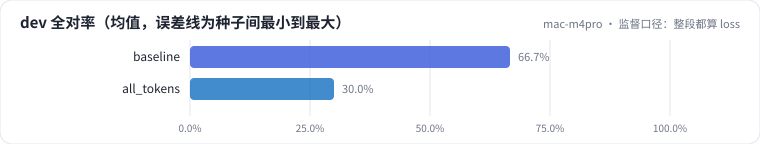
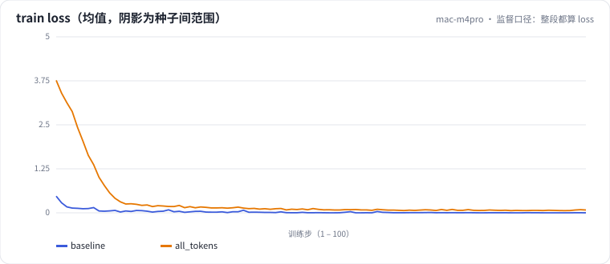

<!-- 本页由 python -m labkit docs 从 ../lesson.yaml 和 results/ 生成，不要手改 -->

[← 学习率：5e-5 / 2e-4 / 1e-3](11-lr.md) · [课程首页](../README.md) · [截断故障：max_len=256 →](13-fault.md)

# 第 12 步 / 共 15 步：监督口径：整段都算 loss

> 阶段 4 / 6：**逐个揭晓** · 场景：`all_tokens`（对照 `baseline`）

把 labels mask 去掉：系统提示、广告原文、回复全部参与 loss。其余配置和基线相同。

## 这一步跑了什么

| 场景 | 作用 | 说明 | 相对基线改了什么 | 种子（H20） |
| - | - | - | - | - |
| `baseline` | 对照 | 基线：LoRA r=16 挂注意力 + MLP，assistant-only 监督，2 轮 | — | 3 |
| `all_tokens` | 本步 | 整段都算 loss（系统提示和用户文案也监督） | `supervision=all_tokens` | 3 |

## 先预测

**整段对话都算 loss，dev 全对率（3 种子均值）会怎样？**

- **A.** 更好：监督信号更多
- **B.** 差不多
- **C.** 更差

> 先选定一个（记下来），再展开下面的实测。差异小于 3.3 个点（dev 一条样本）或小于种子间波动，都按“差不多”算。

## 实测

展开实测：H20 · Qwen2.5-7B · 3 种子（已有 0 / 6 个运行）

_还没有结果：H20 正在跑或还在排队，进度见 [作业看板](../../../jobs/README.md)。_

展开实测：Mac 历史档 · Qwen2.5-0.5B · 单种子（已有 2 / 2 个运行，只作对照，不能推断 7B 上的结论）

| 场景 | 类型 | dev 全对率 | 被监督 token 总数 | 最终 train loss | dev 全对率：与 `baseline` 差 | dev 全对率：各种子 | 断言 |
| - | - | - | - | - | - | - | - |
| `baseline` | 基线 | 66.7% | 12,849 | 0.0010 | — | s0 66.7% | 通过 |
| `all_tokens` | 候选改动 | 30.0% | 122,618 | 0.0802 | -36.7 个点 | s0 30.0% |  |

运行目录（每个目录里有 `summary.json` 指标、`evidence.json` 证据摘要、`predictions.jsonl` 逐条预测、`log.txt` 日志）：

- `baseline` [s0](../../../results/mac-m4pro/L1/baseline/s0-f8f01d/)
- `all_tokens` [s0](../../../results/mac-m4pro/L1/all_tokens/s0-033332/)

## 看完实测再想一步

两者的被监督 token 数差多少倍？整段监督的 loss 主要花在学什么上？

---

[← 学习率：5e-5 / 2e-4 / 1e-3](11-lr.md) · [课程首页](../README.md) · [截断故障：max_len=256 →](13-fault.md)
