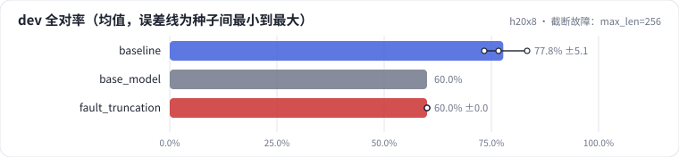
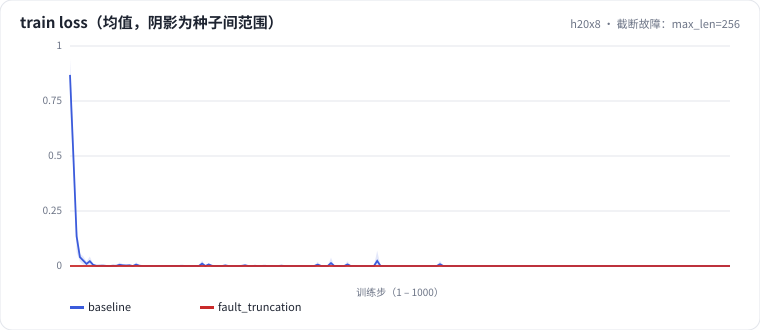
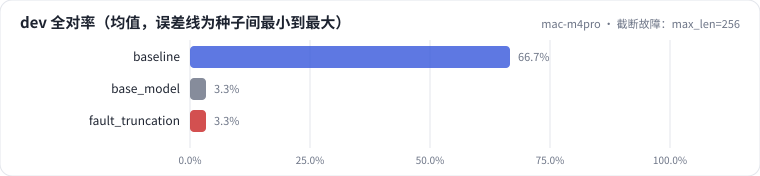
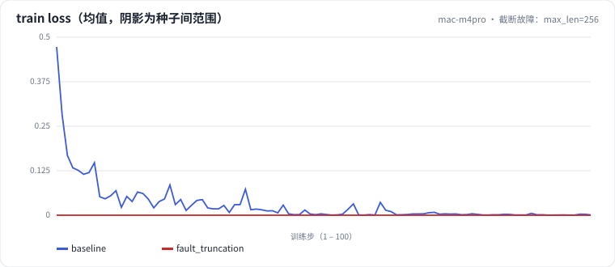

<!-- 本页由 python -m labkit docs 从 ../lesson.yaml 和 results/ 生成，不要手改 -->

[← 监督口径：整段都算 loss](12-supervision.md) · [课程首页](../README.md) · [诊断故障 →](14-diagnose.md)

# 第 13 步 / 共 15 步：截断故障：max_len=256

> 阶段 4 / 6：**逐个揭晓** · 场景：`fault_truncation`（对照 `baseline`）

一位同事为了省显存，把 `max_len` 调到 256，截断方式改成 `right`。训练正常结束，没有任何报错，train loss 非常低，适配器保存、重新加载核对也通过了。

## 这一步跑了什么

| 场景 | 作用 | 说明 | 相对基线改了什么 | 种子（H20） |
| - | - | - | - | - |
| `baseline` | 对照 | 基线：LoRA r=16 挂注意力 + MLP，assistant-only 监督，2 轮 | — | 3 |
| `base_model` | 参照 | 不训练，直接评估基础模型（零样本） | `train_mode=none` | 1 |
| `fault_truncation` | 本步 | 教学故障：max_len=256 + 右截断，回答被整段截掉 | `max_len=256`, `truncation=right` | 3 |

## 先预测

**这个配置下，dev 全对率会接近谁？**

- **A.** 接近 SFT 基线
- **B.** 介于基线和基础模型之间
- **C.** 和基础模型几乎一样

> 先选定一个（记下来），再展开下面的实测。差异小于 3.3 个点（dev 一条样本）或小于种子间波动，都按“差不多”算。

## 实测

展开实测：H20 · Qwen2.5-7B · 3 种子（已有 7 / 7 个运行）

| 场景 | 类型 | dev 全对率 | 最终 train loss | dev 全对率：与 `baseline` 差 | dev 全对率：各种子 | 断言 |
| - | - | - | - | - | - | - |
| `baseline` | 基线 | 77.8% ± 5.1 | 0.0000 ± 0.0000 | — | s0 76.7% / s1 83.3% / s2 73.3% | 通过 |
| `base_model` | 参照 | 60.0% | — | -17.8 个点 | s0 60.0% |  |
| `fault_truncation` | 教学故障 | 60.0% ± 0.0 | 0.0000 ± 0.0000 | -17.8 个点 | s0 60.0% / s1 60.0% / s2 60.0% | 通过 |

运行目录（每个目录里有 `summary.json` 指标、`evidence.json` 证据摘要、`predictions.jsonl` 逐条预测、`log.txt` 日志）：

- `baseline` [s0](../../../results/h20x8/L1/baseline/s0-11e3fc/) · [s1](../../../results/h20x8/L1/baseline/s1-a5b97a/) · [s2](../../../results/h20x8/L1/baseline/s2-3083cc/)
- `base_model` [s0](../../../results/h20x8/L1/base_model/s0-a493bd/)
- `fault_truncation` [s0](../../../results/h20x8/L1/fault_truncation/s0-9927ff/) · [s1](../../../results/h20x8/L1/fault_truncation/s1-5751e8/) · [s2](../../../results/h20x8/L1/fault_truncation/s2-e55a67/)

展开实测：Mac 历史档 · Qwen2.5-0.5B · 单种子（已有 3 / 3 个运行，只作对照，不能推断 7B 上的结论）

| 场景 | 类型 | dev 全对率 | 最终 train loss | dev 全对率：与 `baseline` 差 | dev 全对率：各种子 | 断言 |
| - | - | - | - | - | - | - |
| `baseline` | 基线 | 66.7% | 0.0010 | — | s0 66.7% | 通过 |
| `base_model` | 参照 | 3.3% | — | -63.3 个点 | s0 3.3% |  |
| `fault_truncation` | 教学故障 | 3.3% | 0.0000 | -63.3 个点 | s0 3.3% | 通过 |

运行目录（每个目录里有 `summary.json` 指标、`evidence.json` 证据摘要、`predictions.jsonl` 逐条预测、`log.txt` 日志）：

- `baseline` [s0](../../../results/mac-m4pro/L1/baseline/s0-f8f01d/)
- `base_model` [s0](../../../results/mac-m4pro/L1/base_model/s0-3f30e8/)
- `fault_truncation` [s0](../../../results/mac-m4pro/L1/fault_truncation/s0-6e627b/)

## 看完实测再想一步

先别急着找原因，下一步"诊断故障"会逐条给线索。

---

[← 监督口径：整段都算 loss](12-supervision.md) · [课程首页](../README.md) · [诊断故障 →](14-diagnose.md)
