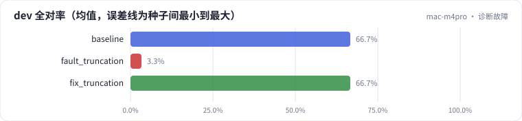
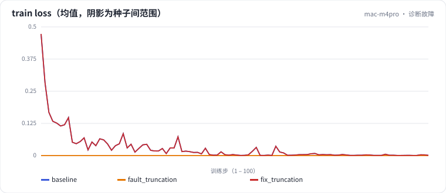

<!-- 本页由 python -m labkit docs 从 ../lesson.yaml 和 results/ 生成，不要手改 -->

[← 截断故障：max_len=256](13-fault.md) · [课程首页](../README.md) · [回顾：全部场景一览 →](15-review.md)

# 第 14 步 / 共 15 步：诊断故障

> 阶段 5 / 6：**诊断故障** · 场景：`fix_truncation`（对照 `baseline`）

上一步的配置训练"成功"了，效果却等于没训练。按需逐条展开线索（每条线索指向一个证据），然后选你认为的根因，最后展开修复后的结果（`max_len = 512`，保留右截断）。

## 这一步跑了什么

| 场景 | 作用 | 说明 | 相对基线改了什么 | 种子（H20） |
| - | - | - | - | - |
| `baseline` | 对照 | 基线：LoRA r=16 挂注意力 + MLP，assistant-only 监督，2 轮 | — | 3 |
| `fault_truncation` | 参照 | 教学故障：max_len=256 + 右截断，回答被整段截掉 | `max_len=256`, `truncation=right` | 3 |
| `fix_truncation` | 本步 | 修复：max_len=512（保留右截断，确认已不再截到回答） | `max_len=512`, `truncation=right` | 3 |

## 线索

逐条展开，看到能下判断为止。

线索 1

看 loss：故障运行最终的 train loss 是 0（基线 0.00101）。一个真正在学的模型，loss 会恰好是这个数吗？（数字来自 Mac 历史档）

线索 2

看数据统计：故障运行的被监督 token 总数是 0，零监督样本 400 条。一条样本的 prompt 有 274 个 token，max_len 是 256。（数字来自 Mac 历史档）

线索 3

看参数是否更新：LoRA B 初始化为 0，故障运行训练后 B 的范数是 0（基线 2.62）。loss 为 0 时梯度是多少？（数字来自 Mac 历史档）

## 先预测

**根因是什么？**

- **A.** 学习率太小，256 长度下 100 步不够
- **B.** 适配器没有正确保存或加载
- **C.** 截断把回答整段截掉了，监督 token 为 0，梯度为 0
- **D.** dev 和训练集分布差太远

> 先选定一个（记下来），再展开下面的实测。差异小于 3.3 个点（dev 一条样本）或小于种子间波动，都按“差不多”算。

## 实测

展开实测：H20 · Qwen2.5-7B · 3 种子（已有 0 / 9 个运行）

_还没有结果：H20 正在跑或还在排队，进度见 [作业看板](../../../jobs/README.md)。_

展开实测：Mac 历史档 · Qwen2.5-0.5B · 单种子（已有 3 / 3 个运行，只作对照，不能推断 7B 上的结论）

| 场景 | 类型 | dev 全对率 | 被监督 token 总数 | 零监督样本 | 训练后 LoRA B 范数 | dev 全对率：与 `baseline` 差 | dev 全对率：各种子 | 断言 |
| - | - | - | - | - | - | - | - | - |
| `baseline` | 基线 | 66.7% | 12,849 | 0 | 2.62 | — | s0 66.7% | 通过 |
| `fault_truncation` | 教学故障 | 3.3% | 0 | 400 | 0 | -63.3 个点 | s0 3.3% | 通过 |
| `fix_truncation` | 修复 | 66.7% | 12,849 | 0 | 2.62 | +0.0 个点 | s0 66.7% | 通过 |

运行目录（每个目录里有 `summary.json` 指标、`evidence.json` 证据摘要、`predictions.jsonl` 逐条预测、`log.txt` 日志）：

- `baseline` [s0](../../../results/mac-m4pro/L1/baseline/s0-f8f01d/)
- `fault_truncation` [s0](../../../results/mac-m4pro/L1/fault_truncation/s0-6e627b/)
- `fix_truncation` [s0](../../../results/mac-m4pro/L1/fix_truncation/s0-0e08b1/)

## 看完实测再想一步

这类故障上线前靠什么发现？想想训练日志里应该有哪几个数一出现就报警。

---

[← 截断故障：max_len=256](13-fault.md) · [课程首页](../README.md) · [回顾：全部场景一览 →](15-review.md)
