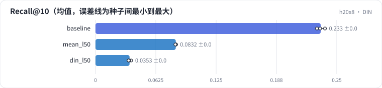
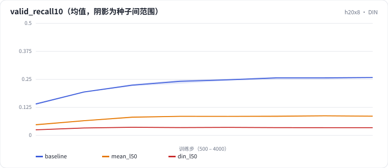

<!-- 本页由 python -m labkit docs 从 ../lesson.yaml 和 results/ 生成，不要手改 -->

[← mean pooling](06-mean.md) · [课程首页](../README.md) · [只看最近 20 个 →](08-len20.md)

# 第 7 步 / 共 14 步：DIN

> 阶段 3 / 6：**三种模型** · 场景：`din_l50`（对照 `baseline`）

DIN 对每个候选物品重新给历史加权：和候选相似的历史物品权重大。和 mean pooling 一样不看顺序，但"看候选"。每个位置都监督（和 SASRec 一样多的训练信号）。

## 这一步跑了什么

| 场景 | 作用 | 说明 | 相对基线改了什么 | 种子（H20） |
| - | - | - | - | - |
| `baseline` | 对照 | 基线：SASRec，保留最近 50 个行为 | — | 3 |
| `mean_l50` | 参照 | 历史 embedding 求平均（mean pooling），L = 50 | `model=mean` | 3 |
| `din_l50` | 本步 | DIN（按候选 target attention），L = 50 | `model=din` | 3 |

## 先预测

**DIN 和 SASRec 比，测试 Recall@10 怎样？**

- **A.** 低 0.03 以上
- **B.** 差不多（±0.03）
- **C.** 高 0.03 以上

> 先选定一个（记下来），再展开下面的实测。Recall@10 在 6040 个用户上的抽样标准误约 0.005；均值差小于 0.01（模型对比小于 0.03）或小于种子间波动，都按“差不多”算。

## 实测

展开实测：H20 · MovieLens-1M · leave-one-out · 对全部 3706 部电影排序 · 3 种子（已有 9 / 9 个运行）

| 场景 | 类型 | Recall@10 | 采样 100 Recall@10 | 训练 样本/秒 | 每用户推理乘加 | Recall@10：与 `baseline` 差 | Recall@10：各种子 | 断言 |
| - | - | - | - | - | - | - | - | - |
| `baseline` | 基线 | 0.233 ± 0.004 | 0.800 ± 0.002 | 18,917 ± 89 | 5,472,448.0 ± 0.0 | — | s0 0.233 / s1 0.229 / s2 0.238 | 通过 |
| `mean_l50` | 候选改动 | 0.083 ± 0.000 | 0.691 ± 0.005 | 36,203 ± 393 | 244,544.0 ± 0.0 | -0.150 | s0 0.083 / s1 0.083 / s2 0.083 |  |
| `din_l50` | 候选改动 | 0.035 ± 0.001 | 0.631 ± 0.019 | 17,660 ± 102 | 23,724,800.0 ± 0.0 | -0.198 | s0 0.037 / s1 0.035 / s2 0.034 |  |

运行目录（每个目录里有 `summary.json` 指标、`evidence.json` 证据摘要、`predictions.jsonl` 逐条预测、`log.txt` 日志）：

- `baseline` [s0](../../../results/h20x8/R01/baseline/s0-585a43/) · [s1](../../../results/h20x8/R01/baseline/s1-87e137/) · [s2](../../../results/h20x8/R01/baseline/s2-471d19/)
- `mean_l50` [s0](../../../results/h20x8/R01/mean_l50/s0-648a16/) · [s1](../../../results/h20x8/R01/mean_l50/s1-aef33a/) · [s2](../../../results/h20x8/R01/mean_l50/s2-9c27fe/)
- `din_l50` [s0](../../../results/h20x8/R01/din_l50/s0-bddc4b/) · [s1](../../../results/h20x8/R01/din_l50/s1-c29381/) · [s2](../../../results/h20x8/R01/din_l50/s2-ffd0a9/)

## 看完实测再想一步

三个模型的训练曲线（valid_recall10）谁先到顶？

---

[← mean pooling](06-mean.md) · [课程首页](../README.md) · [只看最近 20 个 →](08-len20.md)
