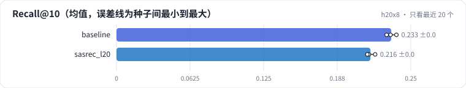

<!-- 本页由 python -m labkit docs 从 ../lesson.yaml 和 results/ 生成，不要手改 -->

[← DIN](07-din.md) · [课程首页](../README.md) · [加长到 200 →](09-len200.md)

# 第 8 步 / 共 14 步：只看最近 20 个

> 阶段 4 / 6：**序列长度** · 场景：`sasrec_l20`（对照 `baseline`）

SASRec 的输入从最近 50 个缩到最近 20 个。ML-1M 用户的中位历史长度约 96，L = 20 时几乎所有用户都被截断。

## 这一步跑了什么

| 场景 | 作用 | 说明 | 相对基线改了什么 | 种子（H20） |
| - | - | - | - | - |
| `baseline` | 对照 | 基线：SASRec，保留最近 50 个行为 | — | 3 |
| `sasrec_l20` | 本步 | SASRec，L = 20 | `max_len=20` | 3 |

## 先预测

**L 从 50 降到 20，测试 Recall@10 怎样？**

- **A.** 降 0.01 以上
- **B.** 差不多（±0.01）
- **C.** 升 0.01 以上

> 先选定一个（记下来），再展开下面的实测。Recall@10 在 6040 个用户上的抽样标准误约 0.005；均值差小于 0.01（模型对比小于 0.03）或小于种子间波动，都按“差不多”算。

## 实测

展开实测：H20 · MovieLens-1M · leave-one-out · 对全部 3706 部电影排序 · 3 种子（已有 6 / 6 个运行）

| 场景 | 类型 | Recall@10 | 历史 > L 的用户 | 历史 ≤ L 的用户 | 历史 > L 的人数 | Recall@10：与 `baseline` 差 | Recall@10：各种子 | 断言 |
| - | - | - | - | - | - | - | - | - |
| `baseline` | 基线 | 0.233 ± 0.004 | 0.193 ± 0.002 | 0.326 ± 0.008 | 4,205.0 ± 0.0 | — | s0 0.233 / s1 0.229 / s2 0.238 | 通过 |
| `sasrec_l20` | 候选改动 | 0.216 ± 0.004 | 0.211 ± 0.003 | 0.373 ± 0.010 | 5,863.0 ± 0.0 | -0.018 | s0 0.220 / s1 0.214 / s2 0.213 |  |

运行目录（每个目录里有 `summary.json` 指标、`evidence.json` 证据摘要、`predictions.jsonl` 逐条预测、`log.txt` 日志）：

- `baseline` [s0](../../../results/h20x8/R01/baseline/s0-585a43/) · [s1](../../../results/h20x8/R01/baseline/s1-87e137/) · [s2](../../../results/h20x8/R01/baseline/s2-471d19/)
- `sasrec_l20` [s0](../../../results/h20x8/R01/sasrec_l20/s0-217b83/) · [s1](../../../results/h20x8/R01/sasrec_l20/s1-5d3a7f/) · [s2](../../../results/h20x8/R01/sasrec_l20/s2-044b3a/)

## 看完实测再想一步

两组用户（历史 ≤ L / > L）各自变了多少？

---

[← DIN](07-din.md) · [课程首页](../README.md) · [加长到 200 →](09-len200.md)
