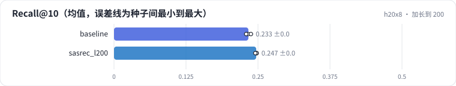

<!-- 本页由 python -m labkit docs 从 ../lesson.yaml 和 results/ 生成，不要手改 -->

[← 只看最近 20 个](08-len20.md) · [课程首页](../README.md) · [mean pooling 加长到 200 →](10-pool-len.md)

# 第 9 步 / 共 14 步：加长到 200

> 阶段 4 / 6：**序列长度** · 场景：`sasrec_l200`（对照 `baseline`）

SASRec 的输入加长到最近 200 个。L = 200 已经覆盖了大约四分之三用户的完整历史。

## 这一步跑了什么

| 场景 | 作用 | 说明 | 相对基线改了什么 | 种子（H20） |
| - | - | - | - | - |
| `baseline` | 对照 | 基线：SASRec，保留最近 50 个行为 | — | 3 |
| `sasrec_l200` | 本步 | SASRec，L = 200 | `max_len=200` | 3 |

## 先预测

**L 从 50 加到 200，测试 Recall@10 怎样？**

- **A.** 降 0.01 以上
- **B.** 差不多（±0.01）
- **C.** 升 0.01 以上

> 先选定一个（记下来），再展开下面的实测。Recall@10 在 6040 个用户上的抽样标准误约 0.005；均值差小于 0.01（模型对比小于 0.03）或小于种子间波动，都按“差不多”算。

## 实测

展开实测：H20 · MovieLens-1M · leave-one-out · 对全部 3706 部电影排序 · 3 种子（已有 6 / 6 个运行）

| 场景 | 类型 | Recall@10 | 历史 > L 的人数 | 注意力占比 | 训练 样本/秒 | Recall@10：与 `baseline` 差 | Recall@10：各种子 | 断言 |
| - | - | - | - | - | - | - | - | - |
| `baseline` | 基线 | 0.233 ± 0.004 | 4,205.0 ± 0.0 | 6.1% ± 0.0% | 19,735 ± 487 | — | s0 0.233 / s1 0.229 / s2 0.238 | 通过 |
| `sasrec_l200` | 候选改动 | 0.247 ± 0.001 | 1,572.0 ± 0.0 | 20.7% ± 0.0% | 15,292 ± 205 | +0.014 | s0 0.248 / s1 0.248 / s2 0.245 | 通过 |

运行目录（每个目录里有 `summary.json` 指标、`evidence.json` 证据摘要、`predictions.jsonl` 逐条预测、`log.txt` 日志）：

- `baseline` [s0](../../../results/h20x8/R01/baseline/s0-585a43/) · [s1](../../../results/h20x8/R01/baseline/s1-87e137/) · [s2](../../../results/h20x8/R01/baseline/s2-471d19/)
- `sasrec_l200` [s0](../../../results/h20x8/R01/sasrec_l200/s0-9de048/) · [s1](../../../results/h20x8/R01/sasrec_l200/s1-806689/) · [s2](../../../results/h20x8/R01/sasrec_l200/s2-0a2af4/)

## 看完实测再想一步

长度 × 4，训练吞吐掉了多少？

---

[← 只看最近 20 个](08-len20.md) · [课程首页](../README.md) · [mean pooling 加长到 200 →](10-pool-len.md)
