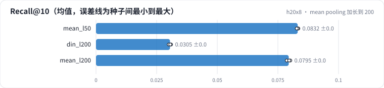

<!-- 本页由 python -m labkit docs 从 ../lesson.yaml 和 results/ 生成，不要手改 -->

[← 加长到 200](09-len200.md) · [课程首页](../README.md) · [加长的代价 →](11-cost.md)

# 第 10 步 / 共 14 步：mean pooling 加长到 200

> 阶段 4 / 6：**序列长度** · 场景：`mean_l200`（对照 `mean_l50`）

同样把 mean pooling 的输入从 50 加到 200。平均对每个历史行为一视同仁。另有一个 DIN L = 200 的对照。

## 这一步跑了什么

| 场景 | 作用 | 说明 | 相对基线改了什么 | 种子（H20） |
| - | - | - | - | - |
| `mean_l50` | 对照 | 历史 embedding 求平均（mean pooling），L = 50 | `model=mean` | 3 |
| `din_l200` | 参照 | DIN，L = 200 | `model=din`, `max_len=200` | 3 |
| `mean_l200` | 本步 | mean pooling，L = 200 | `model=mean`, `max_len=200` | 3 |

## 先预测

**mean pooling 的 L 从 50 加到 200，测试 Recall@10 怎样？**

- **A.** 降 0.01 以上
- **B.** 差不多（±0.01）
- **C.** 升 0.01 以上

> 先选定一个（记下来），再展开下面的实测。Recall@10 在 6040 个用户上的抽样标准误约 0.005；均值差小于 0.01（模型对比小于 0.03）或小于种子间波动，都按“差不多”算。

## 实测

展开实测：H20 · MovieLens-1M · leave-one-out · 对全部 3706 部电影排序 · 3 种子（已有 9 / 9 个运行）

| 场景 | 类型 | Recall@10 | 历史 > L 的用户 | 历史 ≤ L 的用户 | Recall@10：与 `mean_l50` 差 | Recall@10：各种子 | 断言 |
| - | - | - | - | - | - | - | - |
| `mean_l50` | 候选改动 | 0.083 ± 0.000 | 0.053 ± 0.002 | 0.153 ± 0.004 | — | s0 0.083 / s1 0.083 / s2 0.083 |  |
| `din_l200` | 候选改动 | 0.031 ± 0.001 | 0.006 ± 0.000 | 0.039 ± 0.001 | -0.053 | s0 0.030 / s1 0.031 / s2 0.031 | 通过 |
| `mean_l200` | 候选改动 | 0.079 ± 0.001 | 0.011 ± 0.003 | 0.103 ± 0.001 | -0.004 | s0 0.079 / s1 0.080 / s2 0.080 |  |

运行目录（每个目录里有 `summary.json` 指标、`evidence.json` 证据摘要、`predictions.jsonl` 逐条预测、`log.txt` 日志）：

- `mean_l50` [s0](../../../results/h20x8/R01/mean_l50/s0-648a16/) · [s1](../../../results/h20x8/R01/mean_l50/s1-aef33a/) · [s2](../../../results/h20x8/R01/mean_l50/s2-9c27fe/)
- `din_l200` [s0](../../../results/h20x8/R01/din_l200/s0-a13a68/) · [s1](../../../results/h20x8/R01/din_l200/s1-72aab0/) · [s2](../../../results/h20x8/R01/din_l200/s2-a470b4/)
- `mean_l200` [s0](../../../results/h20x8/R01/mean_l200/s0-931fe6/) · [s1](../../../results/h20x8/R01/mean_l200/s1-b61db9/) · [s2](../../../results/h20x8/R01/mean_l200/s2-e7c1a5/)

## 看完实测再想一步

三种模型加长到 200 的方向一致吗？

---

[← 加长到 200](09-len200.md) · [课程首页](../README.md) · [加长的代价 →](11-cost.md)
