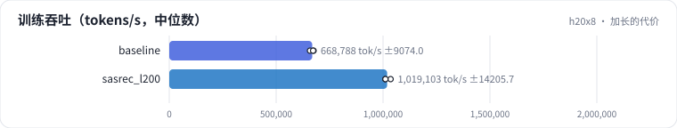
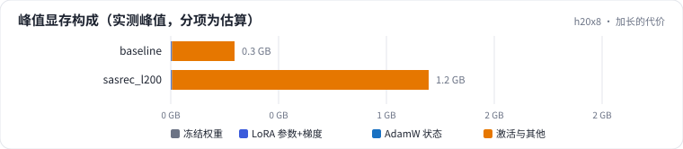

<!-- 本页由 python -m labkit docs 从 ../lesson.yaml 和 results/ 生成，不要手改 -->

[← mean pooling 加长到 200](10-pool-len.md) · [课程首页](../README.md) · [同事改了截断 →](12-fault.md)

# 第 11 步 / 共 14 步：加长的代价

> 阶段 4 / 6：**序列长度** · 场景：`sasrec_l200`（对照 `baseline`）

同一个 SASRec，L = 50 和 L = 200，每步都是 128 条序列。看训练吞吐（样本/秒）。

## 这一步跑了什么

| 场景 | 作用 | 说明 | 相对基线改了什么 | 种子（H20） |
| - | - | - | - | - |
| `baseline` | 对照 | 基线：SASRec，保留最近 50 个行为 | — | 3 |
| `sasrec_l200` | 本步 | SASRec，L = 200 | `max_len=200` | 3 |

## 先预测

**L = 200 的训练样本/秒是 L = 50 的多少？**

- **A.** 80% 以上：几乎不变
- **B.** 40% - 80%
- **C.** 15% - 40%
- **D.** 不到 15%

> 先选定一个（记下来），再展开下面的实测。Recall@10 在 6040 个用户上的抽样标准误约 0.005；均值差小于 0.01（模型对比小于 0.03）或小于种子间波动，都按“差不多”算。

## 实测

展开实测：H20 · MovieLens-1M · leave-one-out · 对全部 3706 部电影排序 · 3 种子（已有 6 / 6 个运行）

| 场景 | 类型 | 训练 样本/秒 | 训练 token/秒 | 注意力占比 | 训练 样本/秒：与 `baseline` 差 | 训练 样本/秒：各种子 | 断言 |
| - | - | - | - | - | - | - | - |
| `baseline` | 基线 | 18,917 ± 89 | 619,050 ± 3,102 | 6.1% ± 0.0% | — | s0 18,992 / s1 18,819 / s2 18,940 | 通过 |
| `sasrec_l200` | 候选改动 | 14,657 ± 82 | 946,953 ± 5,595 | 20.7% ± 0.0% | -4,260 | s0 14,615 / s1 14,751 / s2 14,605 | 通过 |

运行目录（每个目录里有 `summary.json` 指标、`evidence.json` 证据摘要、`predictions.jsonl` 逐条预测、`log.txt` 日志）：

- `baseline` [s0](../../../results/h20x8/R01/baseline/s0-585a43/) · [s1](../../../results/h20x8/R01/baseline/s1-87e137/) · [s2](../../../results/h20x8/R01/baseline/s2-471d19/)
- `sasrec_l200` [s0](../../../results/h20x8/R01/sasrec_l200/s0-9de048/) · [s1](../../../results/h20x8/R01/sasrec_l200/s1-806689/) · [s2](../../../results/h20x8/R01/sasrec_l200/s2-0a2af4/)

## 看完实测再想一步

token/秒是涨了还是跌了？

---

[← mean pooling 加长到 200](10-pool-len.md) · [课程首页](../README.md) · [同事改了截断 →](12-fault.md)
