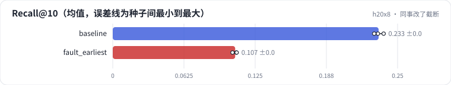
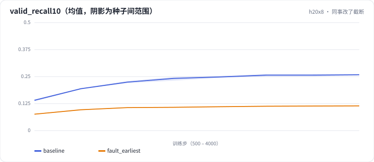

<!-- 本页由 python -m labkit docs 从 ../lesson.yaml 和 results/ 生成，不要手改 -->

[← 加长的代价](11-cost.md) · [课程首页](../README.md) · [诊断：loss 更低，测试为什么大跌 →](13-diagnose.md)

# 第 12 步 / 共 14 步：同事改了截断

> 阶段 5 / 6：**截断方向** · 场景：`fault_earliest`（对照 `baseline`）

同事重构数据管道时把截断写成了 seq[:L]——"保留 L 个行为"，没注意保留的是最早的。训练、评估都经过这个函数。训练正常结束，loss 甚至比以前低。

## 这一步跑了什么

| 场景 | 作用 | 说明 | 相对基线改了什么 | 种子（H20） |
| - | - | - | - | - |
| `baseline` | 对照 | 基线：SASRec，保留最近 50 个行为 | — | 3 |
| `fault_earliest` | 本步 | 超过 L 时保留最早的 50 个（seq[:L]） | `truncate=earliest` | 3 |

## 先预测

**测试 Recall@10 会怎样？**

- **A.** 降不到 0.01
- **B.** 降 0.01 - 0.05
- **C.** 降 0.05 以上

> 先选定一个（记下来），再展开下面的实测。Recall@10 在 6040 个用户上的抽样标准误约 0.005；均值差小于 0.01（模型对比小于 0.03）或小于种子间波动，都按“差不多”算。

## 实测

展开实测：H20 · MovieLens-1M · leave-one-out · 对全部 3706 部电影排序 · 3 种子（已有 6 / 6 个运行）

| 场景 | 类型 | Recall@10 | 训练末 loss | 历史 > 50 的用户 | 历史 ≤ 50 的用户 | Recall@10：与 `baseline` 差 | Recall@10：各种子 | 断言 |
| - | - | - | - | - | - | - | - | - |
| `baseline` | 基线 | 0.233 ± 0.004 | 5.366 ± 0.011 | 0.193 ± 0.002 | 0.326 ± 0.008 | — | s0 0.233 / s1 0.229 / s2 0.238 | 通过 |
| `fault_earliest` | 教学故障 | 0.107 ± 0.002 | 4.920 ± 0.016 | 0.015 ± 0.001 | 0.319 ± 0.005 | -0.126 | s0 0.105 / s1 0.108 / s2 0.109 | 通过 |

运行目录（每个目录里有 `summary.json` 指标、`evidence.json` 证据摘要、`predictions.jsonl` 逐条预测、`log.txt` 日志）：

- `baseline` [s0](../../../results/h20x8/R01/baseline/s0-585a43/) · [s1](../../../results/h20x8/R01/baseline/s1-87e137/) · [s2](../../../results/h20x8/R01/baseline/s2-471d19/)
- `fault_earliest` [s0](../../../results/h20x8/R01/fault_earliest/s0-341113/) · [s1](../../../results/h20x8/R01/fault_earliest/s1-9117fc/) · [s2](../../../results/h20x8/R01/fault_earliest/s2-ac5af4/)

## 看完实测再想一步

验证曲线和训练 loss 的走势一致吗？

---

[← 加长的代价](11-cost.md) · [课程首页](../README.md) · [诊断：loss 更低，测试为什么大跌 →](13-diagnose.md)
