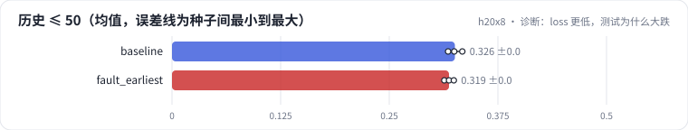

<!-- 本页由 python -m labkit docs 从 ../lesson.yaml 和 results/ 生成，不要手改 -->

[← 同事改了截断](12-fault.md) · [课程首页](../README.md) · [回顾 →](14-keycard.md)

# 第 13 步 / 共 14 步：诊断：loss 更低，测试为什么大跌

> 阶段 5 / 6：**截断方向** · 场景：`fault_earliest`（对照 `baseline`）

配置只改了截断方向。训练 loss 比基线低，测试 Recall@10 掉了一大截。按需逐级点开线索，然后点选最主要的原因。

## 这一步跑了什么

| 场景 | 作用 | 说明 | 相对基线改了什么 | 种子（H20） |
| - | - | - | - | - |
| `baseline` | 对照 | 基线：SASRec，保留最近 50 个行为 | — | 3 |
| `fault_earliest` | 本步 | 超过 L 时保留最早的 50 个（seq[:L]） | `truncate=earliest` | 3 |

## 线索

逐条展开，看到能下判断为止。

线索 1

按历史长度分组：历史 ≤ 50 的用户 Recall 0.319 ± 0.005（基线 0.326 ± 0.008）；历史 > 50 的用户 0.015 ± 0.001（基线 0.193 ± 0.002）。

线索 2

输入最后一个行为到目标隔了几步：121 ± 0（基线 1 ± 0）。目标类型和输入末尾 5 部电影类型的重合度：0.211 ± 0.000（基线 0.248 ± 0.000）。

线索 3

看追踪里同一个长历史用户：保留最近 50 个时输入末尾是哪几部、保留最早 50 个时是哪几部，各离目标隔了几步。

## 先预测

**最主要的原因是什么？**

- **A.** 保留了最早的 50 个，最近兴趣丢了，输入末尾和目标隔得很远
- **B.** L = 50 太短，模型容量不够
- **C.** 历史长的用户本来就更难预测
- **D.** 过拟合，没有早停

> 先选定一个（记下来），再展开下面的实测。Recall@10 在 6040 个用户上的抽样标准误约 0.005；均值差小于 0.01（模型对比小于 0.03）或小于种子间波动，都按“差不多”算。

## 实测

展开实测：H20 · MovieLens-1M · leave-one-out · 对全部 3706 部电影排序 · 3 种子（已有 6 / 6 个运行）

| 场景 | 类型 | 历史 ≤ 50 | 历史 > 50 | 输入末尾到目标的距离 | 类型重合度 | 历史 ≤ 50：与 `baseline` 差 | 历史 ≤ 50：各种子 | 断言 |
| - | - | - | - | - | - | - | - | - |
| `baseline` | 基线 | 0.326 ± 0.008 | 0.193 ± 0.002 | 1.0 ± 0.0 | 0.248 ± 0.000 | — | s0 0.325 / s1 0.318 / s2 0.334 | 通过 |
| `fault_earliest` | 教学故障 | 0.319 ± 0.005 | 0.015 ± 0.001 | 120.9 ± 0.0 | 0.211 ± 0.000 | -0.007 | s0 0.313 / s1 0.319 / s2 0.324 | 通过 |

运行目录（每个目录里有 `summary.json` 指标、`evidence.json` 证据摘要、`predictions.jsonl` 逐条预测、`log.txt` 日志）：

- `baseline` [s0](../../../results/h20x8/R01/baseline/s0-585a43/) · [s1](../../../results/h20x8/R01/baseline/s1-87e137/) · [s2](../../../results/h20x8/R01/baseline/s2-471d19/)
- `fault_earliest` [s0](../../../results/h20x8/R01/fault_earliest/s0-341113/) · [s1](../../../results/h20x8/R01/fault_earliest/s1-9117fc/) · [s2](../../../results/h20x8/R01/fault_earliest/s2-ac5af4/)

---

[← 同事改了截断](12-fault.md) · [课程首页](../README.md) · [回顾 →](14-keycard.md)
