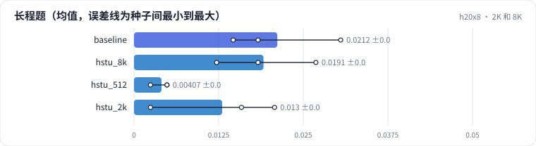

<!-- 本页由 python -m labkit docs 从 ../lesson.yaml 和 results/ 生成，不要手改 -->

[← 截断到 512](06-len512.md) · [课程首页](../README.md) · [整体收益被稀释 →](08-benefit.md)

# 第 7 步 / 共 17 步：2K 和 8K

> 阶段 3 / 6：**长度的收益与成本** · 场景：`hstu_2k`（对照 `baseline`）

再看中间两个长度：2048 和 8192。2048 时约 83% ± 0% 的长程题能看到上一次回访，8192 时 99% ± 0%。

## 这一步跑了什么

| 场景 | 作用 | 说明 | 相对基线改了什么 | 种子（H20） |
| - | - | - | - | - |
| `baseline` | 对照 | 基线：HSTU，最近 10240 个行为（按 query 分块计算注意力） | — | 3 |
| `hstu_8k` | 参照 | HSTU，L = 8192 | `max_len=8192` | 3 |
| `hstu_512` | 参照 | HSTU，L = 512 | `max_len=512` | 3 |
| `hstu_2k` | 本步 | HSTU，L = 2048 | `max_len=2048` | 3 |

## 先预测

**长程题的 Recall@10，L = 2048 比 L = 10240 低多少？**

- **A.** 低 0.2 以上
- **B.** 低 0.05 - 0.2
- **C.** 差不到 0.05

> 先选定一个（记下来），再展开下面的实测。Recall@10 在 2048 个测试用户上的抽样标准误约 0.01，长程题（约 800 个）约 0.017；均值差小于 0.03（长程题小于 0.05）或小于种子间波动，都按“差不多”算。

## 实测

展开实测：H20 · 合成长序列 1K-10K（回访簇作长程信号）· HSTU d=64、2 层 · 3 种子（已有 12 / 12 个运行）

| 场景 | 类型 | 长程题 | 整体 | 训练 token/秒 | 长程题：与 `baseline` 差 | 长程题：各种子 | 断言 |
| - | - | - | - | - | - | - | - |
| `baseline` | 基线 | 0.021 ± 0.008 | 0.279 ± 0.003 | 31,431 ± 320 | — | s0 0.018 / s1 0.031 / s2 0.015 | 通过 |
| `hstu_8k` | 候选改动 | 0.019 ± 0.007 | 0.278 ± 0.005 | 47,155 ± 83 | -0.002 | s0 0.018 / s1 0.012 / s2 0.027 |  |
| `hstu_512` | 候选改动 | 0.004 ± 0.001 | 0.287 ± 0.005 | 1,155,154 ± 6,558 | -0.017 | s0 0.002 / s1 0.005 / s2 0.005 |  |
| `hstu_2k` | 候选改动 | 0.013 ± 0.009 | 0.282 ± 0.004 | 341,945 ± 897 | -0.008 | s0 0.021 / s1 0.002 / s2 0.016 |  |

运行目录（每个目录里有 `summary.json` 指标、`evidence.json` 证据摘要、`predictions.jsonl` 逐条预测、`log.txt` 日志）：

- `baseline` [s0](../../../results/h20x8/R02/baseline/s0-7f1334/) · [s1](../../../results/h20x8/R02/baseline/s1-b6ddff/) · [s2](../../../results/h20x8/R02/baseline/s2-b2e97d/)
- `hstu_8k` [s0](../../../results/h20x8/R02/hstu_8k/s0-621c7c/) · [s1](../../../results/h20x8/R02/hstu_8k/s1-9b97f7/) · [s2](../../../results/h20x8/R02/hstu_8k/s2-0005b3/)
- `hstu_512` [s0](../../../results/h20x8/R02/hstu_512/s0-c30810/) · [s1](../../../results/h20x8/R02/hstu_512/s1-e2e360/) · [s2](../../../results/h20x8/R02/hstu_512/s2-b64856/)
- `hstu_2k` [s0](../../../results/h20x8/R02/hstu_2k/s0-f697bf/) · [s1](../../../results/h20x8/R02/hstu_2k/s1-e5d5c6/) · [s2](../../../results/h20x8/R02/hstu_2k/s2-d2b821/)

## 看完实测再想一步

四个长度的长程题 Recall，曲线在哪里变平？

---

[← 截断到 512](06-len512.md) · [课程首页](../README.md) · [整体收益被稀释 →](08-benefit.md)
