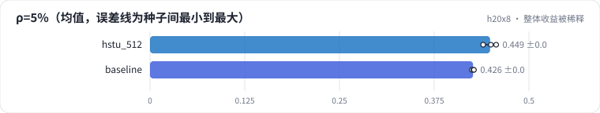

<!-- 本页由 python -m labkit docs 从 ../lesson.yaml 和 results/ 生成，不要手改 -->

[← 2K 和 8K](07-len-mid.md) · [课程首页](../README.md) · [长度的成本 →](09-cost-len.md)

# 第 8 步 / 共 17 步：整体收益被稀释

> 阶段 3 / 6：**长度的收益与成本** · 场景：`baseline`（对照 `hstu_512`）

真实流量里，依赖远处行为的请求可能只占很小一部分。把三类题按比例重新加权：长程题占 ρ，其余按近期 : 新会话 = 2 : 1。

## 这一步跑了什么

| 场景 | 作用 | 说明 | 相对基线改了什么 | 种子（H20） |
| - | - | - | - | - |
| `hstu_512` | 对照 | HSTU，L = 512 | `max_len=512` | 3 |
| `baseline` | 本步 | 基线：HSTU，最近 10240 个行为（按 query 分块计算注意力） | — | 3 |

## 先预测

**只有 5% 的请求依赖远处行为时，L = 10240 比 L = 512 的整体 Recall@10 高多少？**

- **A.** 不到 0.005：测不出来
- **B.** 0.005 - 0.02
- **C.** 0.02 以上

> 先选定一个（记下来），再展开下面的实测。Recall@10 在 2048 个测试用户上的抽样标准误约 0.01，长程题（约 800 个）约 0.017；均值差小于 0.03（长程题小于 0.05）或小于种子间波动，都按“差不多”算。

## 实测

展开实测：H20 · 合成长序列 1K-10K（回访簇作长程信号）· HSTU d=64、2 层 · 3 种子（已有 6 / 6 个运行）

| 场景 | 类型 | ρ=5% | ρ=20% | ρ=50% | ρ=5%：与 `hstu_512` 差 | ρ=5%：各种子 | 断言 |
| - | - | - | - | - | - | - | - |
| `hstu_512` | 候选改动 | 0.449 ± 0.009 | 0.379 ± 0.007 | 0.238 ± 0.004 | — | s0 0.457 / s1 0.450 / s2 0.440 |  |
| `baseline` | 基线 | 0.426 ± 0.002 | 0.362 ± 0.002 | 0.234 ± 0.004 | -0.022 | s0 0.425 / s1 0.427 / s2 0.427 | 通过 |

运行目录（每个目录里有 `summary.json` 指标、`evidence.json` 证据摘要、`predictions.jsonl` 逐条预测、`log.txt` 日志）：

- `hstu_512` [s0](../../../results/h20x8/R02/hstu_512/s0-c30810/) · [s1](../../../results/h20x8/R02/hstu_512/s1-e2e360/) · [s2](../../../results/h20x8/R02/hstu_512/s2-b64856/)
- `baseline` [s0](../../../results/h20x8/R02/baseline/s0-7f1334/) · [s1](../../../results/h20x8/R02/baseline/s1-b6ddff/) · [s2](../../../results/h20x8/R02/baseline/s2-b2e97d/)

## 看完实测再想一步

ρ 从 5% 到 50%，差值放大了几倍？

---

[← 2K 和 8K](07-len-mid.md) · [课程首页](../README.md) · [长度的成本 →](09-cost-len.md)
